# Bridge Plan: frankensearch

## Implementation follow-through — 2026-10-29

**The main product wiring gaps have narrowed; full current-source and release qualification remain open.** Explicit ranking priors now reach the actual product, compatible-contract upgrades carry unchanged document embeddings, and missing-model streams keep their terminal final. Native retained readers now hydrate vector-only winners from their own immutable source cohort. These are implemented behaviors with the scoped observations below, not completion of the whole project vision or the competitive performance campaign.

**October 29, 14:01 UTC checkpoint:** frozen source `a88cf1b86505ca8567cce1fbbc70c99220ed60b4` has passed the stock DSR formatting, workspace check, workspace/hybrid Clippy, Windows compile guard, workspace tests, bounded Quill and FSFS stages. FSFS library tests are **2,915 passed, zero failed, 15 declared ignored**; the original restart cases and bounded GC retry case pass in this default-feature run. This does not erase the earlier model-free or other-host failures. Facade, executable and overall stock results remain pending. Both full Quill configurations are still executing at this same frozen source; neither has a full verdict.

At that source, the actual native executable, SHA-256 `6a007ba56f472f04d0b222d861cc47fbb3e0b36e94db041b67a1b8e29d9d3091`, passes **18 real-model exact/HNSW authority lifecycle controls**, including historical reads and rollback. Original hybrid and Quill-only native binary profiles each pass **252/0/0**, with zero filtered cases, in 112.02 s and 136.36 s respectively. Original product watcher/stream/upgrade observers and numerical certificate follow-through are executing separately on worker129; they have no verdict yet. No native-tensor latency, competitive or release claim follows.

**Later stock result: RED.** The a88 facade and documentation stages pass, and all **19 original real-model CLI cases pass**, zero failed or ignored, 247.16 s. The separate documented executable quickstart nevertheless fails its unchanged `MISSING-PHASE` assertion: buffered legacy search returns `refinement_failed`; quality initialization takes **826,988 microseconds** against the original 500 ms refinement window. Its actual invocation-built ELF is `4e011a6376cf9c67fe8b094072a57e74a58c8d253b28f108b24b6a176064234f`. Lite passes; the complete stock run ends with exactly this one failed stage. Passing earlier scopes do not clear it. The failed installed executable, checker/build receipt and hybrid stdout/stderr are retained with the stock raw logs. Cold initialization remains a product repair, not permission to relax the gate.

The later I/O diagnostic increment explicitly represents counter availability, establishes fresh rate baselines after recovery and makes pressure pauses visible at normal verbosity. Its patch SHA-256 is `9cc953417539e9e3c6f8bcc0a5565997152d504112dea0abfb1e746a82f4b8d9`. Exact-source scoped validation passes **25 sampler tests**, zero failed or ignored, plus the original cancellation and watch-preservation cases **1/0/0** each; warnings-denied model-free library Clippy passes in 6m08s. The worker/source/index hashes bind these results separately from a88. An initial 1,800-second RCH outer deadline killed compilation before testing; normal recovery reports 137, and only the source-identical retry with an explicitly verified longer outer window supplies the positives. No repository test budget changed. This increment is committed as `5d97ca28`. A later default-feature CLI built from that source plus the cold-prefetch candidate below also verifies its normal-verbosity diagnostic: an actual low load ceiling pauses before store creation, emits WARN on stderr, cancels with one typed JSON error and exit 130, and indexes the same source after raising the ceiling. This is model-free Linux one-shot proof, not completion of scheduling, automatic deferred work or the full pressure lifecycle. The three-file static UBS scan reports zero critical findings, 5,910 warnings and 2,059 informational findings; Cargo categories were explicitly not evaluated by that scan.

**Cold-prefetch code is now committed as `615094de`:** its runtime bytes are identical to tested patch `f55d267cdaf232c99c27a8f6caf776388c683d69f7eb4db450ab36fd3a7f823e` on `5d97ca28`. It overlaps independent cold fast/quality loading on the caller's existing bounded pool. It retains the original post-Initial refinement deadline and per-generation admission; unavailable or busy capacity keeps lazy loading. The earlier default library run passes **2,918/0/15**, zero filtered, 43.02 s; default integration binaries, the original **89** quality controls and strict all-targets Clippy pass. Actual CLI `821b8c3f2af9ba69f56a1bff6f6691de7254cb7253aa3d3bff51cdaddee9e66a` delivers Initial and Refined at the original 500 ms policy; end-to-end cold search remains about 4.3 s in that invocation, not a latency-target qualification.

**The earlier gates remain recorded as RED.** The original executable checker requires a cold Started frame to claim semantic admission, contradicting the streaming contract's false-before-admission requirement. The correctly configured original 19-case suite ends **16 passed, three failed**: two mandatory cold-timeout assertions instead receive successful refinement at 50 ms; the older cf54 upgrade arm returns a fallback page while the candidate returns semantic refined results, failing exact ranking equality. The immediate a88 predecessor also fails that comparison. The first runner attempt separately failed **13/6** because it omitted required environment inputs; those setup failures are retained. The owner's response to the concrete proposal authorizes proceeding with the checker/cold-outcome corrections; this interpretation is explicit in commentary and Bead4519. The upgrade comparison now requires Refined on both actual executables under a test-local 5 s quality budget before comparing exact artifacts and rankings. Product default 500 ms and dedicated 50 ms controls are unchanged. Strict all-targets Clippy passes on `615094de` plus the reviewed checker/test patch; runtime validation is still executing. Source and stream Beads remain open pending the complete clean-source stock gate.

**Full Quill profile results at frozen a88:** all-feature correctness passes **1,086/0/9** across six actual test executables; the wrapper ends zero, acknowledges completion and releases its sources. The script's scope is native-witness and typed-query correctness, not a competitive performance result or every conformance surface. Default-profile execution instead ends **137** at 16:31 UTC with no complete verdict, despite its recorded 12-hour outer and unchanged 8-hour internal budget. No OOM entry appears in the inspected worker interval; cause remains unconfirmed. Preserve the killed run, and require the missing final-source default result rather than treating the all-feature pass as a substitute.

**Later FSFS qualification:** the first corrected-gate full run fails **2,917/1/15** because the pressure/watch test allows an actual host sample to pause its baseline before it injects controlled pressure. Test-only patch `084dccf6`, now committed as `50e4edd0`, supplies the initial idle sample without changing the bounded attempts or any preservation/cancellation/resume assertion. The source-bound retry passes strict all-target Clippy, **2,918/0/15** library tests, default integrations, **19/0/0** real-model cases (225.01 s) and **5/0/0** watch cases (29.56 s). Deliberately omitting only the production pause guard in an owned validation copy fails **0/1** at the intended publication-while-paused assertion; the literal guard is restored and its source hashes match. This is a discriminating fixture correction, not a weakened publication check.

The first live executable checker completes its positive checks and all **21** negative controls with the expected outcomes and no remaining owned process, but ends RED because the final inventory assertion still expects the old 18 controls. Updating that assertion to 21 accounts for the three explicitly added controls; the failed receipt remains retained. The subsequent **clean-source `8f8410e2` rerun passes** the original executable quick-start checker with `--require-source --negative-probes --keep-artifacts`: ordinary invocation-owned default Cargo build, both semantic phases and all 21 negative controls. Its installed ELF is `821b8c3f2af9ba69f56a1bff6f6691de7254cb7253aa3d3bff51cdaddee9e66a`; seven end-source hashes match and the named remote wrapper ends zero with acknowledged completion and released sources. The complete clean-source stock gate and full Quill qualification remain required before source/stream closure; the completed DEFAULT scope appears below.

**Native rebuild gate defect:** at `71dce4a0`, all 18 real-model exact/HNSW lifecycle controls pass, while the hybrid native unit profile ends **251 passed, one failed**. The failing source-cut case incorrectly requires changed lexical payload bytes when only the source checkpoint changes; that checkpoint is bound outside the payload. The identical original test ELF produces **9 passes and 11 failures in 20 predeclared runs across two allowed cores** (5/5 and 4/6), with every failure at that byte inequality. The test-only correction on `8f8410e2` requires actual lexical rebuilding and the changed manifest checkpoint, while preserving payload inequality for changed content/title/metadata and all publication/fencing assertions. Its 20 same-ELF controls pass, and both original hybrid and Quill-only profiles pass **252/0/0**, zero filtered, in 134.09 s and 126.51 s; strict Clippy passes. Deliberately omitting only the production source-cut reuse guard in an owned validation copy fails **0/1** at the new rebuild assertion (0.54 s). Restoring the literal guard and matching all four source hashes passes **1/0** (3.80 s). Main's production guard is unchanged. The integrity split is 11 formerly vetoed correctness trials made decidable; no performance WIN or LOSE is claimed. Raw original failures, fixed controls and both omission/restoration runs remain retained.

**Clean committed-source native follow-through:** `9bac75fcc44838a73b67ea96a1c0a9b6ca010eb1` passes all **18 real-model exact/HNSW authority lifecycle controls**, followed by both original native profiles **252/0/0**, zero filtered, in 106.34 s and 132.95 s. Its actual native executable SHA-256 is `6a007ba56f472f04d0b222d861cc47fbb3e0b36e94db041b67a1b8e29d9d3091`. The wrapper ends zero, retrieves 42 raw files, acknowledges completion and releases the sources. This is scoped lifecycle/unit evidence, not native-tensor latency, competitive performance or release qualification. The original complete stock DSR run remains active at `9bac75fc`; a separate stock run now executes at committed `2b6cce13`. Full Quill DEFAULT at `8f8410e2` has completed, while ALL ended 137 without a complete verdict, as detailed below. Neither whole-gate result is inferred from these native passes. The first new all-feature launch failed before building because its runner was missing on the worker (127, then delivery 102); supported recovery acknowledged the failed delivery and released sources before the verified-runner retry. All attempts remain retained.

**Full Quill at frozen `8f8410e2`:** DEFAULT passes **980/0/5** across six actual test executables; every executed binary exits zero, with no timeout. The wrapper returns zero, retrieves 30 raw files, acknowledges completion and releases its sources. This certifies the script's native-witness and typed-query correctness scope, not every conformance surface or competitive performance. ALL instead ends **137 at 2026-10-29T23:53:57Z**, after 14,506.186 s, with no suite terminal: **559 completed tests, zero observed failed, six declared ignored and two unfinished semantic-seal tests** are partial records only. Its actual main executable, SHA-256 `5ad65d8ce976d443975854e04a569426f6b2fe9d81d491b867c0e554dedf409e`, and all 18 raw child logs are retained locally and remotely. The wrapper acknowledges the failed result and releases its sources. The original 12-hour external and 8-hour test budgets were declared; the inspected kernel interval has no entries and the kill's cause remains unconfirmed. Two unchanged ALL requests on hz3 subsequently fail before execution: namespace initialization returns 73/Killed (RCH 103), then a normal retry reaches the 20 s SSH initialization timeout. Neither supplied a test result or observed durable wrapper. A healthy connectivity/toolchain probe does not establish namespace admission. No source guard, worker/global configuration, workload, deadline or ignore was changed to force a retry; the original failed evidence and missing ALL qualification remain explicit. Both admitted stock runs continue separately.

**Hard restart with a warm quality daemon:** the existing complete-watch real-model case now keeps an admitted predecessor reader and the same daemon alive, SIGKILLs and reaps its owned watcher, edits the source while the watcher is absent, and requires restart to publish the edit. Direct and forwarded searches discriminate old/new lexical membership; the same full query returns Refined with the changed snippet after restart; the daemon PID and pinned predecessor manifest remain unchanged, and both final vector tiers encode current source. The final test file SHA-256 is `24ad7c8fc4f3f63c554d01ba879d3dc808b449d9999066d07742b68dd980cca1`, executed as patch `d58026df9be9265edbfd9b4ca274a5dac1679c1f8561eb0a0c2571d4e18b9d8c` on `3ef7c293`. Warnings-denied targeted Clippy passes; the focused case passes **1/0/0**, 18 unrelated cases filtered, **69.42 s**, then the full original suite passes **19/0/0**, zero filtered, **286.25 s**. Actual default CLI SHA-256 is `e8169bc167f7c57831074dd9902b16ef811b1a70ab75ab845fbaaaa103760087`, retained with the first candidate's logs. The final wrapper ends zero, retrieves eight raw files, acknowledges completion and releases its sources. The earlier fast-only-daemon candidate separately passes its focused case and all 19 cases; those results are not substituted for this stronger revision. The existing test-local 5 s functional budget now also covers the added full-query checks; product default 500 ms and dedicated 50 ms controls are unchanged. This is restart after a stable publication, not phase-specific build/seal/publish/install crash/cancellation, macOS, latency or release qualification. `bd-z2nfa` remains open.

**Repaired product source `fc319fd32e0bc529638069074549e00431d3a3d8` passes the original complete CLI quick-start suite: 19 passed, zero failed or ignored, 268.39 s.** The original multilingual uncached 500 ms requests, cache identity, incompatible-producer refusals and exact native F16 append checks execute. The strengthened reader-pin/reclamation watcher regression passes **1/0/0**, four unrelated cases filtered, **32.88 s**. Native units pass **62/0/15** (passed/failed/declared ignored); both explicitly selected original numerical certificates pass **1/0/0**, 76 unrelated cases filtered each. The actual CLI SHA-256 is `9910d2596552479f559514aa1fc1bdb79e2ee00c2a604d1b3630e1c13761d5c1`; its matching quick-start executable is `690e70d0f415de08f922dfcde2a2a8d0769aaa2da97fa4eb395ce93091ceff04`. These scoped passes precede the still-pending full DSR, native lifecycle and full Quill results.

The earlier M evidence below names **`09e35fb2238f674f32499cde81acedf3c21710aa`**, including the Quill successor-producer corrections, with actual CLI SHA-256 `0b62d4cf5dfac32d590b84e79dc72f4fc265acfdf707e70668e289414f8c3632`. Candidate54's original suite failed **17/2/0**, 241.71 s; candidates65 and9242 also failed **17/2/0** at later assertions. All red raw results and actual executables are retained in Beads evidence. Their successive failures distinguish the original deadline problem from stale protocol/cache/refusal expectations and a fixture that inspected the predecessor instead of the published append successor. The repaired lock SHA-256 is `d2a1e389f1c944421275f256d0eaaaced9840702e42e77e64e840853e19a5283`: one normal native-to-index dependency edge, without package upgrades. The pinned sibling remains `a4bd47e25a45737f04203792c0ababa7079c37a5`. A later source or documentation update does not turn an earlier execution into evidence for that later source.

| Original gap | Implemented behavior and observed boundary | Remaining work |
|---|---|---|
| Ranking priors existed only behind an unused builder | Ordinary configuration/argv selects the policy; daemon negotiation, cache identity, serve requests, retained search and explanations carry it. A fresh original M executable regression passed **1/0/0**, 18 unrelated cases filtered, **42.19 s**: eight documents, direct/daemon off/on arms, both phases, exact hit arrays and actual explanation contributions. A second M observation passed serve miss/miss/hit/hit separation, exact retained arrays and actual PTY live-TUI winners in Initial and Refined. The planted M constructor bypass fails the original discriminating on-control assertion. | **`bd-fsfs-cli-ranking-priors-wbdkd` closed** on this functional scope. Default stays off. Held-out relevance/default-promotion work remains in E6.7. The dashboard's deliberate lexical-only typing lane remains neutral under the existing degraded-mode guard. |
| An executable change always prevented completed-work reuse | The explicit `compatible-contract` policy checks a versioned indexing contract while retaining producer, source and artifact admission. Query-only prior/admission settings do not invalidate eligible index work; exact typed floating-point serialization preserves old configuration bytes. Actual cf54→M executables passed six predeclared complete-watch/legacy-seed/legacy-watch compatible/disabled arms: **zero document embedding admissions** in compatible arms, positive cold controls, unchanged predecessor bytes and exact rankings. | **`bd-fsfs-cli-upgrade-reuse-rsqq7` stays open**: startup model-health inference still runs, so literal zero **total** inference is unsatisfied. Old v1 indexing receipts require the documented cold rebuild after the exact-JSON v2 contract change. |
| Failed direct streams appended an ordinary error envelope after Terminal | Output ownership now marks already reported errors; the generic process boundary preserves the typed exit without appending another envelope. Actual M missing-model controls and complete-daemon direct/forwarded JSONL/TOON controls passed. The signed published 1.12.3 executable still fails the specific extra-envelope assertion, providing the retained negative. Relevant partial-writer/cancellation protocol tests passed within the M stock execution. | **`bd-fsfs-stream-terminal-final-oct27-giad7` stays open** for its required successful repository stock gate. This does not close the general semantic-recovery task. |
| Vector-only native winners lost source metadata | Closed retained-cohort readers resolve winning metadata through exact live-ID lookup and the retained Quill image. Initial and Refined use the same hook; generic lexical hydration still excludes vector-only ownership it cannot establish. Private validation no longer reapplies the user's source-inclusion policy to an already assembled complete candidate. The scoped M native hybrid library run passed **446 tests**, 59 unrelated cases filtered, **125.06 s**. | Final-source native/ANN/lifecycle gates remain part of **`bd-reality-oct27-current-source-dxp8z`**. Corrected fixture producer/storage identities preserve the original admission guards; deterministic fixture passes are not real-model qualification. |
| Watch proof stopped short of the complete live product | An actual M observer passed **79 records** across source creation/update/rename/move-out, independent lexical/fast/quality membership, one stable live daemon and a query held after Initial across a successor publication. That query completed against its original image and bytes. The original path-only retention test exposed a fixture error: a pathname does not pin a generation. The strengthened sourceFC test passes **1/0/0**, **32.88 s**: genuine `PublishedGeneration` readers pin receipt-matched old images across independent CLI queries and create/rename/delete publications; both old directories are collected after release. The later source-bound real-model case above also passes hard restart with an offline edit, retained predecessor and the same daemon serving Refined before and after restart, followed by all **19** original CLI cases. | **`bd-z2nfa` stays open** for build/seal/publish/install crash/cancellation, their reconciliation paths and macOS. Restart after a stable publication and reader reclamation have executed; phase-specific crash recovery and unlink behavior remain unqualified. |
| Quill successor metadata could retain the older publisher stamp | Checked successor, compaction, concat-merge and quarantine paths stamp the publishing engine after generation advance; no-op and exact-repair preservation remain. The merged M Quill library passed **196 tests** and strict scoped Clippy; a88 passes the original bounded Quill stock lane. | Full DEFAULT at `8f8410e2` passes **980/0/5**; ALL ends 137 without a complete verdict, followed by two pre-execution namespace failures. The old source54 default run ended 137 without a full verdict; its all-feature chain never entered after CLI failure. Partial/cancelled profiles provide no full qualification. This is not publication of the prepared Quill hotfix or a competitive performance win. |
| Pressure settings suggested controls that ordinary execution did not consume | Metadata-only admission avoids body reads and models; explicit quality deferral keeps fast search, records missing quality coverage and backfills when cleared. Ordinary CPU/I/O/load ceilings now reach one-shot, model loading, append, retained mutation and watch admission through the existing hysteresis controller; targeted positive, cancellation and omitted-consumer controls execute. | **`bd-fsfs-pressure-runtime-policy-9zryx` stays open** for bounded scheduler/concurrency execution, automatic durable fenced deferred work and remaining real-model/restart qualification. `WorkloadBudgetScheduler` supplies planning/reservation logic; it is not a finished executing pool. Their no-effect warnings remain. Later availability/normal-verbosity diagnostics are still undergoing separate validation. |

The M authoritative DSR execution passed formatter, workspace check, workspace and hybrid warnings-denied Clippy, Windows index compilation, workspace library/integration, bounded Quill, facade and documentation scopes, but the FSFS lane failed: **2,908 passed, one failed, 15 declared ignored**. The original unchanged restart test exceeded its **120 s** child deadline. Contemporaneous host-wide I/O pressure is a correlation, not a demonstrated cause or concurrency fix. Forty exact original restart invocations in four lanes passed on another worker; that does not clear the original failure. Preserve both outcomes.

SourceFC's later hybrid native regression is **red: 438 passed, eight failed, none ignored**, with 59 unrelated cases filtered. All eight strict authority fixtures fail before their lifecycle assertions because the worker's `/home/ubuntu` ancestor is group-writable (`0775`); the original root-admission check correctly rejects that route. They derive their root from `HOME`, rather than `TMPDIR`. The next source-identical run uses a private `0700` home under the existing `0755` `/data/projects` ancestry, retaining the worker's home permissions and absolute toolchain/model-cache locations. Full DSR and downstream native/cohort/ALL stages did not start in the failed run. Neither the security checks nor these eight assertions are waived.

Candidate54 strengthened two fixtures without increasing budgets: the warm table assertion now requires all ten unchanged files as well as every original count, and the watch test retains real reader pins and requires post-release collection. Its compiler artifact confirms native opt-level2, but the original single-Rayon-thread multilingual query still exceeded 500 ms, including when the original case ran alone. The general hybrid case's separate `PermissionDenied` was traced to `mkdir(/run/user/0/frankensearch/daemon)` in an ubuntu process: the bootstrap had inherited root's runtime-directory environment. The next execution uses a private ubuntu-owned runtime directory; production permission checks and test assertions are unchanged.

CPU sampling of the actual source54 original native case identifies the frankentorch scalar integer-linear fallback as hot work on this AVX2/no-VNNI host. The final two-second sample window also includes teardown; it is not an isolated warm-query latency measurement. Source inspection confirms that quality initialization already retains its successful model. Candidateacae reused the index crate's existing exact AVX2 integer dot for native linears, but its index opt-level0 configuration was **rejected** after the paired control showed a roughly sevenfold cost regression. Exact bits and model certificates passed in that rejected configuration; they did not prove speed. The incumbent dispatch was restored in the working tree while a separate same-source diagnostic changed only index development opt-level2. All four paired kernel controls then improved and both unchanged certificates still passed. This is maintenance evidence with the live original kernel, one Rayon thread and 20 alternating measured pairs per shape; it is not a frozen external-incumbent comparison or end-to-end latency qualification.

Candidate65 makes that index build setting part of normal development and inherited tests, retaining the same quantizer, dequantization order, thread policy and ARM/VNNI routes. Its actual compiler metadata confirms both native and index opt-level2. Native units pass **62/0/15** (passed/failed/declared ignored), and each explicitly run original model certificate passes **1/0/0**, with 76 unrelated cases filtered. The exact-bit case also appears inside those 62, so it is not an additional unique test. Its actual CLI, SHA-256 `9910d2596552479f559514aa1fc1bdb79e2ee00c2a604d1b3630e1c13761d5c1`, completes all three uncached multilingual requests under the original 500 ms policy, including cache identity controls. The case subsequently fails because the complete daemon's correct typed configuration refusal differs from the legacy error text expected by the test. The other failure expects serve schema v16 although production requires v18 and existing runtime tests reject v16/v17. Candidate9242 retains literal v18 checking and strengthens the complete-daemon refusal to require `ok=false`, `invalid_config` and `complete_generation.daemon_config`; the legacy branch and every deadline, ranking and no-fallback control remain. The original red results are retained. No new unsafe site, approximate kernel, model/vector golden, overflow/debug-check relaxation or release-profile change is involved. Stock and full-source qualification remain open; these observations are maintenance evidence, not a competitive performance win.

The source-identical FC repeat passed all 446 native regression tests after using a private trusted HOME, but its original quick-start suite finished **18/1/0**: cold quality initialization exceeded the unchanged 500 ms refinement deadline. Both original single-core controls fail the same assertion. A same-invocation embedder development-profile candidate also fails that assertion and finishes **18/1/0** across the original suite; the candidate was rejected without committing its build override or changing a deadline. The earlier 19-test pass remains a scoped observation, not evidence of reliable deadline compliance.

The old source54 full Quill DEFAULT job on worker1149989 ended **137** at 09:41 UTC, with 613 completed tests, four declared ignores and two still-started cases in the partial library log. Subsequent status notes incorrectly inferred continued execution from that retained log; the terminal wrapper and journal correct that claim. The termination cause remains unconfirmed; the queried kernel interval contains no entries. This is an incomplete failed run, with no full-configuration receipt. The original current-source DSR, native lifecycle and both full Quill configurations remain required. Source, actual executable, lock, sibling inputs and nonzero terminal counts must accompany each claim.

The pressure-policy bead is in progress. Commit **`baa35ca43fe1844e02f06d381e98784d82450212`** connects ordinary CPU/I/O/load ceilings to one-shot, append, retained model/mutation and watch admission. Its exact six-Rust-file implementation plus pressure contract was tested remotely as sourceFC plus patch `37f361417c93adccbf4256988c30fac0326e182fe9b48b516178448683505d27`: **12 targeted tests pass**, zero failed or ignored, including the existing metadata-only no-body-read and deferred-policy controls; scoped model-free library Clippy passes. The staged source hashes match those executed bytes. Deliberately omitting the production watcher guard fails the preservation assertion; restoring it passes. Stale no-effect diagnostics for the consumed ceilings are removed; scheduler/concurrency warnings remain.

Before the final two retained-model-load checks, actual model-free CLI SHA-256 `e77385682e29021c240e7816ee3f98a4aac1c9c1c8ff45f2b3611d693a3f2a6b` passes three existing policy tests and a real Linux load check: low ceiling pauses before index-directory mutation, SIGINT returns typed cancellation/130, and a higher-ceiling restart indexes successfully. This executable observation is sourceFC-plus-patch `dc0936280b024f5d56d60ab1fe2e35e41be19accee87f064c23ccf8f9fd8b581`, not a final-revision model or watch claim. The earlier full model-free library run is **2764/115/2**; unchanged source on the same worker is **2759/114/2**, with all 114 failure names shared and one additional retention-race failure in the draft. That additional test passes alone in both exact executables, and a traced unchanged-source full run reproduces its same 114 failures; concurrent attribution remains unresolved. Actual default-feature/model/watch qualification, automatic durable resumption and resolved scheduler limits remain open. No whole-policy or release qualification follows from the scoped positives.

Release publication, all-platform delivery, semantic-recovery completion, the remaining pressure feature, full conformance and frozen incumbent comparisons remain separate open work. The release/registry observations below were verified on October27; this implementation pass has not published a release or refreshed that external census. The detailed execution TODO is session scratch; Beads remains the durable work-status source. This update and the prior-task closure use fresh author review/reexecution, **not independent verification**.

## October 27 assessment (historical)

**Verdict: the central local search product is implemented and has shipped, but the whole stated project is not finished or currently release-qualified.** Quill, two real embedding tiers, progressive results, retained complete stores, model verification, streaming, reranking and recovery have substantial implementations. Since the last release, native single/sharded serving and fixed-authority generation tooling have expanded considerably. That work does not establish that ordinary fsfs has completed the FSVI v2 authority migration, that every platform ships semantic binaries, or that Quill meets the frozen competitive targets.

This assessment supersedes the October 14 assessment below without rewriting its historical evidence. Entry source: **`50e6368b11838a6e5913d1bcf09947736ca29d10`**, clean tracked source at entry, with existing untracked Beads runtime directories preserved. Live source inspection subsequently spanned **`50e6368b..da2761e038eecca6c73d0a0649f2078297bffd40`** as concurrent work landed. The capability table describes that inspected range; each execution below names its own source. Cargo.lock SHA-256: `07155c695445f10eaa4659ecdf2f37365cfc96fddb937956d0295128909fc293`. Clean remote checks also bind sibling `fast_cmaes` to `a4bd47e25a45737f04203792c0ababa7079c37a5`.

During assessment, 15 source commits landed: retained keyword/ANN/full-cohort authority work, complete empty cohorts, predecessor reads, unpublished-candidate preview, typed doctor/reindex recovery, graph reuse and retained model-migration reuse. Local HEAD had advanced to `f304e762` before fetching `fc8af564`, which adds `ReadinessUnproven` and stops deriving semantic provenance or half-coverage from a failed query. A last refresh brought `da2761e0`, implementing metadata-only indexing without body reads, source snippets or model loading and refusing supplied-body upserts under that policy. Its code, tests and pressure contract were reviewed and fast-forwarded without overlapping this assessment's edits. The initial expensive jobs remain explicitly bound to `50e6368b`; they do not qualify later commits. A separate check was requested at `fc8af564`; it does not qualify `da2761e0`'s new tests. None of the intervening commits changes the named formatter/compiler failure sites or enables the two unreachable runtime options.

### 1. Evidence, source and shipped boundaries

Read `/data/projects/AGENTS.md` (663 lines), the repository `AGENTS.md` (957 lines) and `README.md` (1,595 lines) completely before source assessment. Also read the complete 630-line Quill design plan, the reality-check skill and its gap/bridge/ambition/vision references; reviewed the existing bridge assessment, architecture, active native/live guides, packaging/publication contracts, dependency/bug histories, quality evidence and authoritative Beads JSONL. Code inspection followed actual command dispatch, provider admission, retained generation/publication, ranking, recovery and test implementations. Historical documents are measurements and requirements of their recorded scope, not proof about today's source.

| Observation | Result and exact boundary |
|---|---|
| Live GitHub Releases API | `v1.12.3`, published `2026-10-05T19:46:51Z`, remains latest. Full archives exist for Linux x86_64 GNU and Apple Silicon; four explicitly Lite platform/profile variants also exist. No Windows or Linux ARM GNU full archive is published. There are 506 commits in `v1.12.3..50e6368b`, 520 through `fc8af564` and 521 through `da2761e0`; their availability on main does not make them released. |
| Live crates.io census, 13 public packages | Facade `0.7.1`, fsfs `1.12.3`, rerank `0.5.0`, index `0.4.2`, Quill `0.4.1`, and the other eight packages `0.4.0`. Main still declares index/Quill `0.4.0`. A new publication must advance occupied versions and internal requirements; do not republish or relabel them. |
| Fresh formatting | **FAIL:** three rustfmt diffs in `crates/frankensearch-quill/src/index.rs`, around lines 12997, 38133 and 38152. This alone prevents claiming the stock gate green. No implementation or gate edits were made by this assessment. |
| Fresh clean-revision workspace checks | **FAIL, exit 101 twice.** Entry `50e6368b` on RCH hz2 at `2026-10-27T23:20:59Z` fails E0277 at `src/bin/fsfs-import-model.rs:735`: `format!("{:x}", Sha256::digest(&bytes))` requires a missing `LowerHex` implementation for the selected digest array. Later `fc8af564` on hz4 at `23:39:24Z` exposes another E0308 at `tests/default_build_quickstart.rs:835`: `VectorIndex::open_read_only` requires `&Path`, but the fixture passes `PathBuf`. Both report unused `SearchExecutionMode` at `runtime/complete_cli.rs:15`. These are source gate failures, not infrastructure failures; Cargo's parallel stop order does not supply a complete defect census. Logs: `/tmp/frankensearch-reality-20261027-check-final.log` and `...-final-source-check.log`. |
| Fresh native executable tests | **FAIL: 184 passed, 35 failed, none ignored**, 219 executed on entry `50e6368b`, vmi1149989, terminal `2026-10-27T23:46:59Z`. Thirty-four authority/generation cases reject `identity_bound_embedding.storage.format=fsvi-v2` for an in-process `Vec<f32>` output; the request-tuning test at line 559 gets `Null` instead of `"vector"`. The current generation-test helper still sets that persisted format and the request-tuning file is unchanged through `da2761e0`; the expanded later authority implementation still needs its own full rerun. These are actual test failures, not missing runtime execution or admission failures. |
| Validation scope | Strict RCH attempts and terminal receipts are recorded in the final validation subsection below. Admission/transfer failure is not a compiler failure or test result. A worker job reporting a different Git revision/dirty overlay cannot qualify the named clean source. |
| Installed executable smoke | Installed Lite `fsfs 1.12.3`, SHA-256 `b99b99d285be04eb6552bb890c60ce2b3eee6b62e0cf49b7b18c38015f2903a1`, passed isolated two-document index, status and no-daemon lexical search. The query found `concurrency.md` and reported `skip_reason=lexical_only`, with zero semantic indexed files. This proves that installed binary's lexical flow, not current-source semantic execution. Scratch evidence: `/data/tmp/frankensearch-reality-20261027-v0etga3k/receipt.json`. |
| Fresh shipped full-binary semantic lifecycle | Downloaded the actual v1.12.3 Linux GNU full archive into private scratch; SHA-256 `074928fe8aefbd70802fadae9afc814fa219bde1701e97d33871f23554da8f07` matches its sidecar and its Minisign signature verifies against repository `minisign.pub`. Executable SHA-256 `04363e366090555b9bd97f8cfae2ccda3406cd87b0d6eed1288d1c3523c4f7be`. With fresh HOME/XDG state, private copies of both registered model caches and offline configuration, explicit fast/quality verification, four-document semantic indexing and status succeeded. A natural-language streamed search emitted `query.stream.initial_ready`, then `query.stream.refined_ready`, then a successful terminal; `retry.md` ranked first in both phases. An unmatched path-filter control returned zero hits. Receipt: `/data/tmp/frankensearch-reality-full-20261027-1a17qc2p/receipt.json`. This is fresh Linux/cached-model release-runtime proof, not a fresh network installer, current-source, ANN, cross-platform, relevance-campaign or latency-SLA result. |
| Shipped full-binary missing-model control | With the same index and an empty selected model directory/offline configuration, search correctly exits **78**, returns no results and leaves vector/lexical artifact hashes unchanged. **FAIL:** stdout is `started`, failed `terminal`, then a generic non-stream error envelope. The terminal is not final, violating the streaming contract. `semantic_admitted=true` in the header derives from the non-hash stored generation before provider admission; it is not proof the query can execute. Current source's generic stream error arm still returns an unmarked error after emitting its terminal; main suppresses only already-reported forwarded/progressive errors. Current executable reproduction remains unrun. New `bd-fsfs-stream-terminal-final-oct27-giad7` owns the observed process/protocol defect, related to the existing typed recovery work. Merely choosing a different configured fast-model name was **not** a valid missing-cache control: the stored generation's cached producer still served successfully. |
| Packaging checks | Current-source packaging unit and `model-features` modes **PASS**. The latter exercises checksum/profile failure controls and verifies full/lite feature separation. These are contract/static and installer-control checks, not full-platform installation or real-model runtime qualification. |
| Dependency posture | Current Cargo.lock contains none of `tokio`, `hyper`, `reqwest`, `axum`, `tower`, `async-std`, or `smol`. Default fsfs still uses FastEmbed/ORT for quality; the native profile is opt-in. The optional `ann` closure still selects renamed `frankenhnsw =0.3.5`. |
| Work graph before this review's new tasks | 1,437 durable records: 1,298 closed, 88 open, 42 in progress, 5 blocked, 4 deferred. Of the 135 active records, 92 are P0 and 72 have performance/evidence campaign titles. `br sync --import-only` succeeded: 22 updated, 1,415 skipped. `br dep cycles --json` reports zero active cycles and two archived closed-only cycles. |

Release evidence was refreshed through the credential-free GitHub/crates.io APIs, rather than the stale web cache of `/releases/latest`. The README's publishing section still says September 21 / fsfs 1.10.0 / facade 0.6.1, contradicting both its installation section and those live APIs. The performance manifest's descriptive oracle string says Tantivy 0.27.0 while Cargo and the executable current oracle contract pin registry 0.26.2; preserve historical oracle identities when correcting current descriptions.

### 2. Vision checklist and coverage

Statuses describe delivery breadth, not a completion percentage. **IMPLEMENTED** means code was inspected; historical focused receipts are identified separately from fresh execution. **PARTIAL** names a remaining product or coverage gap. **UNPROVEN** means the required empirical/release evidence is absent. **FUTURE** is an explicit scope decision rather than a broken shipped feature. No control-provider test or older receipt makes the exact current source WORKING.

| Goal | Actual state, code/evidence and remaining gap | Existing coverage / action |
|---|---|---|
| V1: ordinary install yields semantic search on supported platforms | PARTIAL. Two full binary platforms ship; Windows and ARM Linux semantic delivery/native qualification remain missing. Intel macOS semantic refusal is explicit. `install.sh` and packaging contract checks are real. | `bd-fsfs-cross-platform-semantic-installer-46z3u`, `bd-windows-generation-root-authority-f77gj`, `bd-macos-x86-generation-root-qualification-bb39t`, `bd-dsbym`. |
| V2: durable two-tier indexing, clean exit and efficient rerun/upgrade | IMPLEMENTED / PARTIAL. Retained indexing, complete-store seeding and mtime hash-confirmation are present. `IndexingContractDigestV1` exists, but cross-executable reuse defaults off and has no production enabling call site. | Closed `bd-rhpnx` and `bd-ky0j2` prove earlier slices; **new `bd-fsfs-cli-upgrade-reuse-rsqq7`** owns the CLI reachability gap. `bd-pz8va` still owns shutdown/pressure completion. |
| V3: Initial then independently refined results, warm daemon and live subscriptions | IMPLEMENTED with historical semantic receipts. `runtime.rs`, fusion `searcher.rs`, complete daemon and live-search paths are real; independent quality candidates are explicit in native/full authority code. Current exact-source semantic E2E and tail latency remain to be qualified. | `bd-dsbym`, `bd-xomn.2/.3`, `bd-fsfs-identity-bound-watch-staging-t9m9m`. |
| V4: deterministic RRF, configurable blend and meaningful optional priors | RRF and blend are real (`rrf.rs`, `blend.rs`). Priors are implemented behind `enable_ranking_priors=false`; no production caller invokes `with_ranking_priors`. Normal CLI users cannot choose them. A default relevance improvement is not established. | Closed `bd-rlesw` proves helper/runtime work; **new `bd-fsfs-cli-ranking-priors-wbdkd`** owns the product opt-in gap. Existing `E6.7` owns quality ablation. |
| V5: cancellation, deadlines and bounded inference ownership | IMPLEMENTED / PARTIAL. Caller-owned pools, quality deadlines, warm models and `AdmittedEmbedder` coalescing exist. Synchronous kernels and I/O are not preemptible. Serialized daemon admission does not itself prove useful multi-client batching or throughput. | `bd-2ba5`, `bd-pz8va`; closed `bd-6r8u5` is scoped coalescer evidence, not a measured product batching win. |
| V6: agent output, explain, filters, snippets and query syntax | IMPLEMENTED / DEFECT OBSERVED. Actual dispatch reaches output/explain/search handlers; source inspection found no `todo!()`/`unimplemented!()` macros in workspace Rust. Fresh released-binary failure emits an ordinary envelope after the final stream terminal. Complete Quill/Tantivy metadata/snippet/error/order equivalence is still open. | **New `bd-fsfs-stream-terminal-final-oct27-giad7`**; existing `bd-qwkq`, `bd-cass-total-lexical-contract-jxyq`, `bd-quill-e6-gauntlet-scale-rm3q.4/.8.1`. |
| V7: fresh cross-process search while watching | IMPLEMENTED on cooperative complete stores. Linux new roots and completed legacy promotion are wired; incomplete/explicit legacy roots retain the lifetime writer limitation. macOS complete-store default qualification remains separate. | `bd-z2nfa`, `bd-fsfs-identity-bound-watch-staging-t9m9m`, platform beads. Closed `bd-0wxjd` owns the earlier wakeup repair. |
| V8: append/delete/compact/flush and retained predecessor lifecycle | IMPLEMENTED on cooperative stores. `complete_cli.rs`, generation store and retained batches publish successors; `flush` has selected-generation rather than queue-drain scope. This does not migrate every operation to fixed AUTHORITY. | `bd-immutable-generation-lifecycle-migration-rgcvv`, `bd-generation-retention-roots-xnmxi`, `bd-xomn.3`. |
| V9: truthful status/doctor/readiness and recovery guidance | IMPLEMENTED / PARTIAL. Manifest verification, real-loader doctor, strict semantic admission and typed recovery APIs exist. One branch-total RecoveryPlan through fsfs/facade/CASS and every degraded case remains unfinished. | `bd-3fy9`, `bd-p6z6`, `bd-p6z6.3/.4`, `bd-jbfg`. |
| V10: usable facade and registry-only public packages | PUBLISHED / PARTIAL. Facade 0.7.1 exists; inspected IndexBuilder and open_hybrid are real. New native executable work is source-only and not covered by the old package versions. Publication skew needs forward versioning. | `bd-dsbym`, `bd-8nqz`, current-source validation follow-up. |
| V11: native Quill with full observable conformance | IMPLEMENTED DEFAULT / PARTIAL CONFORMANCE. Real FSLX, tokenizer/postings/BM25/delta/merge paths exist. Bounded witness success cannot replace full E6, exact-first R1, UNION_HORIZON or the divergence census. | `bd-r1-exact-repair-or-residual-1i4j4`, `bd-quill-union-horizon-exactness-salej`, `bd-y7vz`, `bd-quill-flip-conformance-release-gate-0r2p`, `E6.4/.6/.7/.8.1`. |
| V12: complete independent FSVI v2 identities and one durable authority | PARTIAL, materially beyond October 14. `vector_cohort.rs`, native `generation.rs` and CLI `generation.rs` now admit/publish/query full fast+quality owners, ANN, updates/rebuilds, source fetch, recovery and rollback. Ordinary fsfs still uses cooperative `FSFS-CURRENT`; authority-backed partial/sharded cohorts remain unsupported. External-floor and platform qualifications are not supplied by `--cooperative-local`. | `bd-xomn`, `.1`–`.4`, `bd-fixed-generation-root-publisher-ycng6`, `bd-generation-antirollback-floor-ynwdi`, `bd-retained-composite-generation-snapshot-cdny8`, `bd-raw-vector-api-retirement-8sc8a`. |
| V13: repair/rebuild/recovery without losing valid generations | IMPLEMENTED / PARTIAL. `fsfs-recover`, retained recovery and authenticated native source rebuilds are real. A coherent source body can rebuild damaged derived images; damaged authentication/source requires backup. Unified production recovery and fresh-process fault coverage remain. | `bd-3fy9`, `bd-p6z6.3/.4`, `bd-xomn.2`, `bd-immutable-generation-lifecycle-migration-rgcvv`. |
| V14: scalable, owner-bound native ANN | IMPLEMENTED / PARTIAL CUTOVER. In-tree HNSW has persisted ownership receipts and native/sharded consumers. The old optional ANN dependency still exists; representative recall/latency/memory qualification is absent here. Authority-backed sharding is not the ordinary receipt-sharded path. | `bd-kcek`, `bd-exact-residual-vector-scan-iusa0`, `bd-xomn.2/.3`. |
| V15: optional real cross-encoder reranking | IMPLEMENTED. Existing fsfs/native paths load native Frankentorch, retain indexed source and report applied/skipped/timed-out states. Quality is corpus-dependent and the ordinary deadline can expire on longer documents. | `bd-2ba5`, `E6.7`, `bd-dsbym`; retain opt-in policy. |
| V16: fully qualified native embedding and ONNX removal from default | PARTIAL. English/native-multilingual and ONNX-free profiles exist. Ordinary fsfs still uses ORT; ARM native numerical admission remains open. | `bd-2ba5`, `bd-6kafg`. |
| V17: demonstrable retrieval quality across real corpora/stages | HISTORICALLY MEASURED / CURRENT UNPROVEN. Product BEIR/code harnesses exist; Initial can lose to BM25 and reranking can hurt. Neither Python proxy experiments nor deterministic-provider authority tests qualify current product relevance. | `E6.6/.7`, `bd-2g2l`, `bd-q4rg`, R1/flip beads. |
| V18: honest latency, RSS, cold start and indexing envelopes | SCOPED HISTORICAL RECEIPTS. September library/daemon measurements establish their recorded host/corpus/config. They do not bind today's inspected source, new windows/authority paths, cold defaults or every corpus. | `bd-dsbym`, `E6.7` and existing perf receipt lanes; no new benchmark bureaucracy. Closed `bd-u8cof` records a later focused cold-load result. |
| V19: Quill beats the incumbent at frozen QG targets | UNPROVEN. All ten committed gates remain `activated=false`. Historical self-speedups are maintenance. Even future activation certifies measurement; PASS versus MISS is a separate verdict. | `bd-h6eh`, `E8`, `E8-H`, per-QG decision/repair beads. The September owner ruling keeps Quill default independently of this campaign. |
| V20: CASS/xf/Agent Mail adoption and semantic recovery | PARTIAL. Reusable APIs and CASS interop exist; terminal exact cross-repo semantic lifecycle is not proven by this checkout or registry publication. No fresh xf/Agent Mail runtime acceptance was run here. | `bd-cass-semantic-cross-repo-receipt-91k2`, `bd-cass-total-lexical-contract-jxyq`, `bd-q4rg`, `bd-3fy9`; retained host-adoption decisions remain outside a local-only claim. |
| V21: privacy, pressure/degradation and replay | PARTIAL. Privacy/redaction, scope restrictions, pause/lexical degradation and replay exist. `config.rs` still warns ordinary CPU/I/O/load ceilings, profile concurrency/scheduler limits and deferred embedding are partly ineffective. Metadata-only was also ineffective at entry; concurrent `da2761e0` implements its read/model avoidance and return-to-content behavior, with tests this audit has not executed. Warning-only support was valid `bd-pena2` acceptance, not completion of every policy. | `bd-pz8va`, `bd-3fy9`, ArtifactStore F4/F5; **new `bd-fsfs-pressure-runtime-policy-9zryx`** tracks remaining limits/deferred-work and preserves the new metadata-only implementation. |
| V22: current-source quality and test reliability | NOT GREEN. Fresh formatter fails; exact current compile/test outcomes are in the validation record. Old repair closures do not qualify newer authority and Quill changes. Test/control/real-model/full-conformance evidence remain distinct. | **New `bd-reality-oct27-current-source-dxp8z`**; `bd-dsbym`, `bd-xomn.2`, E6. Closed tempdir/watcher repair beads remain historical successes. |
| V23: accurate docs, examples and shipped capability descriptions | PARTIAL. README release status, architecture native-HNSW description, current-oracle prose and October 14 assessment disagree with current code/registry. This in-place assessment repairs the roadmap, not the missing implementations. Seven orphan-source dispositions still await permission. | `bd-dsbym` for release-facing docs; `bd-d7xk1` remains blocked. Preserve historical documents and fixtures. |
| V24: fleet operations and distributed replication | FUTURE / EXPERIMENTAL by owner decision. Ops has no shipped telemetry producer; native local sharding is not multi-node replication. Do not promote draft distributed design to current functionality. | Closed `bd-p6k61` scope decision; deferred distributed beads. Optional future work is not an unannounced local-release prerequisite. |

### 3. Bridge from this source to the promised product

Each work unit includes code, meaningful unit/integration/E2E assertions and bounded diagnostic evidence together. Tests are not split from implementation into artificial closure units. Existing graph owners retain their tasks; follow-ups below address observed residuals rather than reopening peers or duplicating the whole campaign.

1. **Restore and qualify the final source (`bd-reality-oct27-current-source-dxp8z`, P1).** Repair the three formatter differences, the `fsfs-import-model.rs:735` digest-format error, the `default_build_quickstart.rs:835` missing borrow and the unused `complete_cli.rs:15` import without weakening assertions or warnings-denied lint. Diagnose the 34 native identity-boundary failures and the request-tuning result-schema failure; preserve the in-memory output guard and all behavioral assertions. Diagnose subsequent failures and execute the existing stock gate on one bound repaired revision. Run full Quill after its changes and current authority/CLI/vector-cohort tests. A real-model Initial/Refined lifecycle is required separately from control providers. This is an immediate predecessor of the next release, not a substitute for the unfinished architecture/correctness campaigns.
2. **Deliver upgrade-compatible reuse to CLI users (`bd-fsfs-cli-upgrade-reuse-rsqq7`, P1, M).** Expose an explicit typed product policy, propagate it through real runtime constructors and preserve conservative source/producer/artifact/contract admission. Prove two genuinely different executables reuse unchanged work only when semantic indexing contracts agree. The existing library predicate and fake executable-hash unit test alone do not close the operator problem.
3. **Make optional ranking priors reachable and coherent (`bd-fsfs-cli-ranking-priors-wbdkd`, P2, M).** Add a typed product opt-in through the existing config precedence, daemon negotiation and cache keys, with prior-aware explanations. Exercise direct, forwarded, TUI/retained paths. Keep the neutral default until held-out paired code/prose ablation supports promotion; no new relevance claim follows from wiring alone.
4. **Converge production generation authority (P0 architectural, XL; existing xomn graph).** Reuse the existing native composite builder/reader/publisher, including independent full tiers, rather than add another format. Move ordinary facade/fsfs writers, watch, caches and recovery to one retained authority; preserve fast-only and partial coverage truthfully, and complete authority-backed shard support required by the existing contract. Legacy removal waits for its native-platform and recovery prerequisites.
5. **Finish branch-total semantic recovery and consumers (P0, L/XL; existing recovery/CASS graph).** Carry one typed plan from readiness through authorized acquisition, inactive build, nonempty semantic preview, expected-old publication, exact replay and higher-sequence rollback. Exercise cancellation/unknown-outcome/concurrent publisher boundaries and exact CASS consumer artifacts. Do not infer downstream adoption from a local helper.
6. **Complete Quill behavior before broad equivalence claims (P0, L; existing E6/R1/flip graph).** Preserve exact-first comparisons, classified divergences, complete metadata/snippet/count/order/error observations, UNION_HORIZON negative fixtures, scaled held-out corpora and actual hybrid interchange. Keep the incumbent live in the same comparison. Bounded smoke and fixture integrity do not discharge those requirements.
7. **Advance native inference and ANN by measured user benefit (P1, L; existing native graph).** Close ARM numerical qualification without widening certificates; finish optional ANN cutover without losing lifecycle features; then qualify recall, latency and RSS at representative sizes. Demonstrate actual coalesced batches under product scheduling before claiming multi-client throughput improvement. Do not globally parallelize a serialized search state without its ownership/cancellation proof.
8. **Ship a coherent forward-versioned release (P1, L; `bd-dsbym`).** Reconcile index/Quill hotfix versions, bind package archives and fresh consumers, and explicitly classify fsfs-recover/fsfs-live/native executable availability. Preserve the existing six binary variants, then satisfy the open semantic-platform obligations. Update active README/architecture/current-oracle text in place. Crate publication, binary archive presence, installed capability and native-platform qualification require separate receipts.
9. **Execute the competitive campaign without making its harness the product (existing E8/E8-H).** Attack measured losses and missing live incumbent rows. Preserve all frozen targets, raw samples, null controls and unsuccessful outcomes. No new evidence framework is needed for this review. QG-1..10 activation, target PASS/MISS and local product release are separately reported axes.
10. **Respect explicit deferred scope.** Ops telemetry/distributed replication and orphan-file disposition follow their existing owner decisions. Keep their scope visible without silently inflating the flagship local release's dependency graph or deleting source.
11. **Complete the remaining pressure/deferred-indexing behavior (`bd-fsfs-pressure-runtime-policy-9zryx`, P2, L).** Keep the existing honest no-effect warnings until real runtime consumers enforce resolved soft admission/scheduling and preserve durable deferred work. Use existing pressure, queue, watcher and publication machinery. Prove max-in-flight work, hysteresis, restart/resume and truthful incomplete semantic coverage. This is optional follow-up capability work, related to `bd-pz8va`, not a new immediate release gate or an OS resource-cap claim.
12. **Repair actual executable stream failure ownership (`bd-fsfs-stream-terminal-final-oct27-giad7`, P1, M).** Preserve the reproduced v1.12.3 missing-model refusal as the negative control. Reuse typed output-ownership/reporting primitives so direct, complete and forwarded paths emit exactly one final stream terminal, the same process exit, no generic envelope afterward and no replay after a partial writer failure. Exercise both JSONL and TOON through the actual process, with missing-model, successful progressive, cancellation and bad-output cases. Coordinate admission-header truth with `bd-3fy9`; do not replace the existing recovery program. This observed protocol defect is a hard predecessor of `bd-dsbym`.

### 4. Would finishing the existing Beads have completed the vision?

**Not as the graph stood at entry.** It substantially covers the large authority, recovery, Quill, native and release programs, but two closed items left real CLI behavior behind unreachable runtime flags: upgrade reuse and ranking priors. No open issue contained those residual enabling options. The older compilation-repair closure also cannot absorb the newly observed formatter/compiler failures and the newer source's qualification. Refinements found no active implementation follow-up for the remaining warning-only pressure policies and reproduced a shipped stream protocol failure. These five units now have explicit acceptance; optional policy work is distinguished from the two immediate release blockers.

Completing the corrected graph with its actual acceptance evidence would address the enumerated local product gaps. It would still not make a draft distributed architecture a shipped feature, create an unmeasured cross-corpus quality guarantee, or transform a valid QG MISS into a win. Those are different scopes and outcomes. The 1,298 closed issue count is not a vision-delivery percentage.

### 5. Skill execution and refinement record

Phase 1 source/vision/Bead comparison and Phase 2 bridge are recorded above. Phase 3a created these self-contained units through `br`, each including implementation, unit/integration/E2E, negative controls, diagnostics and explicit retirement conditions:

- `bd-reality-oct27-current-source-dxp8z` (P1 bug): restore and qualify the final current source; existing source/lint/semantic/full-Quill gates remain unchanged.
- `bd-fsfs-cli-upgrade-reuse-rsqq7` (P1 bug, related to closed `bd-ky0j2`): make compatible reuse reachable from the actual executable and prove a real two-binary lifecycle.
- `bd-fsfs-cli-ranking-priors-wbdkd` (P2 feature, related to closed `bd-rlesw`): make optional priors reachable with policy-coherent cache/daemon/explanation behavior; retain the neutral default pending quality evidence.
- Refinement pass 1 added `bd-fsfs-pressure-runtime-policy-9zryx` (P2 feature, related to `bd-pena2`/`bd-pz8va`): complete remaining scheduler/admission/deferred-indexing policies while preserving the honest warnings and existing closures.
- Refinement pass 4 added `bd-fsfs-stream-terminal-final-oct27-giad7` (P1 bug, related to `bd-3fy9`, blocking `bd-dsbym`): fix the reproduced post-terminal generic envelope at the actual process boundary.

#### Ambition round 1: converge ownership and behavior, without confusing security profiles

The first bridge still risked treating four generation paths as one. Refine tracks 4–7 around their actual selectors and guarantees:

| Existing lane | Selector and owner | What is real | What must not be inferred |
|---|---|---|---|
| Ordinary fsfs cooperative store | `FSFS-CURRENT`, retained directory reader, publication lease | Whole lexical/vector/catalog bundle, successor operations, cross-process readers | External antirollback, hostile-parent safety or completion of the fixed-authority cutover |
| Native ordinary/sharded cohorts | Caller-owned exact selection receipt and live session | Single/sharded sources, independently owned tiers/graphs, explicit activation and migration | A durable global restart selector, distributed replication or external-floor authority |
| Native qualified authority route | Fixed `AUTHORITY`/`LOCK`, exact attempt/receipt and retained composite reader | Complete one/two-tier publication, full-query stages, source fetch, updates/rebuild/recovery and higher-sequence rollback | Qualified partial/sharded authority cohorts, arbitrary filesystem/platform support or an external service from cooperative-local |
| Storage published embeddings | FrankenSQLite publication/source snapshot | Revision-coherent published vectors and exact snapshot queries | Completion of either fsfs selector migration or native generation-root security |

Use existing xomn/watch/cache/recovery tasks to preserve each lane's source checkpoint, independent producer identities, complete/partial coverage and publication knowledge through every transition. Share existing bound-provider and component-admission primitives where their semantics agree; do not merge unlike security profiles, infer authority from the newest pathname, or replace existing engines with a new abstraction project. The release acceptance has to name which lane and topology was actually exercised.

#### Ambition round 2: prove the actual product boundary and the lost acknowledgement

The reachability findings expose a recurring failure mode: helper tests can pass while executable construction leaves the feature permanently off. Strengthen tracks 1–3 around actual argv/config entry points and visible results. Reuse must compare two real executables, not an edited digest in a receipt. Priors need a fixture where the option changes a ranked page, plus a cache-policy/transport control; a parsed-but-unused flag must fail. Preserve the existing full-model quickstart, timeout and broken-output negatives. Do not introduce a second gate framework for these assertions.

For tracks 4–5, retain publication knowledge independently from process success: not committed, unknown, and committed-but-not-durable/acknowledged are different outcomes. Reconcile the saved exact attempt before any retry. Deliver Initial before quality work; after an output failure do not emit a contradictory terminal or replay a query. After a lost update/activation acknowledgement, inspect exact authority/status rather than duplicate the mutation. The existing authority/recovery tests and xomn.2 acceptance already name these boundaries; extend their populated lifecycle to the full-tier code landed on October 27 rather than declare it covered from a one-tier test.

#### Ambition round 3: make reuse, quality and speed decisions falsifiable

Treat indexing compatibility as a relation over the persisted semantic contract, source and producer identities, rather than executable byte equality or shared display names. Cross-executable reuse is admissible only when that relation and artifact authentication hold; every omitted semantic input is a falsifier. A two-process test must separately prove acceptance under equal contracts and rejection under each independent drift class. Retain conservative behavior for old receipts and unsupported platforms.

Use paired held-out relevance differences for priors/reranking/default changes, not helper-score movement. Their useful target is the confidence interval for actual user-query quality, while negative prose/code slices remain visible. For performance, Amdahl's bound `1 / ((1-f) + f/s)` limits whole-query benefit from accelerating a fraction `f`; if the daemon serializes requests before they reach the coalescer, the existence of a batch API says nothing about realized throughput. Profile the actual product schedule and observe batch sizes before changing concurrency. These are reasoning constraints on existing work, not new empirical claims, new dependencies or extra evidence infrastructure.

After these rounds, regenerate the work mapping by amending the follow-ups and the existing authority/release tasks with the concrete acceptance deltas; do not create duplicate epics or split code from tests. Later refinements added the pressure-policy and stream-failure tasks above. Implementation remains future work; no production code or guard is changed by this assessment.

#### Refinement passes, with concrete outcomes

1. **Completeness:** the V21/no-effect configuration cross-check exposed the remaining scheduler/concurrency/deferred-indexing gap. Created `bd-fsfs-pressure-runtime-policy-9zryx` with actual consumption, durable resume, negative controls and truthful coverage requirements. The closed `bd-pena2` wired-or-warned decision remains valid.
2. **Dependency and priority:** made the observed source repair a hard blocker on `bd-dsbym`. Upgrade reuse and priors have related edges to release/quality work; they do not make optional ranking policy a new release prerequisite. Existing authority, recovery, platform and Quill tasks retain their own prerequisites. Cycle check remains zero active.
3. **Compatibility and cache semantics:** found a second-order trap in naive product wiring: adding reuse/prior flags to the conservatively fingerprinted config can invalidate all reuse. Amended both Beads to distinguish query/admission policy from semantic indexing contract, with explicit reviewed exclusions and an actual toggle/reuse regression. Cache/daemon identity still has to change when ranking changes.
4. **Evidence and actual-process falsifiers:** distinguished the import-model test-fixture compilation error from production-executable availability; added source/producer fencing for resumed work. The released full-binary negative found a new post-terminal protocol defect, now its own populated regression task. A concurrent metadata-only implementation landed during this pass; amended the pressure follow-up to preserve and qualify it rather than repeat it. Its strict no-body-read contract excludes classification probes; intentional path-only indexing does not automatically promise deferred body jobs. A configured model-name change that still used the stored producer was rejected as a missing-model control; an empty selected model cache supplied the valid refusal.
5. **Final scoped convergence:** reread all five complete follow-up descriptions, acceptance criteria, notes and dependency edges against the 24-goal/12-track mapping and the late metadata-only contract. No further change was needed in this review. The two observed release defects are hard predecessors; optional reuse/prior/pressure policies retain their separate scope. Each code change includes its own meaningful tests and falsifiers; none is closed through this plan. This is convergence of the reviewed plan, not proof that the project has no undiscovered defects.

### 6. Graph validation and implementation handoff

`br sync --flush-only` succeeded. `br dep cycles --json` remains **zero active cycles** (two archived closed-only cycles retained). Both `bv --db /data/projects/frankensearch/.beads/issues.jsonl --robot-triage` and `--robot-plan` loaded all **1,442** authoritative JSONL records without errors, skips, tombstones or source warnings, with data hash **`d6bd5f54658610320043067edfe739cba90f6c9fa294fc3bfa3b72a9b8494a9a`**. JSONL byte SHA-256: `12e3631acc0bc6b05d15a11001972d23d2b4ede63c4b42fad42234eea52acf58`. Final states: 1,298 closed, 93 open, 42 in progress, 5 blocked, 4 deferred; 37 actionable, 144 not closed. Default SQLite-backed BV was also checked, but these hashes deliberately name the durable JSONL source.

The stock tool import/export and this review's comments/edges affected 503 existing rows, primarily normalizing historical comment identifiers and dependency audit metadata, which explains the large textual JSONL diff. A semantic comparison against the original 1,437 records found **no missing IDs, changed issue payload/status fields, lost comment author/text/timestamp multiplicities or removed dependency endpoint/type multiplicities**. One previously DB-only correction comment on `bd-rhpnx` was recovered; original records and history were preserved. The five new tasks and explicit comments/edges are the substantive graph additions. No tracker database rebuild, file deletion, peer closure, source rollback or runtime-artifact cleanup was performed.

Suggested next work is to repair the named formatter/compiler failures and the actual-process stream refusal, then run the unchanged source-bound gate and full Quill/native lanes. Continue the existing fixed-authority, recovery/consumer and conformance articulation work; do not let optional policy wiring or additional evidence tooling displace it. Reserve edit surfaces and refresh the source/Beads before acting. The assessment/bridge/Bead workflow is complete; implementation, release qualification and performance campaign completion remain open.

### 7. Fresh validation record

All remote Rust commands used strict RCH with no local fallback and the pinned `nightly-2026-08-31` toolchain. Commands below show the requested Cargo operation; RCH additionally binds selected clean project/sibling trees and isolated build configuration. The sibling hash is recorded at the top. Temporary log paths are local diagnostic artifacts; the outcomes and identities below are the durable record.

| Operation | Subject and result | Evidence boundary |
|---|---|---|
| `cargo fmt --check` | `da2761e0`: **exit 1**, the same three Quill formatting hunks. | `/tmp/frankensearch-reality-20261027-fmt-current.log`; no formatting or gate changes made. |
| `cargo check --locked --workspace --all-targets` | `50e6368b`, hz2: **exit 101**, E0277 in import-model test fixture at line 735. | `/tmp/frankensearch-reality-20261027-check-final.log`, SHA-256 `e5c3a07c127675782e081d6a7e81075c7dbe2dc4ffe6ebed7ee2d9c2f6842394`. Also emitted the unused import warning. This fails the required all-target gate; it is not a claim every production binary fails to build. |
| `cargo check -j2 --locked --workspace --all-targets` | `fc8af564`, hz4: **exit 101**, E0308 in default-build quickstart test at line 835. Terminal `2026-10-27T23:39:24Z`. | `/tmp/frankensearch-reality-20261027-final-source-check.log`, SHA-256 `00dd738674525bc0c3dc921d00c7585062e9c8a3ba28bad492ed439e7359afd6`. It passes a joined `PathBuf` to `VectorIndex::open_read_only(&Path)`. Also reports the unused import and sibling deprecation warnings. The late metadata-only landing is outside this execution. |
| `cargo test -j2 --locked -p frankensearch-core --lib` | `50e6368b`, hz4: **PASS, 1,178 passed, 0 failed, 1 ignored**. Terminal `2026-10-27T23:32:56Z`. | `/tmp/frankensearch-reality-20261027-core-admitted.log`, SHA-256 `a2dd9ad7bd710a683f058045d48d8d458a9736a1d36d29d1bbc12e7300a018e1`. Clean tree `349b8c929d9a64c17cd510b5c484f93505dad21e`, overlay fingerprint `fe0d5151031be8fda7951fe7fe1f42f7ce344018fdb3ed21e6ada866b230b195`. Predates the later recovery/source changes. |
| `cargo test -j2 --locked -p frankensearch --features quill --bin frankensearch-native` | `50e6368b`, vmi1149989: **exit 101; 184 passed, 35 failed, 0 ignored**. Terminal `2026-10-27T23:46:59Z`, after actual 219-test execution. | `/tmp/frankensearch-reality-20261027-native-admitted.log`, SHA-256 `39e6e8f09cfe3eaa97922a3be282cdae6268e4656de0fac51f6f24b29a8a3c9a`. Thirty-four cases reject persisted `fsvi-v2` labeling of in-memory vector output, and one fails the expected reranked `doc_id` assertion. Native fixture helper and tuning assertion remain present at the inspection cutoff. Preserve the identity guard; diagnose adapter/fixture/storage conversion and result shape instead of weakening it. This control-provider suite is not real-model or final-source qualification. |
| Raw stock-gate diagnostic | Worker vmi1293453 reported Git `2cb73f09`, 137 dirty entries, rather than the requested subject. Its formatter stage failed. Cancelled only this audit's wrapper `rchw-03b724cc-e5f6-46fe-a0a1-7ea151e21ba2`, build `30083720853585929`, with `rch jobs cancel`. | `/tmp/frankensearch-reality-20261027-gate-vmi.log`. **No complete gate verdict and no clean-subject qualification.** Do not count its partial execution as a pass. |
| RCH pre-execution refusals | Source-content transfer rejected an untracked sibling symlink; other attempts refused admission/capacity/disk or unsupported option combinations. | No source/test verdict. No symlink deletion, worker restart or fleet-configuration change was used to bypass the refusal. The clean-overlay commands above supplied real execution. |
| Packaging and release executable probes | Packaging `unit` and `model-features`: **PASS**. Installed Lite lexical and verified published full Linux semantic lifecycle: **PASS** within the isolated scope above; missing-model stream protocol: **FAIL** despite correct refusal. | See Section 1. No cross-platform, fresh network provisioning, current-source real-model, relevance or speedup qualification is inferred. |
| Pre-commit UBS | `ubs --staged`: **exit 3, nothing scanned**, because the staged changes are Markdown and Beads JSONL, with no supported source language. | `/tmp/frankensearch-reality-20261027-ubs-staged.log`. Not a scanner PASS or Rust qualification; no no-scan override or unrelated source changes were added to manufacture a green result. `git diff --check` and graph-preservation checks pass for this documentation/tracker change. |

Warnings-denied Clippy, Windows compile guard, complete workspace/fsfs/integration/full-Quill suites, current-source real-model quickstart, native inference qualification, full conformance and competitive performance remain **unqualified by this assessment**. The named red gates suffice to reject a current release-ready claim; they are not a reason to weaken the remaining acceptance.

---

## Historical October 14 assessment (superseded)

**Verdict: `frankensearch` and `fsfs` have matured substantially since September 22—shipping `frankensearch 0.7.1`, `fsfs 1.12.1`–`1.12.3`, `frankensearch-tui 0.4.0`, and hotfixes `frankensearch-index 0.4.2` and `frankensearch-quill 0.4.1`, while landing Linux default complete-generation stores, seeded 4-second legacy conversion, source-aware atomic watch deltas, `fsfs-recover`, `fsfs live-search` / `fsfs-live`, sharded `frankensearch-native` serving/migration/source-fetch/tuning/pooling, atomic SQLite embedding publication, and bounded batch coalescing on `main`—but `main` at `438c6f24` currently fails `cargo fmt --check` and `frankensearch-native` compilation due to 52 uncompiled sandbox commits, carries version skew against crates.io hotfixes (`0.4.0` in `Cargo.toml` vs. published `index 0.4.2` and `quill 0.4.1`), and has active documentation/tutorial drift.**

This section supersedes the September 22 assessment retained below. It is revised in place per Rule 1 (no competing plan files) for the owner's end-to-end `/reality-check-for-project` request. Source inspected: `759821d89351f78187df0b148bb84d041a3711a7` through final refresh `438c6f24ce2114a065bc70bb63e31620d4b2eca5` (`main`, `origin/main`, `origin/master`).

### 1. Source, Shipped, and Evidence Boundary

Read all 958 lines of `/data/projects/frankensearch/AGENTS.md`, all 472 lines of `/data/projects/AGENTS.md`, all 1,567 lines of `README.md`, `CHANGELOG.md`, `docs/PERF_LEDGER.md`, `docs/crates-publishing-contract.md`, `docs/planning/BRIDGE_PLAN_2026-09-02.md`, `docs/planning/UPGRADE_LOG.md`, `docs/planning/BUG_FIX_TODO.md`, `docs/architecture/overview.md`, `docs/architecture/quill-engine.md`, `scripts/quality-gate.sh`, and the full set of late-September/October feature guides and tutorials (`docs/live-search-*.md`, `docs/native-*.md`, `docs/tutorials/*.md`). Inspected live GitHub Releases API, live crates.io API across all 13 published crates, `.beads/issues.jsonl` (1,434 records after this review's additions), and the workspace source tree through `438c6f24`.

| Evidence / Probe | Observed Reality and Boundary |
|---|---|
| Live GitHub Releases API (`/releases/latest`) | Latest binary release is **`v1.12.3`** (published `2026-10-05T19:46:51Z` from `cc528269`, 50 assets): Full semantic archives for `x86_64-unknown-linux-gnu` (glibc 2.39 floor per `611ce5c1`) and `aarch64-apple-darwin`; explicit Lite archives for `x86_64-unknown-linux-musl`, `aarch64-unknown-linux-musl`, `x86_64-apple-darwin`, and `aarch64-apple-darwin`, with `.metadata.json`, `.sha256`, `.minisig`, and signed `SHA256SUMS`. No Windows asset (`x86_64-pc-windows-msvc` / `aarch64-pc-windows-msvc`) and no `aarch64-unknown-linux-gnu` Full semantic asset exist yet. All October 6–14 `main` commits after `cc528269` are **unreleased**. |
| Live crates.io API (all 13 public crates) | Published Oct 3–12: `frankensearch 0.7.1`, `frankensearch-fsfs 1.12.3`, `frankensearch-rerank 0.5.0`, `frankensearch-tui 0.4.0`, `frankensearch-core 0.4.0`, `frankensearch-embed 0.4.0`, `frankensearch-lexical 0.4.0`, `frankensearch-fusion 0.4.0`, `frankensearch-storage 0.4.0`, `frankensearch-durability 0.4.0`, `frankensearch-ops 0.4.0`, plus hotfix releases **`frankensearch-index 0.4.2`** (2026-10-12) and **`frankensearch-quill 0.4.1`** (2026-10-12). **Manifest skew on `main`:** `Cargo.toml`, `crates/frankensearch-index/Cargo.toml`, and `crates/frankensearch-quill/Cargo.toml` still declare `version = "0.4.0"` because the `0.4.1`/`0.4.2` hotfixes were published from hotfix branches (`ce949c24`). |
| Local host binary & model cache | `~/.local/bin/fsfs` is `1.12.3` static musl Lite (`SHA-256 b99b99d285be04eb6552bb890c60ce2b3eee6b62e0cf49b7b18c38015f2903a1`). Verified model cache `/home/ubuntu/.local/share/frankensearch/models` has `potion-multilingual-128M` and `all-MiniLM-L6-v2`. |
| `cargo fmt --check -- -l` on `438c6f24` | **FAIL (exit 1).** 52 commits authored in a toolchain-less sandbox ("Cargo is unavailable" / "no Rust toolchain") remain unswept after `6f248c7f` and `51b32dd9`: 5 commits in `frankensearch-storage` (`65715fbe`, `911f7874`, `0e166fb4`, `43bd973b`, `3d887f32`), 2 commits in `frankensearch-embed` (`d7279b8b`, `1e03868d`), and 45 commits in `frankensearch` / `native_cli` (`df37633f..6c4928f3`). 22 files fail rustfmt, and `rustfmt`/`rustc` fail to resolve `mod tuning;` in [`frankensearch/src/bin/native_cli/query.rs:21`](file:///data/projects/frankensearch/frankensearch/src/bin/native_cli/query.rs#L21) (needs `#[path = "query/tuning.rs"]` because `query.rs` is loaded via `#[path = "native_cli/query.rs"]`) and `mod tests;` in [`frankensearch/src/bin/native_cli/source.rs:282`](file:///data/projects/frankensearch/frankensearch/src/bin/native_cli/source.rs#L282) (needs `#[path = "source/tests.rs"]`). Additionally, `51b32dd9` cites `bd-r4ftv` for never-run test failures, which was absent from `.beads/issues.jsonl` and is now absorbed into `bd-uncompiled-oct13-commits-8w8il`. |
| `.beads/issues.jsonl`, `bv --robot-triage`, `br` | **1,434 records** in authoritative `.beads/issues.jsonl`: 1,281 closed, 96 open, 48 in_progress, 5 blocked (`bv`), 4 deferred; **0 active dependency cycles** (2 archived closed-only cycles). Note: local `.beads/beads.db` is at schema 16 (1,219 rows, stale July `bd-2ba5` dirty row); all tracker operations must use authoritative `.beads/issues.jsonl`. |
| Quill competitive gates (`docs/contracts/quill-perf-gates.toml`) | All 10 gates (`QG-1`..`QG-10`) remain `activated = false`. Per the September 1 owner ruling, Quill is the shipped default lexical engine independently of the unfinished `E8`/`E8-H` competitive campaign. |

### 2. Vision Checklist (V1–V24) and Current Reality at `438c6f24`

`WORKING` means the scoped capability is implemented and has cited execution evidence (either in `v1.12.3` or on `main` receipts). `IMPLEMENTED (UNCOMPILED/UNRUN)` marks code landed in the unswept sandbox commits that has not yet compiled or run its tests under Cargo. `PARTIAL` names concrete remaining gaps. `UNPROVEN` marks empirical or cross-repo claims awaiting terminal receipts.

| # | Vision Goal | Status & Current Reality (`438c6f24` vs. Shipped `v1.12.3` / `0.7.1`) | Bead Coverage |
|---|---|---|---|
| **V1** | One-line install yields a working semantic `fsfs` on every documented platform | **PARTIAL.** `v1.12.3` ships signed Full semantic archives for Linux `x86_64-gnu` (glibc ≥ 2.39 built in Ubuntu 24.04 via `611ce5c1`) and macOS `aarch64`, plus 4 explicit Lite archives (`musl` x86_64/aarch64, Darwin x86_64/aarch64). `install.sh` checks candidate version before model provisioning (`d87f070c`) and diagnoses `install.verify.glibc_too_old` (`a1ad6ce6`). Missing: `aarch64-unknown-linux-gnu` Full semantic binary, Windows release binary (`x86_64-pc-windows-msvc`), and full cross-OS installer qualification. | `bd-fsfs-cross-platform-semantic-installer-46z3u` (in_progress P0), `bd-dsbym` (in_progress P1), `bd-windows-generation-root-authority-f77gj` (open P1), `bd-macos-x86-generation-root-qualification-bb39t` (open P1) |
| **V2** | `fsfs index` builds a durable two-tier generation and exits cleanly; unchanged reruns are fast | **WORKING on `main` (`99051737`), PARTIAL on `mtimes`/shutdown/upgrade.** `v1.12.1`–`1.12.3` ship two-tier indexing with 128 fast semantic windows (`bd-oowfm`) and 256-token MiniLM quality budget (`bd-7651e`). On `main`, plain `fsfs index` over an unchanged 19.5k-file tree carries unchanged files in ~0.35s instead of 88–136s (`bd-xfpi2`), and long builds space durable publications (`971f6ef0`). Remaining: (a) touching a file's mtime without changing content still re-embeds it (`bd-rhpnx`, patch drafted in `/data/tmp/claude-1000/bd-rhpnx.patch`, unmerged); (b) every `fsfs` binary upgrade invalidates completion receipts via `executable_sha256` (`bd-ky0j2`); (c) one-shot indexing shutdown/sustained memory pressure (`bd-pz8va`, raw emergency escalation fixed in `438c6f24`). | `bd-rhpnx` (in_progress P2), `bd-ky0j2` (open P2), `bd-pz8va` (in_progress P1) |
| **V3** | Progressive search: fast Initial (<15ms envelope), quality Refined (~150ms envelope), live search subscriptions | **WORKING.** Direct CLI, `--stream`, warm query daemon (`bd-fsfs-progressive-daemon-dq48i`), `fsfs live-search` (`--hybrid`, `--watch-source`, `--tui`), and `fsfs-live` all implement progressive delivery with bounded slow-reader drain (`e0bbf7b2`, `bd-4cu97`) and disconnected-peer cleanup (`376f405c`, `5fd1e1f1`, `367f85c9`, `fb51ce80`). Shared forwarded/raw daemon serve cache (`659d8c5f`, `ed763447`) is wired on `main`. | `bd-dsbym` (release of Oct 6–14 `main` work) |
| **V4** | Configurable 70/30 quality/fast blending + coverage-weighted semantic RRF + ranking priors | **PARTIAL (priors dark).** Quality weight blending (`bd-fsfs-quality-weight-38u9y`), window-coverage-weighted blend (`bd-bfjk4`), and coverage-weighted semantic RRF (`bd-yen0x`) are WORKING and verified on BEIR + 253-query code eval. However, `ranking_priors.rs` (recency/path/project/code-structure boost) is still never applied in product search (`prior_boost` is always 0.0). | `bd-rlesw` (open P3) |
| **V5** | Quality deadline (`quality_timeout_ms`), cancellation, and coalesced/warm model inference | **PARTIAL (`embed` coalescer & `native` pooling uncompiled).** `fsfs` enforces `quality_timeout_ms` (`bd-fsfs-quality-deadline-yrvjc`), rechecks advertised embedder identity around every admitted inference (`bd-ifop6`, `#55`), and `frankensearch-native` enforces end-to-end progressive deadlines (`da9c2d33`). However, the new bounded batch coalescer (`1cd72d21..1e03868d` in `frankensearch-embed`), warm query embedding cache (`da90a273..f57296d9`), and caller-pool native vector execution (`759821d8..6c4928f3`) were committed without Cargo after `51b32dd9` and have not been compiled or tested. | `bd-uncompiled-oct13-commits-8w8il` (open P1), `bd-2ba5` |
| **V6** | Agent contracts: `--stream`, JSON/JSONL/TOON/CSV, `explain`, `--expand`, snippets, CJK & code queries | **WORKING on `fsfs`, PARTIAL on total lexical equivalence.** `fsfs explain` splits BM25 by term/field (`63722278`), `search --explain` attaches inline explanations (`d892ee97`, `0042ea29`), CJK bigrams (`bd-ahqg0`), `ext:rs ext:md` OR filters (`bd-6afki`), `lang:rust` (`bd-2d3nq`), `std::io` / URL colons (`bd-06o8o`, `bd-3gslf`), `-term` semantic exclusions (`bd-ekop5`), UTF-8 8 KiB probe boundary (`bd-2g5ts`), and terminal escape sanitization (`bd-gb3mu`) are all landed and closed. Total Quill/Tantivy metadata/snippet/explain equivalence in the gauntlet remains in progress. | `bd-qwkq` (in_progress P0) |
| **V7** | Concurrent `fsfs search` while `fsfs watch` runs, with fast incremental publication | **WORKING on Linux default complete-generation stores (`efcfb622`, `11d212e5`); PARTIAL on legacy roots, macOS default, and `asupersync` wakeup.** On Linux, new index roots now default to complete-generation stores (`efcfb622`, `14f0cd77`), where `fsfs watch` publishes source-aware atomic deltas (`11d212e5`, `7257db3c`, `bd-dnqgr`: ~0.7–2.0s vs 20s) while concurrent direct and daemon-forwarded `fsfs search` succeed (`9ac7b4b0`), and `FSFS_COMPLETE_GENERATIONS=1` converts a legacy root in ~4s (`544c1f0e`) while retaining legacy search during migration (`7e412e68`). Remaining: (a) unconverted legacy roots still hold the lifetime FSVI writer lock (`bd-z2nfa`); (b) macOS requires explicit `FSFS_COMPLETE_GENERATIONS=1` until Darwin host qualification (`29f79fd5`); (c) `asupersync` current-thread runtime blocking-pool completion does not unpark spawned tasks, adding ~25ms per file read during warm watch reconciliation (`bd-0wxjd`). | `bd-z2nfa` (open P1), `bd-0wxjd` (open P2), `bd-fsfs-identity-bound-watch-staging-t9m9m` (open P0) |
| **V8** | Index management (`append-batch`, `delete`, `compact`, `flush`, `daemon --stop`) across layouts & profiles | **WORKING across semantic and Lite on both layouts (`65ede34e`, `bd-hu41r`, `bd-636yz`); PARTIAL on Quill fuel/merge edge cases.** Lite builds now index, watch, search, delete, append-batch, and compact on both legacy and complete-generation stores (`scripts/quality-gate.sh` `lite` stage). Complete-generation stores support `flush`, `tui`, `append-batch`, `delete`, `compact`, and automatic retention of active + immediate predecessor (`FSFS_GENERATION_RETENTION`). Quill large-segment u32 offset admission (`cf7133e4`, `bd-o39rq`), Delta visibility across compaction (`ddbb92d5`), and incremental commit hashing (`5ee999fc`, `bd-sw905`) are closed; `bd-458gu` (`8032ff79` query fuel preflight bound) awaits compiled test verification. | `bd-458gu` (in_progress P2) |
| **V9** | Truthful `doctor` / `status`, degraded diagnostics, and model verification receipts | **WORKING for inspection and `fsfs-recover`; PARTIAL for unified auto-repair.** Cross-libc model verification receipts (`bd-2a4z5`), lazy-load `semantic_admitted` readiness (`1a233100`, `bd-j6pjx`), and hardened degraded-result replay/diagnostics (`86d4f41d`) are landed. Unified `RecoveryPlan` across facade/fsfs/CASS remains open (`bd-3fy9`, `bd-p6z6.3/.4`). | `bd-3fy9` (open P0), `bd-p6z6` / `.3` / `.4` (open P0) |
| **V10** | Reusable library facade (`frankensearch`), registry-only closure, and `frankensearch-native` CLI | **PARTIAL (`main` facade/native uncompiled).** `frankensearch 0.7.1` is published on crates.io (`bd-8nqz.6` closed). On `main`, `frankensearch` adds sharded native hybrid builds, live updates, model migration, request tuning, source fetching, warm query embedding cache, and caller-pool vector scans (`df37633f..6c4928f3`), plus `frankensearch-storage` DB-published embedding search (`3d887f32`)—all currently uncompiled/unformatted. | `bd-uncompiled-oct13-commits-8w8il` (open P1), `bd-dsbym` |
| **V11** | Quill default lexical engine and differential conformance vs. pinned Tantivy oracle | **PARTIAL.** Quill is the shipped default; CJK bigrams, colon queries, and receipt-bounded open (`c2d1c039`, `fbfb1baa`, `ef6e9061`, `99d5f3cb`) are landed. R1 exact-or-residual scorer trace (`bd-r1-exact-repair-or-residual-1i4j4`), `UNION_HORIZON` top-docs exactness (`bd-quill-union-horizon-exactness-salej`), 10k/250k corpus scale-up (`bd-y7vz`), and terminal divergence census (`E6.8.1`, `0r2p`) remain open/in_progress. | `bd-r1-exact-repair-or-residual-1i4j4`, `bd-quill-union-horizon-exactness-salej`, `bd-y7vz`, `bd-quill-flip-conformance-release-gate-0r2p`, `E6.4/.6/.7/.8.1` |
| **V12** | Identity-complete FSVI v2 and one composite generation authority | **PARTIAL.** Two tracks exist in the repo: (1) `CompleteGenerationStore` (`FSFS-CURRENT` + immutable `generations/<id>/` with `MANIFEST.json`) is shipped and now default on Linux for `fsfs`, and `frankensearch-native` uses explicit caller-owned selection receipts (`frankensearch.native.selection.v1`); (2) the hostile-directory fixed-8192-byte `AUTHORITY` / anti-rollback floor / `FSVI v2` cutover (`bd-xomn`, `bd-xomn.1`–`.4`, `bd-ynwdi`, `bd-ycng6`, `bd-cdny8`, `bd-rgcvv`, `bd-xnmxi`, `bd-8sc8a`, `bd-jbfg`) remains in progress/blocked. | `bd-xomn` & `.1`–`.4`, `bd-generation-antirollback-floor-ynwdi`, `bd-fixed-generation-root-publisher-ycng6`, `bd-retained-composite-generation-snapshot-cdny8`, `bd-jbfg`, `bd-8utj` |
| **V13** | Corruption repair (`.fec`), receipt-directed recovery (`fsfs-recover`), and model-change recovery | **WORKING in `fsfs-recover` (`6f248c7f`); PARTIAL in `doctor --repair`.** Fresh indexes now protect keyword segments with RaptorQ immediately (`bd-2pkpj`) and support segments >231 MB (`bd-pciv1`). `fsfs-recover` (`c3c67e30..5d35e6ca`, compiled in `6f248c7f`) inspects, prepares, applies, confirms durability, and reconstructs damaged vector files from `.fec` sidecars into new immutable recovery generations (`--repair-vectors`). Unified semantic model-change recovery (`bd-p6z6.3/.4`, `bd-3fy9`) remains open. | `bd-p6z6.3`, `bd-p6z6.4`, `bd-3fy9` |
| **V14** | Bounded-scale vector search and in-tree native HNSW (`native_hnsw`) | **PARTIAL.** `TwoTierIndex` skips building an unused quality-tier HNSW graph (`d4a7e812`, `bd-ckddr`) and fast-tier ANN agrees with exact search when its winner is WAL-superseded (`fc3edc1d`, `bd-1hp90`). `frankensearch-native` and `frankensearch-fusion` admitted-v2 cache (`ecb020b7`) use in-tree `native_hnsw` (with bounded full-width retrieval memory in `83af6d29`), while `frankensearch-index`'s `ann` feature still retains the `frankenhnsw =0.3.5` dependency until `bd-kcek` finishes full product cutover. | `bd-kcek` (in_progress P0), `bd-exact-residual-vector-scan-iusa0` (in_progress P0) |
| **V15** | Optional pure-Rust cross-encoder reranker (`frankentorch`) | **WORKING.** Wired in `fsfs search --rerank` (`1a233100` surfaces skipped/timed-out rerank explicitly) and `frankensearch-native` (`--reranker-dir`, `--rerank-window`, and per-request opt-out/window override in `483b5afa`). `065780c9` admits complete rerank responses before committing candidate updates. | Closed in product; `E6.7` for statistical ablation |
| **V16** | Native pure-Rust quality embedding (`frankentorch`) replacing ONNX Runtime (`ort`) by default | **PARTIAL.** Explicit `semantic-native` feature profile (`crates/frankensearch-fsfs/Cargo.toml`) and `--quality-backend native-int8|native-f32|native-multilingual` in `frankensearch-native` exist, but default `fsfs` (`semantic-loaders`) still uses `fastembed`/`ort` for `all-MiniLM-L6-v2` (and profiling shows ORT quality tier is 81% of first-index time on code repos, `bd-2ba5`). ARM64 numerical qualification (`bd-6kafg`) also remains open. | `bd-2ba5` (in_progress P1), `bd-6kafg` (in_progress P1) |
| **V17** | Measured retrieval quality advantage across lexical, fast, Initial, Refined, and reranked stages | **PARTIAL (measured in Python harnesses; `E6.6`/`E6.7` Rust gates open).** Committed `docs/quality_harness/fsfs_beir_product_eval.py` (`SciFact`, `NFCorpus`, `ArguAna`) and `fsfs_code_product_eval.py` (253 judged repo-history code queries, `bd-gnoxf`) measure real `fsfs` output: on 253 code queries with 128 fast windows and coverage-weighted RRF/blend (`bd-oowfm`, `bd-yen0x`, `bd-bfjk4`, `bd-7651e`), Lexical nDCG@10 is `0.5734`, Fast semantic `0.4832`, Initial `0.6295`, Refined `0.6299` (MRR `0.6960`). Formal Rust gauntlet `E6.6`/`E6.7` gates remain open. | `bd-quill-e6-gauntlet-scale-rm3q.6`, `bd-quill-e6-gauntlet-scale-rm3q.7`, `bd-2g2l`, `bd-q4rg` |
| **V18** | Honest latency, memory, cold-load, and indexing cost envelopes | **WORKING (scoped receipts); PARTIAL (cold-load & watch wakeup).** Committed receipts in `docs/evidence/perf/` and `CHANGELOG.md` cover 1k/10k library latency, `fsfs` latency, and 19.5k-file complete-generation index/watch/conversion costs. Open performance bugs: `Model2Vec` cold-load duplicate weight allocation (`bd-u8cof`) and `asupersync` blocking-pool wakeup delay (`bd-0wxjd`). | `bd-u8cof` (in_progress P1), `bd-0wxjd` (open P2) |
| **V19** | Competitive Quill performance targets (`QG-1`..`QG-10`) vs. Tantivy oracle | **UNPROVEN (0/10 activated).** All 10 `activated` flags in `docs/contracts/quill-perf-gates.toml` are `false`. `5ee999fc` (`bd-sw905`) removed O(N) unchanged-segment rehashing on commit (68.6% of cass first-index samples), and `E8`/`E8-H` profiling/contract tasks continue. Not a blocker on Quill being the default engine (owner ruling 2026-09-01). | `bd-h6eh`, `bd-quill-e8-perf-doctrine-x4e4.*`, `bd-quill-e8-hyperopt-nyps.*` |
| **V20** | Downstream host integrations (`cass`, `xf`, `mcp_agent_mail_rust`) | **PARTIAL.** Hotfixes `frankensearch-index 0.4.1`/`0.4.2` (Windows HNSW & rename, `ce949c24`) and `frankensearch-quill 0.4.1` (`5ee999fc` commit hashing) were shipped specifically for `cass`. Full `cass` semantic generation/recovery cross-repo receipt (`bd-cass-semantic-cross-repo-receipt-91k2`), total lexical contract (`bd-cass-total-lexical-contract-jxyq`), and persisted Treasure Island restart proof (`bd-q4rg`) remain open/in_progress. | `bd-cass-semantic-cross-repo-receipt-91k2`, `bd-cass-total-lexical-contract-jxyq`, `bd-q4rg` |
| **V21** | Privacy preflight, secret redaction, pressure profiles, and deterministic replay | **WORKING.** Private keys/credentials are redacted from indexing and snippets (`bd-1r57y`), non-owned directories (`/`, `/etc`) require explicit opt-in (`bd-39q1b`), pressure/degradation profiles actively change runtime behavior (`bd-pena2`), raw memory emergencies bypass EWMA smoothing (`438c6f24`), TUI settings reach the dashboard (`bd-kph9k`), and degraded-result replay commands are sanitized (`86d4f41d`). One-shot indexing shutdown/pressure observation (`bd-pz8va`) remains in progress. | `bd-pz8va` (in_progress P1) |
| **V22** | Real-host quality gate (`scripts/quality-gate.sh`), flake-free tests, and bounded temp usage | **PARTIAL (gate red at `438c6f24` fmt/check; 2 load flakes + tempdir leak open).** `scripts/quality-gate.sh` now runs 11 default stages (`fmt,check,clippy,cross,tests,quill,fsfs,facade,e2e,quickstart,lite`). Currently red on `fmt` and `check` due to the 52 unswept sandbox commits. Open test issues: `bd-jsytw` (gauntlet `perf_assembly` alias test fails in full lib run), `bd-r0cur` (watcher `startup_reconciliation_stays_owed_while_pressure_pauses_watching` ingests twice under load ~45), and `bd-hsffx` (test helpers leak `frankensearch-*` temp dirs). | `bd-uncompiled-oct13-commits-8w8il` (open P1), `bd-jsytw` (open P2), `bd-r0cur` (open P3), `bd-hsffx` (in_progress P2) |
| **V23** | Cohesive documentation, accurate release status, and zero unreferenced source files | **PARTIAL (active drift in `README.md` & 3 tutorials; 7 unreferenced `.rs` files).** (1) [`README.md:82-83`](file:///data/projects/frankensearch/README.md#L82-L83) still states `"every release through v1.10.0 ships Linux and macOS assets only"` instead of `v1.12.3`; (2) [`docs/tutorials/watch-mode-for-a-monorepo.md:28-44`](file:///data/projects/frankensearch/docs/tutorials/watch-mode-for-a-monorepo.md#L28-L44) still says `fsfs watch` always requires `Ctrl+C` before `fsfs search`, ignoring the Linux complete-generation default (`efcfb622`) and `FSFS_COMPLETE_GENERATIONS=1` conversion (`544c1f0e`); (3) [`docs/tutorials/complete-generation-rebuilds.md:218-224`](file:///data/projects/frankensearch/docs/tutorials/complete-generation-rebuilds.md#L218-L224) and [`docs/tutorials/complete-generation-watch.md:171`](file:///data/projects/frankensearch/docs/tutorials/complete-generation-watch.md#L171) still claim TUI, in-place mutators (`delete`, `append-batch`, `compact`), and automatic GC are unimplemented in complete-generation stores, and omit `fsfs-recover`; (4) 7 unreferenced `.rs` files remain under `bd-d7xk1` (blocked on Rule 1 owner disposition). | `bd-active-docs-drift-oct13-b4m0m` (open P2), `bd-d7xk1` (blocked P2) |
| **V24** | Fleet ops console (`frankensearch-ops`) and distributed search | **EXPERIMENTAL / FUTURE DESIGN.** Per the 2026-09-02 owner decision (`bd-p6k61`), `frankensearch-ops` is experimental (note: its terminal resize crash `bd-7n1a0` and FrankenTUI 0.9 upgrade `bd-1d2cj` were fixed in `0.4.0`). Distributed mode remains a future design document. | Closed decision `bd-p6k61`; deferred `bd-1pfc`, `bd-3c0e`, `bd-3urr`, `bd-8ks0` |

### 3. Prioritized Bridge Plan: Closing Every Gap from `438c6f24` to Vision

#### Track G1 (P0/P1 Immediate Blocker, `bd-uncompiled-oct13-commits-8w8il`) — Make Uncompiled Sandbox Commits (`65715fbe..6c4928f3`) Compile, Format, Lint-Clean, and Pass All Authored Tests
- **Current state:** 52 commits across `frankensearch-storage` (`65715fbe`, `911f7874`, `0e166fb4`, `43bd973b`, `3d887f32`), `frankensearch-embed` (`d7279b8b`, `1e03868d`), and `frankensearch` / `frankensearch-native` (`df37633f..6c4928f3`) were authored in a sandbox without Cargo after `6e24008d`/`00181e5b` and `51b32dd9`. On `438c6f24`, `cargo fmt --check` fails on 22 files and module resolution fails in [`frankensearch/src/bin/native_cli/query.rs:21`](file:///data/projects/frankensearch/frankensearch/src/bin/native_cli/query.rs#L21) (`mod tuning;` → needs `#[path = "query/tuning.rs"]`) and [`frankensearch/src/bin/native_cli/source.rs:282`](file:///data/projects/frankensearch/frankensearch/src/bin/native_cli/source.rs#L282) (`mod tests;` → needs `#[path = "source/tests.rs"]`). In addition, `51b32dd9` referenced `bd-r4ftv` for never-run test failures from `065780c9..988a602a`, which did not exist in `.beads/issues.jsonl` and is now tracked under `bd-uncompiled-oct13-commits-8w8il`.
- **Target state:** Every crate in the workspace passes `cargo fmt --check`, `cargo check --locked --workspace --all-targets`, `cargo clippy --locked --workspace --all-targets -- -D warnings`, and `cargo clippy --locked -p frankensearch --features hybrid --all-targets -- -D warnings`, and all newly authored unit and integration tests in `frankensearch-storage`, `frankensearch-embed`, `frankensearch-fsfs`, `frankensearch-fusion`, `frankensearch-rerank`, and `frankensearch` (`native_ann` + `--bin frankensearch-native`) execute and pass without weakening any assertion.
- **Files:** `frankensearch/src/bin/native_cli/query.rs`, `frankensearch/src/bin/native_cli/source.rs`, `frankensearch/src/bin/native_cli/query_cache.rs`, `frankensearch/src/native_ann/**`, `crates/frankensearch-embed/src/{batch_coalescer,coalescing_embedder}/**`, `crates/frankensearch-storage/src/{document_content,embedding_publication,publication_recovery,publication_search,pipeline,schema,worker}.rs`.
- **Vision:** V5, V10, V12, V13, V14, V22.

#### Track G2 (P1 Release & Packaging, `bd-dsbym`, `bd-fsfs-cross-platform-semantic-installer-46z3u`) — Reconcile Hotfix Version Skew and Ship the Next Coherent Release
- **Current state:** `frankensearch-index 0.4.2` and `frankensearch-quill 0.4.1` are live on crates.io from hotfix branches, while `main` manifests still declare `0.4.0`. All October 6–14 `main` capabilities (Linux default complete-generation stores, 4s seeded legacy conversion, source-aware watch deltas, 0.35s unchanged-tree index rerun, `fsfs-recover`, `fsfs live-search` / `fsfs-live`, sharded/pooled `frankensearch-native`, Lite complete-store search/append/compact) are unreleased beyond `v1.12.3` / `0.7.1`.
- **Target state:** After G1 (`bd-uncompiled-oct13-commits-8w8il`) and `scripts/quality-gate.sh` pass on the frozen candidate commit, bump changed crate versions forward past all occupied crates.io versions (including `frankensearch-index > 0.4.2` and `frankensearch-quill > 0.4.1`), explicitly decide binary archive packaging for `fsfs-recover` / `fsfs-live` / `frankensearch-native`, publish crates in topological order (`docs/crates-publishing-contract.md`), build and sign release archives through DSR, and advance cross-platform semantic installer qualification (`bd-fsfs-cross-platform-semantic-installer-46z3u`).
- **Vision:** V1, V2, V3, V7, V8, V10, V13, V22, V23.

#### Track G3 (P1/P2 Complete-Generation & Watch Lifecycle, `bd-z2nfa`, `bd-rhpnx`, `bd-ky0j2`, `bd-0wxjd`, `bd-pz8va`) — Finish Legacy Conversion, Content-Confirmed Reuse, Upgrade-Safe Receipts, and Blocking-Pool Wakeup
- **Current state:**
  1. New Linux index roots default to complete-generation stores where watch and search run concurrently (`efcfb622`, `11d212e5`), and `FSFS_COMPLETE_GENERATIONS=1` converts legacy roots in ~4s (`544c1f0e`) while preserving legacy search during migration (`7e412e68`), but existing legacy roots still hold the lifetime FSVI writer lock unless converted (`bd-z2nfa`), macOS requires explicit opt-in until Darwin host qualification (`29f79fd5`), and the single-run real-model held-handle/crash/restart/cache-invalidation timeline receipt remains open.
  2. Touching a file's mtime without changing content triggers full re-embedding in one-shot `fsfs index` (`bd-rhpnx`, uncommitted patch at `/data/tmp/claude-1000/bd-rhpnx.patch`) and in watch-mode retained batches.
  3. Every `fsfs` upgrade invalidates `retained_reuse` completion receipts because `compatible_execution` binds reuse to `executable_sha256` (`bd-ky0j2`), forcing a cold re-embed of every file after `fsfs update`.
  4. In `asupersync`'s current-thread runtime, a blocking-pool completion does not unpark a spawned task until the 25ms reactor poll timer expires (`bd-0wxjd`), costing ~60s wall time (~2s CPU) to reconcile 2,017 unchanged files in `fsfs watch`.
  5. Raw memory emergency escalation without EWMA delay just landed in `438c6f24`, while one-shot `fsfs index` still needs `ShutdownCoordinator` wired into `Cx` cancellation and periodic mid-pass memory pressure sampling (`bd-pz8va`).
- **Target state:** Land and verify `bd-rhpnx` (across one-shot and watch retained batches), replace raw `executable_sha256` receipt binding with a versioned indexing/canonicalizer/chunking/producer contract digest (`bd-ky0j2`), fix or work around the blocking-pool wakeup park in `fsfs watch` (`bd-0wxjd`), finish one-shot indexing shutdown/pressure wiring (`bd-pz8va`), and complete the remaining `bd-z2nfa` closure items.
- **Vision:** V2, V7, V8, V18, V21.

#### Track G4 (P2 Active Documentation & Tutorial Repair, `bd-active-docs-drift-oct13-b4m0m`) — Align `README.md` and Tutorials with Shipped `v1.12.3` / `0.7.1` and Complete-Generation Reality
- **Current state:**
  1. [`README.md:82-83`](file:///data/projects/frankensearch/README.md#L82-L83) still states `"every release through v1.10.0 ships Linux and macOS assets only"` instead of `v1.12.3`.
  2. [`docs/tutorials/watch-mode-for-a-monorepo.md:28-44`](file:///data/projects/frankensearch/docs/tutorials/watch-mode-for-a-monorepo.md#L28-L44) tells users they must stop `fsfs watch` with `Ctrl+C` before running `fsfs search`, contradicting the Linux complete-generation default (`efcfb622`) and seeded `FSFS_COMPLETE_GENERATIONS=1` conversion (`544c1f0e`).
  3. [`docs/tutorials/complete-generation-rebuilds.md:218-224`](file:///data/projects/frankensearch/docs/tutorials/complete-generation-rebuilds.md#L218-L224) and [`docs/tutorials/complete-generation-watch.md:171`](file:///data/projects/frankensearch/docs/tutorials/complete-generation-watch.md#L171) still state that `fsfs tui`, in-place mutators (`delete`, `append-batch`, `compact`), and automatic GC are unimplemented on complete-generation stores, and omit `fsfs-recover`.
- **Target state:** Revise `README.md` and all three tutorials in place so they accurately reflect `v1.12.3` / `0.7.1` / `index 0.4.2` / `quill 0.4.1`, the Linux complete-generation default versus legacy/macOS behavior, supported complete-generation commands (`tui`, `flush`, `delete`, `append-batch`, `compact`, `explain`, `search --expand`, `FSFS_GENERATION_RETENTION`, `fsfs-recover`), and what remains unreleased on `main`.
- **Vision:** V6, V7, V8, V13, V23.

#### Track G5 (P0 Composite Authority & Semantic Recovery) — Complete Fixed-Slot `AUTHORITY`, Retained Composite Snapshot, and Unified `RecoveryPlan` (`bd-xomn.1`–`.4`, `bd-ynwdi`, `bd-ycng6`, `bd-cdny8`, `bd-rgcvv`, `bd-xnmxi`, `bd-8utj`, `bd-8sc8a`, `bd-jbfg`, `bd-p6z6.3/.4`, `bd-3fy9`)
- **Current state:** `CompleteGenerationStore` (`FSFS-CURRENT`) provides cooperative atomic directory-generation publication for `fsfs`, and `frankensearch-native` / `frankensearch-fusion` (`admitted_v2`) enforce explicit receipt-bound FSVI v2 admission. However, the hostile-directory fixed-8192-byte `AUTHORITY` publisher, linearizable anti-rollback floor, cross-process retention-root pin accounting, and unified `RecoveryPlan` across facade/fsfs/CASS remain open/in_progress.
- **Target state:** Complete the `bd-xomn.1` → `.2`/`.3` → `.4` dependency chain and `bd-p6z6.3`/`.4` → `bd-3fy9` without duplicating the cooperative `CompleteGenerationStore` or `fsfs-recover` workflows; converge `fsfs-recover` and `doctor --repair` onto one typed recovery contract.
- **Vision:** V9, V12, V13, V20, V21.

#### Track G6 (P0 Quill Conformance & Retrieval Quality Verification) — Close R1, `UNION_HORIZON`, Scaled Differential Corpora, and Rust Stage-Ablation Gates (`bd-r1-exact-repair-or-residual-1i4j4`, `bd-quill-union-horizon-exactness-salej`, `bd-qwkq`, `bd-bsjw`, `bd-y7vz`, `E6.4/.6/.7/.8.1`, `0r2p`, `bd-2g2l`, `bd-q4rg`, `bd-rlesw`)
- **Current state:** Python product harnesses (`fsfs_beir_product_eval.py` and `fsfs_code_product_eval.py`) prove substantial gains on 253 code queries (`Initial 0.6295` / `Refined 0.6299` vs. `Lexical 0.5734` / `Fast 0.4832`), but the Rust gauntlet statistical and fusion gates (`E6.6`, `E6.7`), R1 scorer trace (`1i4j4`), `UNION_HORIZON` tie/refill exactness (`salej`), and ranking priors evaluation (`bd-rlesw`) remain open.
- **Target state:** Resolve `1i4j4` and `salej`, execute `E6.6`/`E6.7` with paired lexical/fast/Initial/Refined/reranked ablations (and evaluate `bd-rlesw` priors against the judged repo-history code set before enabling any default prior boost), and close the terminal divergence register census (`E6.8.1`, `0r2p`).
- **Vision:** V4, V6, V11, V15, V17, V20.

#### Track G7 (P0/P1 Native Inference & Native HNSW Cutover) — Finish `native_hnsw` Product Cutover and Native MiniLM Quality Qualification (`bd-kcek`, `bd-exact-residual-vector-scan-iusa0`, `bd-2ba5`, `bd-6kafg`, `bd-u8cof`)
- **Current state:** `native_hnsw` powers `frankensearch-native` and `frankensearch-fusion` admitted-v2 caches, while `frankensearch-index`'s `ann` feature still pulls `frankenhnsw =0.3.5` (`bd-kcek`). Native `frankentorch` powers the default cross-encoder reranker and opt-in `semantic-native` MiniLM, while default `fsfs` quality embedding still uses ONNX Runtime (`bd-2ba5`) and ARM64 native numerical qualification (`bd-6kafg`) plus Model2Vec cold-load memory reduction (`bd-u8cof`) remain in progress.
- **Target state:** Complete `bd-kcek` (retiring `frankenhnsw`), qualify native MiniLM across x86_64 and ARM64 (`bd-6kafg`, `bd-2ba5`) with latency/RSS/cosine parity receipts before any default switch from ONNX, and eliminate redundant `Model2Vec` weight buffers (`bd-u8cof`).
- **Vision:** V14, V15, V16, V18.

#### Track G8 (P2/P3 Test Hygiene & Load-Flake Elimination) — Fix Tempdir Leaks and Full-Suite Races (`bd-hsffx`, `bd-jsytw`, `bd-r0cur`, `bd-d7xk1`)
- **Current state:** Test helpers across ~30 sites leak `frankensearch-*` directories (`bd-hsffx`); `perf_assembly::publication_rejects_output_and_final_path_aliases` loses the canonical file under parallel lib execution (`bd-jsytw`); `watcher::startup_reconciliation_stays_owed_while_pressure_pauses_watching` occasionally ingests twice under heavy load (`bd-r0cur`); and 7 unreferenced `.rs` files await owner disposition (`bd-d7xk1`).
- **Target state:** Make test temp directories RAII-cleaned (`tempfile::TempDir`), isolate process-global or timing state in `bd-jsytw` and `bd-r0cur`, and resolve `bd-d7xk1` per owner direction without unauthorized file deletion.
- **Vision:** V22, V23.

#### Track G9 (P0/P1 Competitive Performance Campaign) — Execute `E8` / `E8-H` Honestly on Registered Hardware (`bd-h6eh`, `bd-quill-e8-perf-doctrine-x4e4.*`, `bd-quill-e8-hyperopt-nyps.*`)
- **Current state:** 0/10 QG gates activated; `5ee999fc` (`bd-sw905`) landed a major real-world commit-hashing improvement, while `E8`/`E8-H` runner, A/A null-band, and profile tasks remain in progress/open.
- **Target state:** Run paired live-incumbent Quill vs. Tantivy benchmarks on registered hardware profiles (`trj`, `m4`, `ovh`), publish both wins and losses in `docs/PERF_LEDGER.md`, and activate QG gates only where admissible evidence meets the frozen bar.
- **Vision:** V18, V19.

### 4. Phase 4 Ambition Rounds (In-Place Plan Revisions)

#### Ambition Round 1 — Architectural Convergence Across the Four Retrieval & Generation Lanes
- **Observation:** Over late September and October 2026, four distinct generation/serving lanes have evolved in the workspace:
  1. **`fsfs` Cooperative Complete-Generation Store** (`crates/frankensearch-fsfs/src/generation_store.rs`, `fsfs`, `fsfs-recover`, `fsfs-live`): directory-generation store (`FSFS-CURRENT` + `generations/<id>/MANIFEST.json`), Unix socket query daemon, source-aware watch deltas, and `.fec`-backed vector repair.
  2. **`frankensearch-native` Explicit-Receipt Cohort Engine** (`frankensearch/src/native_ann/` + `frankensearch/src/bin/frankensearch-native.rs`): caller-owned selection receipts (`frankensearch.native.selection.v1`), single and sharded (`NativeShardSet`) FSVI v2 + `native_hnsw` + Quill cohorts, warm stdio `serve` with activation/updates/model-migration/request-tuning/source-fetch/query-cache, allocation-free retained scoring (`8fdbc4c6`), and caller-pool execution (`759821d8..6c4928f3`).
  3. **`frankensearch-storage` Published Database Snapshots** (`crates/frankensearch-storage/src/{embedding_publication,publication_search,publication_recovery}.rs`): FrankenSQLite-backed atomic embedding publication, revision-coherent source capture, and snapshot exact cosine top-k search.
  4. **`frankensearch-index` Fixed-Slot `AUTHORITY` Root** (`crates/frankensearch-index/src/generation_root.rs`, `bd-xomn.1`–`.4`): hostile-directory 8192-byte two-slot `AUTHORITY` inode with linearizable anti-rollback floor.
- **Ambition Revision:** Prevent permanent semantic divergence across these lanes by enforcing a **Shared Retrieval & Identity Invariant**:
  - Every lane must share the same core query canonicalization (`DefaultCanonicalizer`), lexical query preprocessing (`bd-3gslf` colon/path/CJK handling), coverage-weighted semantic RRF (`bd-yen0x`) and window-coverage blending (`bd-bfjk4`) semantics when indexing windowed documents, and strict pre/post-inference `EmbeddingIdentityBundleV1` admission (`bd-ifop6`, `988a602a`).
  - Explicitly define the binary packaging boundary in `bd-dsbym`: `fsfs` is the flagship local CLI/daemon/TUI shipped in all release archives; `fsfs-recover`, `fsfs-live`, and `frankensearch-native` must have an explicit packaging disposition (either bundled alongside `fsfs` in Full archives with checksum/signature receipts or documented as workspace/cargo binary targets) so `docs/live-search-*.md`, `docs/native-*.md`, and `fsfs-recover` help never mislead operators about binary availability.

#### Ambition Round 2 — Zero-Tolerance Compilation Gate & Paired Six-Arm Retrieval Quality Proof
- **Observation:** Three times in early October (`566d07f5`, `6f248c7f`/`51b32dd9`, and now `65715fbe..6c4928f3`), commits authored in a toolchain-less sandbox landed on `main` with `"Cargo is unavailable"` notes, breaking `cargo fmt --check`, `cargo check --all-targets`, or `cargo clippy --all-targets -- -D warnings`. Meanwhile, retrieval quality improvements (`bd-oowfm`, `bd-yen0x`, `bd-bfjk4`, `bd-7651e`) are proven in Python harnesses (`docs/quality_harness/fsfs_code_product_eval.py`, `fsfs_beir_product_eval.py`), while the Rust gauntlet `E6.6`/`E6.7` gates and `bd-rlesw` (ranking priors) remain open.
- **Ambition Revision:**
  - In **Track G1 (`bd-uncompiled-oct13-commits-8w8il`)**, require not just compilation and formatting, but **execution of every single never-run test** across all 52 commits (plus the `065780c9..988a602a` tests referenced as `bd-r4ftv` in `51b32dd9`) and verification that at least one planted negative per new subsystem (`publication_recovery`, `publication_search`, `coalescing_embedder`, `native_ann/scoring_tests`, `native_ann/hybrid/sharded/policy/execution`, `native_cli/query/tuning`, `native_cli/query_cache`, `native_cli/request_tuning`, `native_cli/source`) fails at its intended assertion when the guard is perturbed.
  - In **Track G6 (`E6.6`, `E6.7`, `bd-rlesw`)**, evaluate a **paired six-arm ablation** on identical held-out corpora (the 253 judged repo-history code queries + BEIR `SciFact`/`NFCorpus`/`ArguAna` + Treasure Island): (1) `Lexical (Quill)` vs. `Lexical (Tantivy oracle)`, (2) `Fast Semantic (Potion 128-window)`, (3) `Initial Hybrid (coverage-weighted RRF)`, (4) `Refined Hybrid (coverage-weighted 70/30 blend)`, (5) `Refined + Native Cross-Encoder Rerank`, and (6) `Refined + Ranking Priors` (`bd-rlesw`: recency, path proximity, code-structure sidecar). Predeclare bootstrap confidence intervals; keep priors disabled by default unless arm (6) beats arm (4) on code queries without degrading BEIR prose queries.

#### Ambition Round 3 — Contract-Bound Upgrade Reuse, Sub-Second Watch Reconciliation, and Hardware-Calibrated Performance Convergence
- **Observation:** On a 19,500-file repository, `main` now achieves ~0.35s warm `fsfs index` reruns (`99051737`), ~0.7–2.0s complete-generation watch edits (`11d212e5`), and ~4s legacy-to-complete store conversion (`544c1f0e`). However, three operational cliffs remain:
  1. **The Upgrade Reindex Cliff (`bd-ky0j2`):** `retained_reuse::compatible_execution` checks `receipt.executable_sha256 == running_binary_sha256`, so every `fsfs update` invalidates the completion receipt and forces a 100s+ cold re-read and re-embedding of all files.
  2. **The Mtime Touch Cliff (`bd-rhpnx`):** `git checkout` / `git stash pop` / build tools that touch mtimes without changing bytes trigger full fast + quality re-embedding in both one-shot `fsfs index` and watch retained batches.
  3. **The 25ms Blocking-Pool Park (`bd-0wxjd`):** In `asupersync`'s current-thread runtime, `spawn_blocking_io` completion does not unpark a spawned task until the 25ms reactor timer expires, turning ~2s of CPU work into ~60s of wall time when reconciling 2,017 unchanged files in `fsfs watch`.
- **Ambition Revision:**
  - Replace raw `executable_sha256` gating in `retained_reuse` (`bd-ky0j2`) with a deterministic, versioned **`IndexingContractDigestV1`** computed over: (a) FSVI/FSLX binary format versions, (b) `DefaultCanonicalizer` + `LEXICAL_CANONICALIZER` version/parameters, (c) fast/quality windowing and truncation parameters (`fast_window_chars`, `fast_window_stride`, `fast_window_max_per_file`, quality token budget), (d) file-classification rules, and (e) exact fast and quality `EmbeddingIdentityBundleV1` digests. Retain `executable_sha256` in the receipt for diagnostic provenance and require `--force` to bypass contract reuse.
  - Extend `bd-rhpnx` so both one-shot `fsfs index` (`runtime.rs`) and watch-mode retained batches (`runtime/retained_batch` / `complete_watch/delta.rs`) hash-confirm mtime-changed files (`skip_no_change` for vector embedding while updating manifest/lexical mtime metadata).
  - Resolve `bd-0wxjd` by ensuring blocking-pool task completion wakes the reactor park (or by coalescing warm reconciliation file reads into batched blocking-pool operations) so warm watch startup scales with I/O and CPU rather than 25ms timer ticks.

### 5. Phase 3a Bead Record, Phase 5 Plan-Space Refinement Passes 1–5, and Honesty Inventory

#### Phase 3a Bead Creation & Amendment Record (Executed against `.beads/issues.jsonl`)
- **Created `bd-uncompiled-oct13-commits-8w8il` (P1 bug, open):** `main (759821d8) fails cargo fmt and frankensearch-native compilation: make the Oct 10-13 uncompiled commits build, pass clippy, and pass their never-run tests` (updated for `438c6f24` / 52 commits across `frankensearch-storage`, `frankensearch-embed`, and `frankensearch`, plus `bd-r4ftv` test failures from `51b32dd9`).
- **Created `bd-active-docs-drift-oct13-b4m0m` (P2 task, open):** `Reconcile README release status and complete-generation / watch tutorials with v1.12.3, 0.7.1, and the Linux complete-store default`.
- **Added dependency edges:** `bd-dsbym -> bd-uncompiled-oct13-commits-8w8il` (`blocks`), `bd-dsbym -> bd-active-docs-drift-oct13-b4m0m` (`related`), and verified `bd-quill-e6-gauntlet-scale-rm3q.7 -> bd-rlesw` (`related`).
- **Amended with 2026-10-13/14 Reality Check & Ambition Round comments:** `bd-dsbym`, `bd-z2nfa`, `bd-rhpnx`, `bd-ky0j2`, `bd-rlesw`, `bd-0wxjd`, `bd-pz8va`, and `bd-quill-e6-gauntlet-scale-rm3q.7`.

#### Phase 5 Plan-Space Refinement Passes (1–5)
1. **Pass 1 (Completeness & Cross-Reference):** Verified 1:1 bidirectional mapping between Vision Checklist items V1–V24, Bridge Plan Tracks G1–G9, and `.beads/issues.jsonl`. Every non-`WORKING` item in V1–V24 is owned by an active bead, including the newly discovered compilation/format break (`bd-uncompiled-oct13-commits-8w8il`), the missing `bd-r4ftv` reference from `51b32dd9`, and the `README.md`/tutorial drift (`bd-active-docs-drift-oct13-b4m0m`).
2. **Pass 2 (Dependency & Priority Optimality):** Verified `br dep cycles` returns **0 active dependency cycles**. Placed `bd-uncompiled-oct13-commits-8w8il` (P1) as a hard blocker on `bd-dsbym` (P1 release) so no release or crate publish can proceed before the 52 uncompiled sandbox commits build, pass clippy, and pass all authored tests, and ensured `bd-dsbym` explicitly accounts for `frankensearch-index 0.4.2` and `frankensearch-quill 0.4.1` on crates.io.
3. **Pass 3 (Negative Coverage & Test Rigor):** Audited every newly created and amended bead against the frozen Phase 3a template: each specifies `Consumer`, `Retire`, `Before/After`, `Boundary`, `Non-Goals`, `Acceptance`, `Edge Cases`, `Unit Tests`, `E2E`, `Logs`, and a concrete `Planted Negative` (e.g., reverting `#[path = "query/tuning.rs"]`, corrupting an `embedding_publication` revision, perturbing `coalescing_embedder` cancellation, or corrupting a `native_ann` selection receipt).
4. **Pass 4 (Proof-Class Separation & Anti-Reward-Hacking):** Explicitly separated: (a) **shipped binary/registry reality** (`v1.12.3` / `0.7.1` / `index 0.4.2` / `quill 0.4.1`), (b) **merged & verified `main` code** (`cc528269..51b32dd9` + `438c6f24`), (c) **merged but uncompiled/untested sandbox code** (`65715fbe..3d887f32`, `d7279b8b..1e03868d`, `df37633f..6c4928f3`), and (d) **open architectural/empirical campaigns** (`bd-xomn.*`, `E6.6`/`E6.7`, `E8`/`QG-1..10`). Zero runtime capability credit is claimed for uncompiled commits or doc/plan revisions.
5. **Pass 5 (Convergence):** Pass 5 required zero new beads, zero priority shifts, and zero structural edits beyond updating the final commit range to `438c6f24`. The plan and bead graph have converged.

#### Execution Checklist for Next Implementation Slices
- [x] **Slice 1 (`bd-uncompiled-oct13-commits-8w8il` — COMPLETED 2026-10-14):** Fixed `#[path = "query/tuning.rs"]` in `frankensearch/src/bin/native_cli/query.rs:21` and `#[path = "source/tests.rs"]` in `frankensearch/src/bin/native_cli/source.rs:282`; ran `cargo fmt`; fixed all compiler, clippy (`-D warnings`), and test issues across `frankensearch-storage` (488/488 passed), `frankensearch-embed` (421/421 passed), `frankensearch-rerank` (41/41 passed), `frankensearch-quill` (`bd-458gu`, 785/785 passed), `frankensearch-quill-gauntlet` (`bd-jsytw`, 546/546 passed), and `frankensearch` (`--lib` with `--features hybrid`: 451/451 passed including 393/393 `native_ann`; `--bin frankensearch-native`: 153/153 passed).
- [x] **Slice 2 (`bd-active-docs-drift-oct13-b4m0m` — COMPLETED 2026-10-14):** Updated `README.md:82-83` (`v1.12.3`) and revised `docs/tutorials/{watch-mode-for-a-monorepo,complete-generation-rebuilds,complete-generation-watch}.md` in place (`1796dd01`).
- [ ] **Slice 3 (`bd-rhpnx` [COMPLETED], `bd-ky0j2` [IN PROGRESS], `bd-0wxjd` [IN PROGRESS], `bd-hsffx` [IN PROGRESS], `bd-r0cur` [IN PROGRESS], `bd-6r8u5` [NEW]):** Landed and verified content-hash confirmation on mtime-only changes across one-shot and watch retained batches (`bd-rhpnx`, `retained_reuse`: 63/63 passed); next in flight: replace raw `executable_sha256` receipt invalidation with `IndexingContractDigestV1` (`bd-ky0j2`), bridge foreign-thread `spawn_local` reactor wakeups on `asupersync 0.5.0` (`bd-0wxjd`), eliminate remaining tempdir/socket-lock leaks (`bd-hsffx`), close `bd-r0cur` with clean full-suite verification, and wire `CoalescingEmbedder` into warm daemon serving (`bd-6r8u5`).
- [ ] **Slice 4 (`bd-dsbym`, `bd-fsfs-cross-platform-semantic-installer-46z3u`):** Bump manifests past occupied crates.io versions (`index > 0.4.2`, `quill > 0.4.1`), publish in topological order, and cut the next signed DSR release.

#### 20-Item Honesty Inventory (2026-10-14)
1. **[RESOLVED in `3a34d3e1`..`9d0193ea`]** `main` at `438c6f24` previously failed `cargo fmt --check -- -l` on 22 files and failed to compile `frankensearch-native` due to `mod tuning;` (`query.rs:21`) and `mod tests;` (`source.rs:282`); all 52 commits now compile, pass `cargo fmt --check`, pass `cargo clippy -- -D warnings`, and pass all authored unit tests (`bd-uncompiled-oct13-commits-8w8il` closed).
2. **[RESOLVED in `9d0193ea`]** All never-run unit tests across `frankensearch-storage` (488/488), `frankensearch-embed` (421/421), `frankensearch-rerank` (41/41), `frankensearch-quill` (`bd-458gu`, 785/785), `frankensearch-quill-gauntlet` (`bd-jsytw`, 546/546), and `frankensearch` (`--lib --features hybrid` 451/451; `--bin frankensearch-native` 153/153) have now been compiled and executed.
3. **[RESOLVED in `9d0193ea`]** Commit `51b32dd9` cited `bd-r4ftv` for never-run test failures from `065780c9..988a602a`; all 6 root causes were diagnosed, fixed, and verified in `1d5673ed`.
4. `frankensearch-index 0.4.2` and `frankensearch-quill 0.4.1` are published on crates.io from hotfix branches, while `main` `Cargo.toml` still declares `0.4.0`.
5. Latest GitHub binary release is `v1.12.3` (`cc528269`, 2026-10-05); all October 6–14 `main` commits are unreleased.
6. No Windows release binary (`x86_64-pc-windows-msvc`) and no `aarch64-unknown-linux-gnu` Full semantic binary are published on GitHub Releases yet.
7. Linux `x86_64-gnu` Full semantic binary in `v1.12.3` requires `glibc >= 2.39` (Ubuntu 24.04 builder floor); older Linux hosts fall back to the static musl Lite archive unless they build from source.
8. Linux now defaults new `fsfs` index roots to complete-generation stores (`efcfb622`), where `fsfs watch` and `fsfs search` work concurrently (`11d212e5`), but unconverted legacy roots still hold the lifetime FSVI writer lock (`bd-z2nfa`).
9. macOS still defaults to the legacy layout unless `FSFS_COMPLETE_GENERATIONS=1` is set (`29f79fd5`), pending Darwin host qualification.
10. **[RESOLVED in `2cf61191`, `1d5673ed`]** Touching a file's mtime without changing its bytes now preserves retained fast and quality embeddings across both one-shot `fsfs index` and watch-mode retained batches (`bd-rhpnx` closed, 63/63 `retained_reuse` tests passing).
11. Upgrading the `fsfs` binary still invalidates `retained_reuse` completion receipts because `compatible_execution` checks `executable_sha256` (`bd-ky0j2`, in progress).
12. `asupersync` 0.5.0 current-thread runtime `ThreeLaneLocalWaker` (`cx.spawn_local`) does not call `io_driver.wake()` on foreign-thread wakes, causing `spawn_blocking` hops in `FsWatcher`'s local ingest task to wait up to one 25ms reactor poll timer (`bd-0wxjd`, in progress).
13. `ranking_priors.rs` is still dark in production search (`prior_boost` is always 0.0, `bd-rlesw`).
14. Default `fsfs` quality embedding (`all-MiniLM-L6-v2`) still uses ONNX Runtime (`fastembed`/`ort`); `semantic-native` (`frankentorch`) is opt-in pending `bd-2ba5` and `bd-6kafg`.
15. `frankensearch-index`'s `ann` feature still depends on `frankenhnsw =0.3.5` until `bd-kcek` finishes cutting over to in-tree `native_hnsw`.
16. The cooperative `CompleteGenerationStore` (`FSFS-CURRENT`) is distinct from the hostile-directory fixed-8192-byte `AUTHORITY` root (`bd-xomn.1`–`.4`), which remains in progress.
17. All 10 Quill competitive performance gates (`QG-1`..`QG-10` in `docs/contracts/quill-perf-gates.toml`) remain `activated = false`.
18. **[RESOLVED in `1796dd01`]** `README.md:82-83` and the three complete-generation / watch tutorials have been updated in place (`bd-active-docs-drift-oct13-b4m0m` closed).
19. Seven unreferenced `.rs` source files remain in the tree awaiting owner disposition under Rule 1 (`bd-d7xk1`).
20. This Reality Check & Bridge Plan update claims runtime capability credit only where code and test execution receipts are cited (`3a34d3e1`, `2cf61191`, `1d5673ed`, `9d0193ea`).

---

### 6. Idea Wizard (30 → Top 5 + Next Best 10) + Modes-of-Reasoning + Brenner Opportunity Matrix Synthesis (2026-10-14)

Per owner direction, we executed an integrated synthesis across **`/idea-wizard`** (generating 30 concrete improvement candidates across `frankensearch` and `fsfs` and winnowing to the **Top 5 + Next Best 10 = 15** highest-leverage ideas), **`modes-of-reasoning-project-analysis`** (applying explicit cognitive operators `M-MECH`, `M-INV`, `M-STR`, `M-CNTR`, `M-PORT`, `M-ABL`, `M-CAL`, `M-DIAG`), **`brennerbot-with-ntm`** (scoring every candidate with the Hypothesis Opportunity Matrix $\text{Score} = \frac{\text{MindChange} \times \text{Falsifiability} \times \text{OptionValue}}{\text{Cost} \times \text{Ambiguity} \times \text{InfraRisk}}$ where each factor is $1\text{–}5$, max $125.0$, plus a **Forced Third Alternative H3** and **Explicit Falsifier**), and **`/just-say-no-to-process-porn-and-ceremony`** (every candidate must pass the **Product/Ceremony Boundary Test**: running product or test-harness code branches on it; zero refusal-only or receipt-farming ideas admitted).

#### 6.1 Full 30-Candidate Generation Pool (Summary)
1. **IW-01 (`bd-0wxjd`)**: Foreign-thread reactor-wake bridge (`LocalWithReactorWaker`) for `cx.spawn_local` watch ingest on `asupersync 0.5.0`. *(Selected — Top 1)*
2. **IW-02 (`bd-ky0j2`)**: Versioned `IndexingContractDigestV1` replacing raw `executable_sha256` receipt invalidation across `fsfs` binary upgrades. *(Selected — Top 2)*
3. **IW-03 (`bd-hsffx` + `bd-r0cur`)**: Hermetic RAII `TempDir` & daemon socket `.lock` cleanup across all workspace tests + watcher load-flake closure. *(Selected — Top 3)*
4. **IW-04 (`bd-6r8u5`, NEW)**: Wire `CoalescingEmbedder` (`crates/frankensearch-embed/src/coalescing_embedder.rs`) into warm `fsfs serve` / query daemon behind the exact-query cache. *(Selected — Top 4)*
5. **IW-05 (`bd-rlesw`)**: Query-intent-gated ranking priors (`Identifier`/`ShortKeyword` code boost vs `NaturalLanguage` zero boost) with paired 6-arm code + BEIR ablation. *(Selected — Top 5)*
6. **IW-06 (`bd-u8cof`)**: Checksum-verified persistent Unigram trie sidecar for `Model2Vec` cold-start elimination. *(Selected — Next 10 #6)*
7. **IW-07 (`bd-2ba5`, `bd-6kafg`)**: Sequence-length bucketing & padding elimination in native `frankentorch` MiniLM quality micro-batches. *(Selected — Next 10 #7)*
8. **IW-08 (`bd-kcek`, `bd-exact-residual-vector-scan-iusa0`)**: Hybrid exact-delta + frozen `native_hnsw` search eliminating full HNSW rebuilds on small watch deltas and retiring `frankenhnsw`. *(Selected — Next 10 #8)*
9. **IW-09 (`bd-ky0j2` Phase 2)**: Watermark-driven incremental Tantivy/Quill lexical delta update when dedup-group canonical topology is unchanged. *(Selected — Next 10 #9)*
10. **IW-10 (`bd-3fy9`, `bd-p6z6.3`)**: Unified `RecoveryPlan` executor shared by `fsfs doctor --repair` and `fsfs-recover`. *(Selected — Next 10 #10)*
11. **IW-11 (`bd-quill-union-horizon-exactness-salej`)**: Dynamic block-max upper-bound horizon refill when the $k$-th heap score ties the `UNION_HORIZON` boundary. *(Selected — Next 10 #11)*
12. **IW-12 (`bd-r1-exact-repair-or-residual-1i4j4`)**: Quantized `dl_norm` lookup equivalence & tie-break trace certificate in Quill BM25. *(Selected — Next 10 #12)*
13. **IW-13 (`bd-dsbym`)**: Crates.io hotfix version-skew preflight (`index > 0.4.2`, `quill > 0.4.1`) + multi-binary Full archive bundling (`fsfs`, `fsfs-recover`, `fsfs-live`). *(Selected — Next 10 #13)*
14. **IW-14 (`bd-z2nfa`)**: Opportunistic 4-second legacy-to-complete store promotion on idle Linux `fsfs watch` startup. *(Selected — Next 10 #14)*
15. **IW-15 (`bd-xomn.1`)**: Lock-free reader epoch pinning combining the fixed-slot 8192-byte `AUTHORITY` inode with generation lease files. *(Selected — Next 10 #15)*
16. *IW-16*: SIMD int8 dot-product prefetch distance tuning on Zen 4 (`frankensearch-index/src/simd.rs`). *(Deferred to E8-H)*
17. *IW-17*: Streaming NDJSON snippet highlighting byte-offset memoization across Initial → Refined phases. *(Lower leverage than IW-01..15)*
18. *IW-18*: Adaptive `quality_timeout_ms` budget scaling from rolling p95 daemon inference latency. *(Deferred: fixed deadline is more predictable for agents)*
19. *IW-19*: Cross-encoder rerank score calibration (Platt scaling) before top-$k$ re-sorting. *(Monotonic sigmoid already preserves rank order)*
20. *IW-20*: Parallel directory walk in `collect_index_candidates` using work-stealing `rayon` queues. *(Warm discovery is already ~50ms on 19.5k files)*
21. *IW-21*: Zstd dictionary training over small JSON metadata payloads in FrankenSQLite catalog. *(Marginal storage delta vs FSVI vectors)*
22. *IW-22*: Prefix-tree fast-path for `ext:` and `lang:` filter bitsets in Quill segment metadata. *(Already fast at current corpus scale)*
23. *IW-23*: Warm daemon Unix socket connection pooling in `fsfs search --daemon` client. *(Single-shot CLI connects once per invocation)*
24. *IW-24*: Incremental RaptorQ `.fec` block update on append-only FSVI WAL tail. *(Complete-generation stores write immutable segments)*
25. *IW-25*: AST-aware Rust/TypeScript chunk boundary splitter for `semantic_windows`. *(High parser complexity vs char/line windowing)*
26. *IW-26*: TUI live flamegraph/timeline overlay for Initial vs Refined stage breakdown. *(Nice UX, lower core retrieval leverage)*
27. *IW-27*: Automatic `git status` dirty-file prioritization during initial `fsfs index` startup. *(Requires git subprocess or libgit2)*
28. *IW-28*: Per-project query expansion synonym cache persisted in `.frankensearch/`. *(Query expansion is already offloaded via `spawn_blocking`)*
29. *IW-29*: Quantized f8 (E4M3) cold-archive tier for inactive generations. *(Complete-generation retention GC already bounds disk usage)*
30. *IW-30*: Cross-repo federated RRF fusion across multiple `fsfs serve` sockets in `frankensearch-ops`. *(Experimental per `bd-p6k61`)*

#### 6.2 Top 5 Ideas — Detailed Brenner Opportunity Matrix, Forced Third Alternatives, and Falsifiers

| Rank & ID | Bead | Modes-of-Reasoning | Brenner Score $\frac{M \times F \times O}{C \times A \times R}$ | Forced Third Alternative (H3) & Mechanistic Design | Explicit Falsifier & Planted Negative |
|---|---|---|---|---|---|
| **#1 — IW-01** | `bd-0wxjd` | `M-MECH` (Mechanistic Decomposition), `M-INV` (Inversion) | $\frac{5 \times 5 \times 5}{1 \times 1 \times 1} = \mathbf{125.0}$ | **H1:** Wait for `asupersync 0.6.0` on crates.io. **H2:** Force every `WatchIngestPipeline` future and test closure to be `Send + Sync`. **H3 (Third Alternative):** In `asupersync 0.5.0`, `ThreeLaneLocalWaker` (`cx.spawn_local`) calls `parker.unpark()` without `io_driver.wake()`, whereas `ThreeLaneWaker` (`cx.spawn`) calls `coordinator.wake_one()` $\to$ `io_driver.wake()` when woken from a foreign thread (`TurnWake::Elsewhere`). Wrap the `spawn_local` ingest future in `watcher.rs` with a `LocalReactorWakeBridge` that pairs `local_waker.wake_by_ref()` with a parked companion `cx.spawn` task's `Waker` whenever `thread::current().id() != owner_thread_id`. | **Falsifier:** A unit test on `RuntimeBuilder::current_thread()` that arms a 5s reactor timer while the `spawn_local` watcher ingest task awaits a 50ms `spawn_blocking` hop must complete in $< 500\text{ms}$ with the bridge, and wait $\ge 5\text{s}$ (or the 25ms poll tick) when the bridge is bypassed. |
| **#2 — IW-03** | `bd-hsffx`, `bd-r0cur` | `M-DIAG` (Diagnostic Isolation), `M-CNTR` (Counterexample) | $\frac{4 \times 5 \times 4}{1 \times 1 \times 1} = \mathbf{80.0}$ | **H1:** Periodically `rm` leaked `/tmp/frankensearch-*` directories via external scripts. **H2:** Convert only unit tests in `crates/`. **H3 (Third Alternative):** Convert the remaining leaking test and quickstart sites at the source—specifically `default_build_quickstart.rs` daemon sockets (`fsfs-progressive-<pid>.sock` and `fsfs-blend-<pid>.sock`, whose sibling `.lock` files leak into `$TMPDIR`), `runtime.rs` self-update `fsfs_test_*` dirs, `index_root_discovery.rs::temp_root`, `index_builder.rs`, `tantivy_wrapper.rs`, and `config.rs`—to RAII `tempfile::TempDir` guards, and close `bd-r0cur` after its 6th consecutive clean full-suite run. | **Falsifier:** Running the converted test targets with a dedicated empty `TMPDIR` must leave **0** `frankensearch-*` or `fsfs*` entries after test exit. |
| **#3 — IW-02** | `bd-ky0j2` | `M-STR` (Structural Invariant), `M-CNTR` (Boundary Analysis) | $\frac{5 \times 5 \times 5}{2 \times 1 \times 1} = \mathbf{62.5}$ | **H1:** Keep `receipt.executable_sha256 == current_executable_sha256`, forcing a 100s+ cold re-embed on every `fsfs` upgrade. **H2:** Check only embedder model fingerprints, risking silent corruption if chunking or canonicalization changes. **H3 (Third Alternative):** Bind `retained_reuse::compatible_execution` to a versioned `indexing_contract_sha256` (`IndexingContractDigestV1`) covering FSVI/FSLX format versions, `DefaultCanonicalizer` + `LEXICAL_CANONICALIZER` contract, discovery/classification rules, and semantic windowing contract (plus existing `config_sha256` and model fingerprints), while retaining `executable_sha256` for provenance and supporting `FSFS_STRICT_EXECUTABLE_REUSE=1` for strict binary matching. | **Falsifier:** Changing `executable_sha256` in `IndexCompletionReceipt` while keeping `indexing_contract_sha256`, `config_sha256`, and model fingerprints identical must admit warm retained reuse; changing `indexing_contract_sha256` (or setting `FSFS_STRICT_EXECUTABLE_REUSE=1`) must reject the receipt and rebuild. |
| **#4 — IW-04** | `bd-6r8u5` *(New)* | `M-PORT` (Cross-Subsystem Porting), `M-ABL` (Ablation) | $\frac{5 \times 5 \times 4}{2 \times 1 \times 1} = \mathbf{50.0}$ | **H1:** Let concurrent warm daemon queries serialize single-query `embed()` calls on the model lock. **H2:** Rely only on exact-string `query_cache` hits. **H3 (Third Alternative):** Wire the already-tested `CoalescingEmbedder` (`crates/frankensearch-embed/src/coalescing_embedder.rs`) behind the exact-query cache on the warm `fsfs serve` / daemon path so concurrent distinct agent queries micro-batch into a single `embed_batch` forward pass while single idle arrivals dispatch without delay. | **Falsifier:** Issuing 4 concurrent distinct queries against the warm daemon must invoke the underlying model `embed_batch` $\le 2$ times (vs $4$ without `CoalescingEmbedder`) while returning bit-identical/cosine-$1.0$ embeddings and preserving per-caller `Cx` cancellation isolation. |
| **#5 — IW-05** | `bd-rlesw` | `M-ABL` (Ablation), `M-CAL` (Calibration) | $\frac{4 \times 5 \times 4}{2 \times 1 \times 1} = \mathbf{40.0}$ | **H1:** Apply uniform recency/path priors to all queries. **H2:** Keep `ranking_priors.rs` permanently dark (`prior_boost = 0.0`). **H3 (Third Alternative):** Gate `ranking_priors.rs` on `QueryClass` (`Identifier` / `ShortKeyword` code navigation queries receive path-proximity and code-structure sidecar priors; `NaturalLanguage` prose queries keep `prior_boost = 0.0`) behind an explicit config toggle, certified via a paired 6-arm ablation on the 253-query repo-history code harness + BEIR (`SciFact`, `NFCorpus`, `ArguAna`). | **Falsifier:** If `QueryClass`-gated priors fail to improve MRR/nDCG@10 on the 253 code queries or regress BEIR prose nDCG@10 beyond the predeclared null band, the default remains off and the negative result is published in `docs/PERF_LEDGER.md`. |

#### 6.3 Next Best 10 Ideas (IW-06 through IW-15) — Scored Summary Matrix

| Rank & ID | Bead | Modes | Score | Core Runtime Mechanism & Falsifier |
|---|---|---|---|---|
| **#6 — IW-06** | `bd-u8cof` | `M-MECH`, `M-CAL` | **40.0** | Persist a SHA-256-bound Unigram trie sidecar next to `tokenizer.json` on first verified `Model2Vec` load so subsequent CLI processes skip rebuilding the 256k-token trie; falsified if cold-start RSS/latency fails to drop or if a 1-byte flip in `tokenizer.json` fails to invalidate the sidecar. |
| **#7 — IW-13** | `bd-dsbym` | `M-STR`, `M-DIAG` | **40.0** | Add a crates.io version-skew preflight check (`Cargo.toml` version vs published `index 0.4.2` / `quill 0.4.1`) and bundle `fsfs-recover` + `fsfs-live` in Full release archives with `.sha256` receipts. |
| **#8 — IW-07** | `bd-2ba5`, `bd-6kafg` | `M-MECH`, `M-ABL` | **33.3** | Sort quality-tier candidate texts by token count before `batch_size = 4` native `frankentorch` MiniLM inference to eliminate quadratic attention padding waste; falsified if cosine parity drops below `0.9999` vs unsorted batches. |
| **#9 — IW-08** | `bd-kcek`, `bd-iusa0` | `M-STR`, `M-PORT` | **33.3** | Combine frozen base `native_hnsw` graph lookup with exact SIMD scan over small ($\le 512$) delta slices so incremental watch/append updates avoid full HNSW graph rebuilds, retiring `frankenhnsw`. |
| **#10 — IW-09** | `bd-ky0j2` (Part 2) | `M-MECH`, `M-STR` | **26.7** | Persist catalog revision watermark in the lexical directory and apply `delete_term + add_document` only for delta canonical `doc_id`s when no dedup-group primary promotion occurred. |
| **#11 — IW-14** | `bd-z2nfa` | `M-PORT`, `M-STR` | **26.7** | Automatically promote a completed Linux legacy index root to a complete-generation store (~4s seeded conversion) when `fsfs watch` starts with no competing writer lease, eliminating the legacy FSVI writer lock. |
| **#12 — IW-10** | `bd-3fy9`, `bd-p6z6.3` | `M-STR`, `M-PORT` | **21.3** | Converge `fsfs doctor` repair plans and `fsfs-recover` onto a single `RecoveryPlan` state machine covering `.fec` vector reconstruction and stale-producer re-indexing. |
| **#13 — IW-12** | `bd-1i4j4` | `M-MECH`, `M-DIAG` | **20.0** | Isolate per-segment `avgdl` quantization vs `f32` accumulation order in Quill R1 multi-segment BM25 scoring and emit a deterministic tie-break proof certificate. |
| **#14 — IW-11** | `bd-salej` | `M-MECH`, `M-CNTR` | **17.8** | Trigger single-pass block-max upper-bound horizon expansion in Quill when the $k$-th heap score ties the `UNION_HORIZON` cutoff or post-filter hits fall below $k$. |
| **#15 — IW-15** | `bd-xomn.1` | `M-STR`, `M-CNTR` | **9.5** | Pair the hostile-directory 8192-byte two-slot `AUTHORITY` inode (`bd-ynwdi`, `bd-ycng6`) with reader lease pins so GC never reclaims an active mmap generation. |

---

## Historical September 22 assessment (superseded)

**The core search product works; the next release and the full generation
migration are not complete.** The previous assessment's compilation failure
was repaired, and frozen `7bcdfa84` passed all eleven stock quality stages plus
two real-model watcher/daemon tests. Newer main `ad12acb9` compiles but fails
strict Clippy in retained embedding reuse. Its subsequent tests did not run.
There is no current-main release pass to infer from the older success.

**Final source refresh:** main advanced concurrently to `fae763dc` during this
review. It adds retained append/delete/compact/explain/expanded search,
parent-store discovery, selective compound-filter gathering, bound embedding
validation/cancellation, and opt-in native quality ANN. Read all 80 new README
lines (now 1,255 total), the revised dispatcher, bound embedding contract and
quality-ANN routing. These are real implementations, but no terminal
qualification of this merged source was observed. The same 64 KiB stack buffer
remains at `retained_reuse.rs:550`. Source findings below reflect this final
snapshot; execution receipts keep their original revisions.

This refresh is the owner's explicitly requested end-to-end reality check.
Consumer: the owner and the existing release/migration assignees. It gates the
assessment's completion, not a newly invented shipping requirement. Observed
defects motivating it are stale API-only descriptions, confusion between
published crates and downloadable binaries, and promotion of partial checks.
Retire this section from active guidance when a later assessment or completed
release supersedes it; no file deletion is authorized. This is planning work,
with zero new runtime-capability credit.

### Source and evidence boundary

Read all 958 project AGENTS lines, all 1,175 initial README lines plus the 80
concurrently added lines, and the suite rules.
Read the architecture overview, Quill map and future distributed design;
reviewed the existing bridge/bug plans, current feature manifests, production
dispatch, generation store/reuse/watch code, live task graph and retained
execution evidence. Ancillary contracts and historical logs were inspected
selectively, not exhaustively; this is not a claim to have read every source
line or every document. No new build was launched for this assessment.

The release evidence root **W** remains
`/data/release-work/frankensearch-release-20260912`. Initial evaluation used
`ad12acb9fa31529a1c1d73623629e3ef7ccdb45f` plus two rustfmt-only edits. Peers
committed those as `5fa7d098` and merged further product work. Final source
review: `fae763dcedac45df8f5e749b285da551156a6315`.

| Evidence inspected | Verdict and boundary |
|---|---|
| W/dependencies/quality-quiet-7bcdfa84-validation/receipt.json, SHA-256 `ce875c0e244bd6028576142acce23370335330711b99a6c5e447a7bf0fd3f7f5` | PASS at **7bcdfa84**: all eleven stock stages, real-model direct/native/daemon paths, installed quickstart and its negative probes; separately two real-model retained watch/daemon tests. Existing ignored tests are not passes. |
| W/dependencies/quality-combined-ad12acb9-controller.log | **FAIL**, September 22 13:28 UTC on vmi1264463. Workspace/all-target check passed; strict Clippy rejected `retained_reuse.rs:421` (`large_stack_arrays`, 64 KiB). Later focused tests and full gate were not executed. Source barriers matched. |
| W/dependencies/quill-default-7bcdfa84-log-audit.json | Complete default configuration log validation: **976 passed, 0 failed, 5 ignored**, seven target inventories. Not a complete two-configuration release pass. |
| W/dependencies/quill-resume-all-r2-7bcdfa84-controller.log | Complete all-feature configuration still running at this assessment; no terminal verdict. Preserve inventories, original assertions and both configuration results. |
| R1 original-family and matched-layout controls in W/dependencies | Original independent-layout exact contract fails. Matched single-segment control passes all six original queries, including with unmodified registry Tantivy. The control diagnoses layout dependence; it does not satisfy or change the original contract. |
| Live GitHub latest and crates.io APIs, September 22 | Downloadable binary remains **v1.10.0**; registry facade **0.6.1**, fsfs **1.11.0**. Current production changes are not shipped by those versions. |
| Beads JSONL and `br ready`, `bv --robot-triage`, `br dep cycles` | 1,298 records: 1,153 closed, 89 open, 46 in progress, 6 blocked, 4 deferred. Zero active cycles; two archived closed cycles. Only `bd-8nqz.6` appears in `br ready`. Graph-actionable does not mean unowned/ready. |

### Vision checklist and actual delivery

V1–V24 preserve the prior numbering. WORKING means the stated scoped behavior
has execution evidence, not that every feature or current main is certified.
The checklist deliberately has no percentage: its goals differ in scope and
some require empirical outcomes rather than code completion.

| Goal / testable promise | Current reality | Existing task coverage |
|---|---|---|
| V1 Install a verified semantic product on supported platforms | PARTIAL: shipped full/lite profiles exist; new seven-variant candidate and installed-archive qualification remain. | `bd-fsfs-cross-platform-semantic-installer-46z3u`, `bd-dsbym` |
| V2 Index real documents durably into lexical and both vector tiers | WORKING at 7bc; interruption-safe complete-store replacement is opt-in, not universal migration. | `bd-pz8va`, `bd-xomn.3` |
| V3 Deliver Initial then Refined/RefinementFailed through CLI and daemon | WORKING at 7bc, including real executable and stream paths. Later source needs requalification. | closed progressive-daemon task; `bd-dsbym` |
| V4 Apply configured quality blending in actual product ranking | WORKING implementation and prior tests; improved relevance is separately V17. | closed quality-weight task; E6.7 |
| V5 Preserve Initial on timeout/cancellation and safely reuse warm models | WORKING in scoped stock/native tests at 7bc; not a global latency guarantee. | `bd-2ba5`, `bd-dsbym` |
| V6 Machine output, snippets, explain and backend equivalence | PARTIAL: ordinary output works; complete-store explain/expand now implemented, TUI still refuses. Latest routes and total lexical equivalence need qualification. | `bd-qwkq`, `bd-xomn.3`, E6.4/E6.7 |
| V7 Independent searches while watcher stays alive | PARTIAL: opt-in complete-store CLI/watch/daemon now exist, with two real-model tests at 7bc. Default legacy lock limitation remains; latest reuse/catch-up changes unqualified. | `bd-z2nfa`, watch staging |
| V8 Append/delete/compact/flush and daemon stay coherent | PARTIAL: complete-store append/delete/compact now publish successors; flush still refuses. Latest mutation routes are unqualified here; fragmented-session merge/fuel remains separate. | `bd-458gu`, immutable lifecycle, `bd-xomn.3` |
| V9 Doctor/status report actual model and generation health | WORKING scoped checks, including complete-store selected-root routing; unified recovery remains incomplete. | `bd-p6z6.4`, `bd-3fy9` |
| V10 Reusable published facade with registry-only consumers | WORKING published family; new source is ahead of public archives. Default hash remains explicitly control-only. | `bd-dsbym`, `bd-8nqz.6` |
| V11 Full used-surface Quill conformance | PARTIAL: real default engine/bounded witness; original R1 fails and full all-feature verdict pending. | R1, E6/E7, `bd-q4rg` |
| V12 One identity-bound retained generation across production | PARTIAL: cooperative FSFS-CURRENT bundle is wired, but not fixed AUTHORITY/antirollback/complete typed v2 migration. | `bd-xomn.1`–`.4`, publisher/snapshot/security owners |
| V13 Repair/recover without mixing generations | PARTIAL: FEC, admission and retained predecessors exist; unified immutable repair/retry lifecycle remains. | `bd-p6z6.3/.4`, `bd-3fy9`, lifecycle |
| V14 Bounded native ANN in actual serving routes | PARTIAL: new opt-in admitted-v2 quality route uses native HNSW and bound query identity. No sidecar persistence; fresh reopen is exact. Fast/fsfs defaults still use existing routes. Recall/latency and migration need qualification. | `bd-kcek` |
| V15 Real optional cross-encoder rerank | WORKING scoped native backend; not a missing feature. New artifact/profile qualification remains. | `bd-dsbym`, E6.7 |
| V16 Pure-Rust quality replacement across promised platforms | PARTIAL: explicit semantic-native source profile works; default is ONNX. Original numerical, ranking, within-2x and no-C-toolchain obligations remain. | `bd-2ba5`, `bd-6kafg` |
| V17 Demonstrably better held-out retrieval quality | UNPROVEN broadly. Delivering Refined or finding one known document is insufficient. | E6.6/E6.7, `bd-2g2l`, `bd-q4rg` |
| V18 Honest latency, memory, cold-load and indexing envelopes | Dated scoped receipts; newest watch reuse and native graph changes have no new performance verdict. | `bd-u8cof`, existing perf campaign |
| V19 Meet frozen competitive Quill targets | UNPROVEN: all ten activation flags remain false. Correctness and self-speedups are not incumbent wins. | E8/E8-H, `bd-h6eh` |
| V20 Real CASS/xf/Mail adoption and lifecycle | PARTIAL: integration surfaces exist; downstream-owned semantic/recovery evidence remains. | `bd-cass-semantic-cross-repo-receipt-91k2`, total lexical contract |
| V21 Privacy, bounded pressure, scope and replay | Implemented components; complete generation fault/rollback/retention matrix still incomplete. | `bd-pz8va`, cache/retention/recovery owners |
| V22 Complete real-host release, installer and package qualification | NOT COMPLETE: current strict lint failure, R1 failure, full Quill pending, final platforms/publication not qualified. | `bd-dsbym`, R1, installer |
| V23 Guidance describes actual shipped/source behavior | Updated README now distinguishes unreleased opt-in complete stores/native quality ANN and their limitations; release notes must follow final qualification. | `bd-dsbym`, migration documentation |
| V24 Ops/distributed extension | Deliberately experimental/design-only, not part of the shipped local-search claim. | existing scope decision/deferred work |

### Bridge plan: dependency order and concrete completion

**R — Finish a releasable source, then distribute it (small repair; large
qualification).** Existing owner `bd-dsbym`; serves V1/V3/V5/V10/V22/V23.

- [ ] Replace the retained-copy stack buffer with one bounded reusable heap
  buffer, preserving copy limits, cancellation, exclusive creation and errors;
  do not suppress the lint. Run strict RCH Clippy and existing retained reuse
  tests before the stock gate. Bind the resulting source and executable.
- [ ] Complete both full Quill configurations, preserving the executed-name
  inventory and terminal counts; inspect failures rather than repeatedly
  restarting completed work. Neither a bounded witness nor one configuration
  discharges this release requirement.
- [ ] Finish original R1 exact-family acceptance through its existing owner.
  Matched-layout evidence is diagnostic. Any contract change requires explicit
  owner disposition; no generic epsilon or silent replacement fixture.
- [ ] Run the unchanged full quality gate and real-model watcher/daemon lane
  on the final frozen source. Preserve previous failures and source differences.
- [ ] Choose forward-only versions after registry census; qualify all seven
  planned binary variants, actual installation/update/rollback/model profiles,
  package archives and registry-only consumers. Publish through DSR/RCH without
  Actions, verify public downloads/archives/source and GitHub latest routing,
  and determine Homebrew applicability from the actual tap. Update changelog
  and guidance only to verified public outcomes.

**G — Complete the existing retained-generation product path (large).**
Existing watch staging, `bd-xomn.3`, lifecycle and `bd-pz8va`; serves
V2/V6/V7/V8/V9/V12/V13/V21. `main.rs` really calls
`run_mode_with_complete_generations`; initial selection is explicit through
`FRANKENSEARCH_COMPLETE_GENERATIONS` / `FSFS_COMPLETE_GENERATIONS`. Existing
stores remain recognized after the variable is unset. This supersedes the
September 21 API-only finding, not the original v2 acceptance criteria.

- [ ] Preserve opt-in and legacy behavior while qualifying current copy reuse,
  source-change catch-up and sustained-churn recovery against real executables.
- [ ] Qualify the newly landed append/delete/compact/explain/expand routes,
  parent discovery, immutable stored-text reranking and bound output checks.
  Finish flush/TUI through the existing immutable lifecycle design; do not
  enable sealed-bundle mutation just to remove refusals. Keep legacy APIs until the
  migration's original platform/identity/retirement criteria are satisfied.
- [ ] Complete fixed publisher, retained snapshot, independent tier identity,
  antirollback and retention-root prerequisites. Trusted-directory publication
  is useful functionality but cannot be relabeled as hostile-directory safety.
- [ ] Hold old reader, watcher and daemon alive while add/change/delete/rename
  becomes visible to fresh readers. Verify quality candidates outside fast
  top-k, model mismatch, pressure, cancellation, competing publishers and
  unknown post-rename durability outcome. Retain bounded logs of source,
  generation, binary/model identity and terminal results.
- [ ] Document exactly which root/layout/profile supports each command and
  which work remains. No claim that default legacy watch is fixed merely
  because an opt-in retained-store E2E passes.

**Q — Prove real retrieval value (large).** Existing R1/E6/E7, total lexical
contract and CASS receipt owners; serves V6/V11/V17/V20. Preserve public lenient
queries, raw score bits, IDs, cutoff membership, metadata/snippets/errors.
Run existing held-out lexical/fast/Initial/Refined/rerank comparisons after
reopen with fixed corpus, queries and budgets; retain per-slice regressions
and the predeclared statistical decision rules. Obtain the consuming CASS
project's actual semantic/recovery execution, not merely package compilation.

**N/P — Complete optional execution and measured performance (large).**
Existing native inference, native ANN, cold-load, merge/fuel and E8 owners;
serves V8/V14/V16/V18/V19. Keep ANN tied to retained vector/docset ownership,
persist/reopen and tombstone recall, then switch the production adapter only
after its original correctness/performance gates. Native inference keeps
separate producer identities and its original cross-platform numerical,
ranking, cost and no-C-toolchain requirements. Measure cold-load and watch
cost through production callers. Competitive claims require live same-run
incumbents, admitted hosts and valid null controls; record losses as outcomes.

**Would finishing all existing beads close the gaps?** They cover every
identified product goal, provided closure means the original end-to-end
acceptance, not a helper/API or refusal. No new uncovered top-level goal was
found. Current lint and documentation drift belong to the release task;
remaining command coverage belongs to the migration. Empirical quality and
performance improvements are not guaranteed by finishing implementation.
No new epic, parallel engine, or test-only subgraph is needed.

### Phase execution and bounded review record

Phase 1 is the source/evidence checklist above; Phase 2 is R/G/Q/N/P. Phase 3a
uses the exact frozen instruction reproduced in the historical September 21
section below, applying it to existing beads through `br` only. Detailed
comments must carry the new source findings and acceptance subtasks without
requiring this plan. Original dependencies, priorities and assignees remain.

**Ambition round 1 — make watch freshness economical, not merely concurrent.**
Re-examining `seed_candidate` and `copy_tree` shows that reuse saves eligible
embeddings but still copies and verifies predecessor artifact files. Its
receipt is deliberately session-bound; restart can rebuild cold. Therefore
"incremental" must not be reported as O(changed bytes) or cross-process reuse.
Within the existing watch/retention tasks, measure source-event-to-visible,
embedding count, copied/verified bytes and retained disk growth separately.
Use sparse edits, delete-heavy edits and sustained churn, with watcher, daemon
and pinned old reader alive. Qualify the new settling behavior: two quiet
observations restore catch-up, while same-metadata content hints and a changed
publisher cannot be acknowledged away. First use existing batching and reuse;
only optimize copy cost after evidence identifies it as the dominant cost.
Do not use hard links to mutable catalogs/vector files. Retention accounting
and authorized GC remain under their existing owner, with no deletion implied.

**Ambition round 2 — deliver one coherent user workflow across layouts.**
The valuable finish line is index → watch → search/stream → explain → update
or compact → restart/recover, retaining one documented feature contract.
At the initial snapshot the opt-in root rejected several ordinary commands;
the final merge implements most of them. Qualify those routes and complete
flush/TUI before
calling the new root a universal replacement; run the same genuine corpus and
operations against both layouts during migration and retain intentional typed
differences. This is existing lifecycle acceptance, not a new conformance
framework. Keep model identity strict when native/ONNX/API selection changes:
the old native bead's proposed automatic fallback is not authorization to
query an index with a different producer. Reconcile that historical proposal
explicitly with the current fail-closed contract, preserving the original
native numerical/ranking/cost objectives. Do not silently change defaults.

Phase 3a is reapplied verbatim after these rounds. Added copy-cost/session,
catch-up, command-coverage and producer-selection obligations belong in the
existing watch/migration/native beads; no new graph or split completion credit.

Each pass below applies the exact frozen Phase 5 instruction reproduced in the
historical September 21 section, including preservation of functionality,
unit/E2E coverage, diagnostic logs and `br`-only tracker mutations.

1. **Completeness:** rechecked all 24 goals against nonclosed task descriptions
   and source. Kept fragmented-session merge/fuel separate from watch reuse,
   native ANN separate from the production registry adapter, and Ops outside
   the local-product release. No uncovered goal or duplicate epic is needed.
2. **Ordering and ownership:** inspected publisher/snapshot/watch/migration
   dependencies and active assignees. The lint repair and release qualification
   can proceed in the owned release task; they need not wait for every future
   performance win or universal v2 migration. R1's original requirement remains
   a real blocker. No dependency, priority, acceptance or ownership was changed.
3. **Positive/negative proof:** inspected the actual retained watch executable
   fixture. Its two real-model tests use **Potion with quality disabled**;
   they prove real semantic concurrency/daemon lifecycle, not two-tier watch
   correctness. The existing watch/migration criteria still require both
   independent tiers, quality-only/out-of-fast-pool behavior and restart.
   Copy reuse must retain inode independence, same-metadata input changes,
   missing/incompatible receipt cold fallback, malformed receipt refusal and
   full-reindex bypass. Current-source lint failure prevents a new test claim.
4. **Release/provenance:** compared actual current terminal failure with older
   stock success and live GitHub/crates.io versions. Full Quill remains pending;
   matched-layout R1 is diagnostic. No assembled pass from different sources,
   public release, native replacement, numerical superiority or performance
   win is claimed. The original failed receipts remain available.
5. **Concurrent-source review:** main advanced to `fae763dc`. Re-read the README
   additions and changed production dispatch. Corrected stale missing-feature
   findings for append/delete/compact/explain/expand and native quality ANN;
   these now need qualification, not duplicate implementation. Bound embedding
   and compound-filter changes also need final-source tests. Preserved original
   feature/identity goals and existing owners.
6. **Final convergence:** compared this corrected snapshot with the revised
   comments and original acceptance. No further planning change identified.
   Stop refining and return to owned release repair/qualification; later commits
   require a source refresh, not retroactive promotion of older receipts.

### Audit disposition and handoff

This session's assessment changes the existing plan and comments on existing
beads only. It adds no test/gate, new framework, spec relaxation, duplicate task
or closure. The two source-formatting edits predate this assessment. Review was
performed locally against actual source and retained execution logs, not by an
independent verifier. No extra builds were launched; the running all-feature
job continues. The next concrete execution is the small Clippy repair, then
existing retained tests and final-source gates; the original R1 resolution and
artifact qualification remain open.

**Bounded anti-ceremony worksheet (this assessment only).** Boundary: this
document is process, not runtime state. Creation gate: explicit owner request;
consumer, observed defects and retirement condition are stated above. The
integrity-control exception is not used (all four exception questions are
inapplicable because the explicit-request gate suffices). Opportunity cost:
the owned release lint repair has greater immediate product value; the owner
requested this assessment first. Verdict: legitimate requested assessment,
finish it once rather than create more machinery.

Real-work inventory for this assessment: one PROCESS unit (existing plan and
Beads refresh), zero USER/ENABLER/UNKNOWN units credited. No product was shipped
by this review, so no two-minute shipped-feature demo is claimed. Without it,
code behavior would be identical but next-work guidance would remain stale.
No new enabler was created. The old watch/search availability problem remains
user-relevant; effort went to assessment because explicitly requested. No swarm
was dispatched and close counts are not used to rank peers. Plan changes do not
stand in for implementation and no follow-up was minted to close an original.
Disposition: bounded requested process; next execution returns to release code.

Honesty inventory, bounded to this assessment's own edits and claims:

1. No test weakened (checked own diff: plan and Beads comments only).
2. No mock or fixture introduced (same changed-path check).
3. No golden regenerated (same changed-path check).
4. No validator/config/suppression edit (same changed-path check).
5. No success-path hardcoding or gate manipulation (same changed-path check).
6. No zero-run result promoted: later ad12 stages did not run; existing ignores
   and the fast-only scope are explicit.
7. No unexecuted command claimed: retained logs are identified as earlier
   executions; this pass launched no build.
8. No lower proof class promoted: native ANN source, matched-layout R1 control
   and older stock success each retain their limits.
9. Stale missing-feature findings arose when peers merged during review;
   corrected in this document and explicitly superseded in the same beads.
10. No stderr suppressed on cited validation commands; one failed exploratory
    filename glob was not evidence and was followed by actual source reads.
11. No bead closed (checked statuses/counts and actual `br` mutations).
12. No requirement rewritten to fit implementation: original acceptance and
    failing R1 remain intact; current-state descriptions were corrected.
13. No delegated closure accepted; no subagent dispatched in this assessment.
14. No test-gaming delegation (no dispatch).
15. No peer report accepted as terminal qualification: merged source was read,
    and its unobserved test verdict remains unproven.
16. No refusal-only closure credited (no closures; flush/TUI still incomplete).
17. No agent agreement treated as independent evidence (source/logs cited).
18. No post-hoc denominator: stated test inventories and 24-goal map retained;
    no invented percentage complete or benchmark win.
19. The misleading moment would have been reporting the pre-merge command
    refusals as current. Final source refresh and corrective bead comments
    prevent that; older snapshots remain explicitly historical.
20. Strongest evidence: exact production dispatch plus source-bound terminal
    gate logs/receipt hashes listed above; a skeptic can inspect and rerun them.

Historical sessions were not newly audited in this bounded pass. No claim of
independent review or clean audit of all earlier swarm work is made. Correction
disposition: stale findings corrected in place, disclosed in commentary and
Beads, and guarded by the final-source refresh (proof-class inflation boundary).

---

## Historical September 21 assessment (superseded)

**Verdict: the core search product is real, but current main is not release-ready.**
The next useful work is to restore compilation, finish the existing exact
conformance and release gates, and then wire the retained-generation foundation
into ordinary indexing/watch/search. Another search engine, evidence framework,
or planning epic is not the missing ingredient.

Baseline: `365a20c4` on main. This assessment preserves the source changes already
in the shared checkout. The user requested a complete reality check; this is
requested planning, not a runtime improvement or a claim of release completion.
The September 8 assessment below is historical, including its then-current
release versions and unfinished daemon/gate tasks.

### Evidence boundaries and current findings

Read the complete suite and project AGENTS files and all 1,171 README lines.
Reviewed the architecture maps, Quill design, existing bridge and bug plans,
current release receipts, source call sites, tests, and full Beads inventory.
Historical upgrade logs and every ancillary contract were not exhaustively
re-audited; this is a comprehensive product/architecture assessment, not a
claim that every repository document or source line was inspected.

Evidence root **W** is `/data/release-work/frankensearch-release-20260912`.
Existing execution evidence retains its source, feature, model and host scope.
No new local build, benchmark or synthetic success is substituted for RCH.

| Observation | Meaning and limit |
|---|---|
| RCH clean `365a20c4`, `cargo check --locked -p frankensearch-fsfs --all-targets`, worker vmi1293453, terminal 101 at 14:24:59 UTC; W/dependencies/current-retained-check-controller.log | **Current compilation fails.** `generation_store.rs:446,607` formats SHA-256 output with `LowerHex`, unavailable for the sha2 0.11 output type. The new generation code needs the same explicit byte encoding used by other migrated callers. Older green gates do not cover this change. |
| W/dependencies/durable-retry-publication-stage.json | Corrected frozen publication validation passes **5 tests**, preserving durable pending state, cancellation, old authority and retry semantics. This does not cover all current publication tests or current main. |
| Prior complete default quality execution at 9c37418e | Many product/library stages passed, but native real-model qualification failed; later fixes and focused passes are not one complete current-source green gate. |
| Prior full Quill execution | Default gauntlet reported 906 pass, 1 failure, 5 ignored; replay framing was subsequently repaired. All-feature execution was interrupted. Neither is a full-lane pass. |
| Live GitHub release and Actions APIs, September 21 | Latest binary release remains `v1.10.0`, September 8, six variants; Actions are disabled. Candidate Windows and later-source binaries are not publicly shipped by their existence in W. |
| Live crates.io API, September 21 | `frankensearch 0.6.1`, `frankensearch-fsfs 1.11.0`, `fsqlite 0.4.4` exist. Current storage manifest and Cargo.lock already use FrankenSQLite 0.4.4. README/AGENTS published-version summaries lag the registry. Occupied versions cannot be republished. |
| Current source, explicit retained APIs | `runtime_retained_generation.rs` implements rebuild/open/search, but explicitly leaves CLI/watch discovery unchanged. `generation_store.rs` documents a cooperative trusted-directory protocol. It is not the complete hostile-directory, antirollback, fixed-authority v2 migration. |
| Current gate manifest | All ten Quill `activated` entries remain false. Dated absolute latency receipts and passing correctness tests do not certify competitive wins. |

Initial Beads inventory: **1,153 closed, 89 open, 46 in progress, 6 blocked,
4 deferred** (1,298 total). `br ready` returns just the publication-reconciliation
task `bd-8nqz.6`; this does not authorize taking over the many owned or blocked
implementation tasks. Completion percentages are not a product metric.

### Vision checklist and gap coverage

V1–V24 retain the September 8 numbering. WORKING below refers to previously
executed, scoped functionality; it never asserts a passing current-main build.

| Goal | Reality now | Existing completion owner |
|---|---|---|
| V1 Semantic installation on supported platforms | PARTIAL: released GNU x86 and Apple ARM full, four explicit lite variants; Windows candidate is not a shipped installer result. | `bd-fsfs-cross-platform-semantic-installer-46z3u`, platform qualifiers, `bd-dsbym` |
| V2 Durable one-shot indexing of both tiers | WORKING on qualified older product; interrupted replacement must preserve the old complete generation. | `bd-pz8va`, `bd-xomn.3` |
| V3 Progressive direct and warm-daemon delivery | IMPLEMENTED and previously qualified; the prior daemon wiring gap is closed. Current release requalification remains. | Closed `bd-fsfs-progressive-daemon-dq48i`; `bd-dsbym` |
| V4 Configured semantic blending | WORKING in shared blend and actual fsfs routes; ranking improvement is a separate question. | Closed `bd-fsfs-quality-weight-38u9y`; E6.7 |
| V5 Timeout/cancellation preserves Initial | IMPLEMENTED; native cold constructor recovery and warm reuse need current terminal proof. | `bd-2ba5`, `bd-dsbym` |
| V6 Machine output, snippets, explanation | IMPLEMENTED; complete lexical backend metadata/snippet equivalence remains unproven. | `bd-qwkq`, E6.4/E6.7 |
| V7 Search while watch remains alive | PARTIAL: ordinary paths still hold lifetime vector writer locks; explicit retained API is not CLI cutover. | `bd-z2nfa`, `bd-fsfs-identity-bound-watch-staging-t9m9m` |
| V8 Append/delete/compact/flush/daemon consistency | WORKING pieces; immutable all-arm lifecycle and fragmented-session merge/fuel repairs remain incomplete. | `bd-458gu`, `bd-xomn.3`, `bd-immutable-generation-lifecycle-migration-rgcvv` |
| V9 Truthful doctor/status | IMPLEMENTED with real producer checks; automated recovery is incomplete. | `bd-p6z6.4`, `bd-3fy9` |
| V10 Reusable published facade | WORKING registry route; current changed code is newer than published archives. | `bd-dsbym`, `bd-8nqz.6` |
| V11 Full Quill used-surface conformance | PARTIAL: real engine and bounded gate, unresolved exact R1 and broader census. | `bd-r1-exact-repair-or-residual-1i4j4`, E6/E7, `bd-q4rg` |
| V12 One retained identity-bound generation | PARTIAL and current fsfs compile-broken: APIs exist, production cutover and authority equivalence do not. | `bd-xomn.1`–`.4`, publisher/snapshot/security/retention owners |
| V13 Recovery without mixed generations | PARTIAL: FEC and typed rebuild behavior exist; unified recovery lifecycle unfinished. | `bd-p6z6.3/.4`, `bd-3fy9`, immutable lifecycle |
| V14 Bounded large-corpus native ANN | PARTIAL: optional ANN still resolves registry frankenhnsw; native graph is not the fsfs route. | `bd-kcek`, retained generation/ANN admission |
| V15 Real optional cross-encoder rerank | WORKING on scoped release/model evidence; not missing implementation. | `bd-dsbym` requalification; E6.7 quality |
| V16 Native quality replaces ONNX | PARTIAL: native F32 and explicit source profile exist; default remains ONNX, cross-platform numerical and cost obligations remain. | `bd-2ba5`, `bd-6kafg` |
| V17 Better relevance on held-out workloads | UNPROVEN broadly: Refined/known-item success does not establish a relevance gain. | E6.6/E6.7, `bd-2g2l`, `bd-q4rg` |
| V18 Honest latency/memory/indexing envelopes | Dated scoped receipts exist; current changed-source wider envelope unproven. | Existing performance campaign, `bd-u8cof` |
| V19 Frozen Quill competitive targets | UNPROVEN: 0/10 activated; retain losses and no-verdicts. | E8/E8-H and `bd-h6eh` |
| V20 Real CASS/xf/Mail adoption | PARTIAL: adapters and registry consumers exist; host-owned semantic lifecycle still needs proof. | `bd-cass-semantic-cross-repo-receipt-91k2`, total lexical contract |
| V21 Privacy, pressure, scope and replay | IMPLEMENTED components; interruption-safe replacement and complete fault matrix remain. | `bd-pz8va`, generation/cache/recovery tasks |
| V22 Complete real-host release gates | PARTIAL: bounded gate and A5 landed; current compilation and full/native terminal gaps block release. | `bd-dsbym`, existing R1 owner |
| V23 Accurate active guidance | PARTIAL: published versions lag; historical plan claims must not override current source. | `bd-dsbym` release documentation; `bd-d7xk1` dormant-file disposition |
| V24 Ops/distributed expansion | Explicitly experimental/design-only; no production telemetry producer or distributed product claim. | Existing scope decision; not a new release blocker |

### Bridge work and granular execution checklist

**R — Restore one coherent releasable source (S repair; L qualification),
`bd-dsbym`, V1/V10/V22/V23.**

- [ ] Encode both SHA-256 results in `generation_store.rs` explicitly as
  lowercase hex, preserving the 64-character persisted digest contract.
- [ ] Exercise its real seal/open/reopen/tamper and retained-reader tests; a
  compiler pass alone does not establish durable publication.
- [ ] Finish the outstanding publication/native/replay run, retaining each
  stage's terminal result separately. Five publication passes do not pass
  the later native or replay stages.
- [ ] Resolve exact R1 through its current owner and original family probe;
  do not replace it with a smaller passing fixture or relaxed score tolerance.
- [ ] Qualify the final source/lock/feature set with all required stock and
  complete Quill lanes, native and registry consumers, strict lint and UBS.
  Use valid feature combinations: the Quill publication test needs
  `durability,conformance-internals`; indiscriminately enabling conflicting
  bench/profile instrumentation is not the full-gauntlet all-feature lane.
- [ ] Choose forward-only versions after live registry verification; build
  the established platform variants from that qualified source through DSR/RCH.
- [ ] Verify installed archives, checksums, actual index/search/update behavior,
  source/ELF identity and full-versus-lite capability on each promised route.
- [ ] Publish authorized venues with Actions disabled; verify GitHub latest
  still selects the binary release, verify registry consumers, determine
  Homebrew applicability from the actual distribution configuration.
- [ ] Update CHANGELOG/README/AGENTS to the verified public state, not the
  intended state. Keep failed/interrupted and older-source receipts visible.

**G — Make existing generation work serve ordinary users (L–XL),
`bd-xomn.3` and watch staging, V2/V7/V8/V12/V13/V21.**

- [ ] Map the explicit cooperative store to the existing fixed-authority,
  antirollback and retained-owner contracts before claiming v2 completion.
- [ ] Reuse the same ranking/admission path; migrate ordinary CLI, daemon,
  watch, facade and storage sinks to one selected complete generation.
- [ ] Bind independent fast/quality identities, lexical/catalog membership,
  source watermark, optional ANN and cache identity to that publication.
- [ ] Preserve update/delete/rename/replay, fast-only and partial quality;
  retrieve quality candidates independently, including outside fast top-k.
- [ ] Hold old readers across publication while new independent readers see
  the successor. Inject cancellation, crash and unknown durability outcome
  at build/seal/publish/install; never serve a mixed bundle.
- [ ] Measure event-to-visible while watcher and daemon remain alive, not
  event-to-applied or search after watcher exit. Keep bounded failure logs.
- [ ] Finish cross-process retention roots and platform qualification before
  retirement of legacy APIs; no deletion or GC authorization inferred.

**Q — Close exactness and user-value evidence (L), existing R1/E6 owners,
V6/V11/V17/V20.**

- [ ] Pair Quill and pinned Tantivy on identical public lenient queries,
  corpus, segmentation and actual addition route; strict-parser traces are
  not interchangeable with public-lenient output.
- [ ] Classify/fix every original exact-family mismatch under the existing
  contract; preserve ordered IDs and score bits, snippets/metadata/errors.
- [ ] Execute lexical/fast/Initial/Refined/rerank held-out ablations through
  real serving routes and persisted reopen; retain per-slice regressions.
- [ ] Apply existing paired statistical lower-bound rules with fixed queries,
  models, candidate budgets and multiplicity; no tuned-on-test superiority.
- [ ] Obtain the actual consuming project's CASS semantic/recovery receipt
  against the published dependency, not only a workspace adapter test.

**N — Finish useful optional execution paths (L–XL), `bd-2ba5`/`bd-kcek`,
V14/V16/V18.** Native inference keeps its original parity, ranking, latency,
feature-matrix and no-C/C++ acceptance. Native ANN needs real routing, retained
vector ownership, persisted restart, tombstone recall and an exact oracle.
Neither should displace the release compilation repair. Reuse existing modules;
do not add another backend or claim native reranking proves native embedding.

**P — Execute the existing performance program (open-ended), E8/E8-H, V19.**
Use current executable provenance, admitted hosts, same-invocation Tantivy,
valid null controls and frozen workloads. Rank actual profile costs before
kernel work; report every valid loss. Do not make ten wins a new prerequisite
for an owner-authorized release, and do not call them achieved because Quill
is already default. Ops/distributed remain outside this local-product bridge.

**Would completing the existing queue suffice?** It covers the identified
product goals if completion means the actual end-to-end acceptance above.
The initial queue lacked the newly observed sha2 call sites and did not make
the distinction between cooperative retained APIs and the promised authority
cutover sufficiently visible. These are subitems of existing release/migration
beads, not new epics. Broad relevance or competitive success is an empirical
outcome, so no finite task count guarantees those goals. There is no newly
discovered top-level unowned product goal in this pass.

### Skill execution and refinement record

Phase 1 and Phase 2 are recorded above. Phase 3a applies the following frozen
instruction to existing owners; tests remain with implementation under suite
work-graph rules:

```text
OK so please take ALL of that and elaborate on it and use it to create a comprehensive and granular
set of beads for all this with tasks, subtasks, and dependency structure overlaid, with detailed
comments so that the whole thing is totally self-contained and self-documenting (including relevant
background, reasoning/justification, considerations, etc.-- anything we'd want our "future self" to
know about the goals and intentions and thought process and how it serves the over-arching goals of
the project.) The beads should be so detailed that we never need to consult back to the original
markdown plan document. Remember to ONLY use the `br` tool to create and modify the beads and add
the dependencies.
```

**Ambition round 1 — make the concurrency fix economical.** A whole-corpus
retained rebuild is a useful replacement-index primitive, but blindly invoking
it for every watch event could remove lock exclusion while making freshness,
embedding cost and disk growth worse. Watch staging must reuse validated
unchanged artifacts and batch changed documents through existing incremental
machinery. Measure candidate-build bytes/work and source-event-to-visible time
separately. Preserve a final catch-up watermark: publishing a complete but
already stale candidate without replaying concurrent changes is not a watch
fix. Bound pending work; retain typed pressure/backlog behavior without silently
dropping mutations. This strengthens the existing watch task, not a second
index or a claim that cooperative FSFS-CURRENT satisfies fixed AUTHORITY.

**Ambition round 2 — qualify the user session, not one lucky query.** Native
quality initialization may legitimately exceed the documented 500 ms cold
budget. The current test contains both an unconditional first-daemon Refined
assertion and a separate forced-cold-timeout/warm-reuse sequence. Preserve the
observed failure and investigate which branch failed before changing anything.
If a test/contract defect is established, a correction needs original RED,
causal evidence, reviewed contract, replacement positive/negative controls,
and an explicit account of newly admitted results. Never raise the deadline
or accept arbitrary failure to turn the lane green. Prove Initial preservation,
typed deadline failure, one retained successful constructor, uncached warm
Refined under the original budget, wrong-producer refusal and clean shutdown.
Keep successful phase delivery distinct from held-out relevance improvement.

Phase 3a is reapplied unchanged after these two rounds; the added requirements
belong to existing watch/native/release owners. Existing acceptance, assignees
and graph structure remain intact.

Each refinement pass below applies this frozen instruction:

```text
Check over each bead super carefully-- are you sure it makes sense? Is it optimal? Could we change
anything to make the system work better for users? If so, revise the beads. It's a lot easier and
faster to operate in "plan space" before we start implementing these things! DO NOT OVERSIMPLIFY
THINGS! DO NOT LOSE ANY FEATURES OR FUNCTIONALITY! Also make sure that as part of the beads we
include comprehensive unit tests and e2e test scripts with great, detailed logging so we can be
sure that everything is working perfectly after implementation. Make sure to ONLY use the `br` cli
tool for all changes, and you can and should also use the `bv` tool to help diagnose potential
problems with the beads.
```

1. **Coverage review:** compared all 24 goals with current and closed task
   records. Restored explicit fragmented-session merge/fuel coverage (`bd-458gu`)
   to V8 rather than allowing the generation program to hide that separate
   bug. Closed daemon, A5 and bounded-gate tasks remain credited at their
   actual source; none is reopened just because the next release is pending.
2. **Dependency/ownership review:** current compilation repair is immediately
   actionable inside the already owned release task. Full watch cutover still
   consumes publisher/snapshot/identity prerequisites; it is not an artificial
   prerequisite for every release fix. Existing R1 ownership remains intact.
   `br dep cycles` reports zero active cycles (two archived closed-only cycles).
   No graph structure or assignee was changed by this assessment.
3. **Test/negative-path review:** distinguish Quill engine publication features
   from the gauntlet's all-feature lane. Added explicit selection above;
   preserve all original tests rather than mistaking mutually exclusive
   instrumentation for a runtime bug. Native cold/warm tests retain stock
   policy, refusal and shutdown checks; score/conformance gates are unchanged.
4. **Provenance/release review:** re-read the publication stage JSON (exit 0,
   log SHA `12a33360cde5b326703ba056cdeee40cefa994d9d83315dcc4993e7aab62910d`),
   the failed current-source check and live public versions. The native stage
   was still compiling at the final observation; later replay stages had no
   verdict. Current source remains 365a20c4. Existing candidate platform builds
   and published crates cannot be relabeled as this source. No fresh full
   product E2E or all-platform pass is claimed by this assessment.
5. **Convergence review:** compared final records against the initial inventory:
   no new/deleted issues or changed descriptions, acceptance, assignees or
   statuses. Four existing beads received the five focused comments above;
   no implementation closure. All 24 vision goals have an explicit disposition
   and existing owner/scope. No further planning change was identified.

Final validation uses `bv --db .beads/issues.jsonl --robot-triage`, not the stale
merge base: 1,298 records, 145 not closed, 36 graph-actionable and no active
cycles. Graph-actionable is not the same as `br ready` or unowned work. Existing
publisher/snapshot/retention blockers explain the watch chain; there is no new
dependency overlay to invent. `br sync --flush-only` and `git diff --check`
complete this documentation/Beads pass. No source edits, gate changes, new
frameworks, benchmark claims or public releases were made in this assessment.

The next execution should repair the two SHA call sites under `bd-dsbym`,
finish the pending gate results and exact R1 disposition, and qualify one
frozen release source. Continue the owned generation chain for watch/search
availability alongside that bounded release work. These are remaining tasks,
not accomplishments of this plan.

---

## Historical September 8 assessment (superseded)

**Verdict:** the core two-tier library and fsfs product work and are published.
The project is not complete against its full vision. The largest remaining
product problem is live watch/search availability. The largest integration
opportunities are retained composite generations, progressive daemon transport,
and the existing native ANN implementation. Broad relevance superiority and
the ten competitive Quill targets remain unproven.

This assessment supersedes the September 4 and September 2 status sections
below without discarding their evidence. Baseline is main
`5027b964169bc7c42d60bf54b0251cfd64ec46ac`; released executable/crate source is
`9c5d8867cbbc7edf696a24410a86af08402fc468`. `git diff 9c5d8867..5027b964`
changes only AGENTS, README, changelog/research and the release bead. Thus the
release's source tests still describe the inspected product implementation;
they are retained September 8 execution evidence, not new test runs in this
assessment. Fresh executable probes below are recorded separately. No source,
test, golden or gate implementation is changed here. A concurrent commit
`0236263b7c04d9a55ca887ed93c5b8978f19c4f7` recorded the initial assessment and
two new beads while this pass continued; its diff contains only this plan and
JSONL. Subsequent ambition/refinement edits complete that initial record.

### Scope, sources and evidence

Read completely: `/data/projects/AGENTS.md` (661 lines), repository `AGENTS.md`
(953), `README.md` (1,102), this existing bridge plan (948 before revision),
the Quill comprehensive plan (626), and all three architecture documents.
Applied the full reality-check skill and its vision, gap, bridge and ambition
references. Inspected current feature manifests, actual product serving and
generation paths, test/gate selection, relevant Beads descriptions/acceptance,
and retained release evidence. Older dated performance receipts retain their
own revision, workload and host limitations. Experimental Ops and the future
distributed design remain outside the shipped local-product completion claim.

Authoritative release evidence root (abbreviated **R** below):
`/data/release-work/frankensearch-release-1.10.0-recovered-20260908`.
The original temporary root disappeared during release work; the recovery
report distinguishes recovered originals, repeated Linux checks, reconstructed
summaries and unavailable private-tool files. This audit does not restore or
upgrade the provenance of anything missing.

| Evidence | What it proves; what it does not |
|---|---|
| Live GitHub `v1.10.0` and `crates-v0.5.0`; R/release-completion.json | Binary release and all 13 crates published at 9c5d8867. Six binary variants across five triples; full GNU x86_64 and macOS ARM, four explicit lite variants. No Windows asset, full ARM Linux or native-only binary family. |
| R/crates-publication3/quality-evidence/receipt.json and its four hashed logs | All ten stock quality stages passed, including seven real-model E2Es. Gauntlet lib tests and embedded-only fsfs integration suites are not part of that stock gate. Receipt duration fields are not used for timing claims. |
| R/gnu-smoke-recovered-summary.json and raw command receipt | Three real documents, both semantic tiers, Refined, three finite applied native rerank scores, doctor pass, stock 500 ms config. Cold-load success on this host is not a universal deadline. |
| R/runtime-validation3-migration-independent.json | Actual 1.9.1 index refuses incompatible search/append without changing old index bytes; explicit rebuild restores both phases and subsequent append. This probe used 5,000 ms, not the stock deadline. |
| R/crates-publication3/public-consumers-qualification.json and publication.log | Nine fresh registry-only feature consumers compiled and ran; real Quill/Tantivy matching and absent-term queries. No semantic inference or retrieval-quality superiority follows from those consumers. |
| R/public-bundle-final-verification.json | Public bundle download, 779 members and all 13 actual crate archives checked. Linux ARM execution used QEMU, Intel macOS used Rosetta; neither is native performance evidence. |
| docs/evidence/perf/*20260903* | Scoped library/product latency, indexing and event-to-applied measurements. Watch freshness was checked after watcher exit; no live cross-process visibility proof. |
| Current source and keyword/Rust AST scans | Real implementations, no `todo!`/`unimplemented!` macros found in scanned source. Test doubles and dormant files are explicitly distinguished from production behavior; absence of macros is not completeness proof. |
| Fresh assessment quickstart and stream, `/data/tmp/frankensearch-reality-20260908.Fx3gbF/` | Supplied public GNU binary SHA `e15517da79c92d55ba64cd1e3f52fa3377e1a5a442a6877f17e5cade2b40c41f`; two successful bounded index runs, correct hybrid top result, both actual FSVIs, Refined. Separate uncached direct JSONL run exited 0 with ten frames and completed terminal. Checker printed 0236263b; release evidence separately binds executable source to 9c5d8867. Cached, verified models; not fresh-install, all-platform or performance proof. |
| Same root, `watch-verbose-receipt.json` and raw watch/search logs | Current released binary reaches watcher-started, remains alive while independent search exits 2 with `fsvi.map_lock`, then exits 0 on SIGINT. This freshly reproduces V7. First observer omitted verbose while expecting an INFO readiness message, ran no search and is retained as NO_VERDICT in `watch-receipt.json`. No freshness or performance claim. |

Initial tracker inventory: 1,149 closed, 92 open, 40 in progress, six blocked,
four deferred (1,291 total). These counts measure bookkeeping, not vision
delivery. `br doctor` confirms DB/JSONL count and metadata synchronization,
integrity, and no pending merge; it exits degraded because duplicate executable
paths and preserved recovery artifacts exist. No repair or cleanup was done.
Plain `bv` selects `beads.base.jsonl`; it happens to match the initial content
hash, but this audit explicitly uses `bv --db .beads/issues.jsonl` thereafter.
Agent Mail attested current reservation reads and granted this agent exclusive
plan/JSONL leases with no conflicts. Existing assignees remain in place.

### Vision checklist — testable promises and coverage

`WORKING` is restricted to the cited executed surface. `PARTIAL` means named
behavior is missing; `UNPROVEN` means existing implementation lacks the full
required evidence. An implementation can be working on one route and partial
on another. V1–V24 retain the September 4 numbering.

| Goal and testable completion criterion | Current reality | Gap / existing owner |
|---|---|---|
| V1 Install a semantic product on every promised platform | PARTIAL. Established full/lite matrix actually installed/upgraded. GNU full requires glibc 2.43; Windows absent, Intel Mac full unsupported with standard ONNX. | `bd-fsfs-cross-platform-semantic-installer-46z3u`, Windows/macOS generation qualification. |
| V2 One-shot indexing durably publishes both semantic tiers and exits | WORKING on released full binaries and real-model gate. Generation-complete output and explicit fast-only reason exist. | Composite atomicity is V12, not an unreleased-product gap. |
| V3 Initial arrives before refinement across useful serving routes | PARTIAL. Direct JSONL/TOON streams emit live phases. `run_search_command` branches into streaming before daemon routing; daemon `SearchServeResponse` buffers `Vec<SearchPayload>`. | Previously uncovered; now G1 `bd-fsfs-progressive-daemon-dq48i`. |
| V4 Configured quality/fast weighting affects real ranking | WORKING at tested product boundary. `blend_two_tier` reused; daemon policy and cache identity include weight/RRF configuration. | `bd-fsfs-quality-weight-38u9y` closed; broad relevance proof remains V17. |
| V5 Quality timeout/cancellation preserves admitted Initial | WORKING with documented limits. Timer covers initialization/admission/inference/retrieval; synchronous work may drain after response. Reranker cold preparation occurs before its separate scoring timer. | `bd-fsfs-quality-deadline-yrvjc` closed; transport V3 and native cold-load V16 remain distinct. |
| V6 Machine formats, streaming, snippets and usable explanations | WORKING for executed command/stream/explain paths; complete cross-backend metadata/snippet equivalence UNPROVEN. | `bd-qwkq`, E6.4/E6.7; do not replace absent BM25 detail with invented numbers. |
| V7 Watch updates become searchable while watcher and readers live | PARTIAL. The watcher retains exclusive FSVI writers; fresh processes are refused with `fsvi.map_lock`. Event-to-applied is not event-to-visible. | `bd-z2nfa`, `bd-fsfs-identity-bound-watch-staging-t9m9m`. |
| V8 Append/delete/compact/flush/daemon maintain all search arms | WORKING pieces and real upgrade/append proof. Full immutable concurrent lifecycle remains PARTIAL. | V12/V13 generation, retention, activation and repair owners. |
| V9 Doctor/status distinguish artifacts, loaders and searchable identity | WORKING for current positive/negative gate and release probes. Automated semantic recovery is not complete. | `bd-p6z6.4`, `bd-3fy9`; status alone is not load/inference proof. |
| V10 Reusable facade, features, examples and registry consumption | WORKING: 0.5.0 plus 13 public crates and nine clean consumers. Default hash is explicitly a control profile. | Registry blocker prose in `bd-8nqz-6-ft-registry-4hca` and `bd-8nqz.6` is stale; exact terminal requirements must be reconciled. |
| V11 Quill implements the promised lexical surface conformantly | PARTIAL. Real default engine, encoding/queries/deltas/concat/compaction and tests exist. Complete scaled public-behavior census and residual disposition are open. | E6.4/.6/.7/.8.1, `bd-y7vz`, `bd-quill-union-horizon-exactness-salej`, existing flip-conformance tasks. |
| V12 Each query pins one complete identity-bound generation | PARTIAL. Substantial generation-root/snapshot APIs exist; product opens fixed fast/quality paths and validates fingerprints rather than retaining one composite authority throughout. | `bd-xomn.1`–`.4`, publisher, retained snapshot, antirollback, `bd-v3hgo`, raw-API retirement. |
| V13 Corruption/restart/model change recover without mixed generations | PARTIAL. Real FEC repair and descriptor-lock fixes shipped; old-index refusals/rebuild verified. One automatic semantic RecoveryPlan across surfaces is incomplete. | `bd-p6z6.3/.4`, `bd-3fy9`, immutable lifecycle and retention tasks. |
| V14 Bounded large-corpus search, native ANN and safe vector ownership | PARTIAL. Exact SIMD/Rayon and optional registry ANN exist. Native HNSW has retained-owner/persistence code and tests but no production adapter cutover; fsfs has no ANN feature. | `bd-kcek` (AzureCove); actual routing, tombstone recall and current incumbent evidence still required. |
| V15 Optional cross-encoder actually scores refined results | WORKING on released full binary and real-model tests; native caller-pool execution wired. | No new reranker implementation task; broad quality and latency claims remain V16/V17. |
| V16 Native quality inference replaces ONNX with parity and speed | PARTIAL. Native F32 parity/ranking passed the retained 355-input September 5 fixture; int8 failed that original >0.999 bar. Native library selection and identity-preserving load-time fallback exist. English/multilingual CLI selection and an ONNX-free source profile ship; stock full still uses ONNX. Broader migration, no-C/C++ build and within-2x latency remain open. | `bd-2ba5`; preserve fixture/producer scope and exact certificate limits. No inference-time cross-space fallback or inferred completion from reranking. |
| V17 Refinement improves relevance on held-out real workloads | UNPROVEN broadly. Real known-item and phase tests demonstrate functioning retrieval, not superiority. | E6.6/E6.7 and `bd-2g2l`, `bd-q4rg`; paired stage ablations and slice losses required. |
| V18 Latency/memory/index-cost envelopes are measured honestly | WORKING for the dated reference rows only. Native cold starts and broader corpus/host envelopes remain UNPROVEN. | Existing perf receipts/campaign, no new dashboard or blanket SLA. |
| V19 Quill wins the frozen QG-1..10 targets against live Tantivy | UNPROVEN; ten `activated = false`. QG-3/4/5 promotion unavailable until matched durability witnesses; hardware/control/provenance blockers remain. | E8/E8-H and `bd-h6eh`, existing measured-loss tasks. Default-backend ruling does not certify the targets. |
| V20 CASS/xf/Mail consume the shared engine end-to-end | PARTIAL. CASS schema-v8 interoperability is real; host adoption and semantic recovery need host-owned proof. | `bd-cass-semantic-cross-repo-receipt-91k2`, `bd-cass-total-lexical-contract-jxyq`, `bd-q4rg`. |
| V21 Privacy/scope/pressure/replay stay correct in production | PARTIAL: substantial real policies and focused tests; complete cross-surface fault/replay proof remains open. | Existing generation/caches, recovery, public-behavior and privacy consumer tasks. |
| V22 Real release gates exercise the promised surface in bounded time | PARTIAL. Ten stock stages pass through DSR, Actions disabled. A5's missing-quality/phase/provenance negatives remain open; gauntlet excluded and embedded-only integration targets skipped by default features. | A5 (`bd-fsfs-executable-quickstart-ci-ve3ul`), G2 below; E6 correctness/quality acceptance preserved. |
| V23 Active guidance matches source; dormant code has a disposition | PARTIAL. Changelog and major active guidance updated. README still mentions embedded macOS/Windows full assets although this release downloads models and has no Windows asset. Seven dormant source files remain tracked. | `bd-d7xk1`; delivery guidance belongs to existing platform/A5 scope, not a second documentation program. |
| V24 Ops/distributed expansion has a real producer and delivery route | EXPERIMENTAL/FUTURE, not a completed shipping capability. Ops has only its simulator; distributed document is design-only. | Retain explicit owner scope decision; no new distributed program in this bridge. |

### Bridge work — initial ordering and concrete completion

1. **Live watch/search and composite generations (L–XL).** Reuse the existing
   antirollback → fixed publisher → retained snapshot → production migration
   chain. `bd-z2nfa` remains the user-visible regression: while writer, daemon
   and independent readers live, create/update/delete/rename must become
   visible in lexical and both semantic tiers. Hold old reader handles across
   publication; inject build/seal/publish/install failures and prove each
   request sees complete old or new membership, never a mixture. Reuse existing
   fault hooks and retention roots; no lock weakening, v1 workaround or new
   authority scheme. Freshness is source event → durable publication → fresh
   independent result, with bounded processes and complete terminal logs.
2. **G1: Warm progressive daemon search (M–L), `bd-fsfs-progressive-daemon-dq48i`.** Reuse the phase sink in
   `runtime.rs` across socket serving and CLI streaming. Introduce a bounded
   framed response carrying policy/generation identity before its first hit,
   Initial, optional Refined/RefinementFailed and exactly one terminal. Forward
   each phase as it arrives. Cache replay must say it is cached; incomplete or
   timed-out work must not poison later queries. Prove real IPC first-phase
   delivery while a controlled quality provider is held, later success/error,
   disconnect/cancel and bounded shutdown. Real-model repeated distinct queries
   must reuse the same daemon/model initialization without hash fallback. This
   is new integration coverage; it does not reopen the correctly scoped
   quality-deadline fix or promise a universal latency SLA.
   The current socket handler executes under the shared resources/cache mutex
   and writes only after releasing it. Moving socket writes into that locked
   future would introduce a slow-reader stall. Keep socket I/O outside the
   async scheduler and bound backpressure/admission so a stalled reader cannot
   hold shared compute state indefinitely. Test a slow reader alongside an
   independent complete query, as well as excessive and partial clients. Once
   Initial has been exposed, never silently retry through direct search or
   another generation: retain the admitted Initial and report the terminal
   failure. Before publication, any existing fallback must be explicit and
   cannot bypass policy/identity refusal. A broken connection cannot receive
   a terminal frame; exactly-one terminal applies to a writable stream, while
   server completion and resource drain must still occur after disconnect.
3. **Relevance/conformance (L, existing E6 program).** Execute the existing
   real-model held-out lexical/fast/Initial/Refined/rerank ablations under E6.6's
   fixed rules. Attribute losses to actual stage/candidate/filter/hydration
   behavior and retain every required slice. Verify both lexical backends,
   persisted restart and actual serving routes; finite scores or a Refined
   label alone cannot pass. Baseline analysis can proceed before G1; its final
   transport-specific checks consume the finished stream route.
4. **Native inference and ANN (L–XL, existing owners).** Native inference
   retains the original parity/ranking/latency/no-C-toolchain obligations in
   `bd-2ba5`; preserve the actual September 5 F32 fixture pass and int8 failure
   rather than calling all parity work absent. `detect_embedder_stack_with_pool`
   already prefers native and can select ONNX if native loading fails, retaining
   the selected producer identity. Mid-query substitution into an existing
   vector space is not allowed. Source profile availability and opt-in library
   selection do not establish a default full-product migration. Native ANN
   reuses `ValidatedNativeHnsw`, exact FSVI owners and the existing brute-force
   oracle; bind graph persistence to composite identity before production
   cutover. Test tombstones/WAL, same-size vector substitution, reopening and
   0/representative/50/90% tombstone recall with real data. No replacement
   adapter architecture, duplicate feature flag or premature default change.
5. **Delivery and automatic recovery (L).** Existing platform task owns real
   full/lite routes, missing targets and exact installer capabilities. Existing
   recovery tasks own explicit model repair/rebuild with compatible identities
   and offline refusal. Preserve current good release receipts; neither typed
   unsupported Windows nor a compile guard is a Windows product. Do not repeat
   a full release just to refresh this assessment.
6. **G2: Bounded mandatory Quill gauntlet lane (M), `bd-bounded-quill-gate-uhx5d`.** Profile the existing
   excluded gauntlet binary and retain the complete selected-test inventory.
   Separate fast correctness from costly evidence construction through existing
   targets/runner selections, preserving every assertion and a runnable full
   lane. Wire mandatory correctness and real oracle cases into the actual DSR
   driver. Fail on zero selected tests, missing oracle, timeout and planted
   divergence; retain stdout/stderr, selection, source and terminal counts.
   Embedded-only product quality suites remain explicit real-model E6 lanes,
   not silently counted as default-gate execution. No reduced fixtures or
   ignored failures to reach a time budget. Historical >50-minute comments
   justify profiling, not a new current timing claim.
7. **A5 and tracker reconciliation (S–M).** Finish the existing quick-start
   positive and named RED cases, including absent quality/phase and external
   binary provenance. Inspect A5's platform hard edge: its own contract excludes
   platform certification, so a local harness improvement must not wait for
   every target. Reconcile registry blockers against actual public archives
   and consumer evidence without publishing again or closing unmet acceptance.
   Dormant-file work remains lower priority; never register unused metrics just
   to satisfy a count, and never delete files without explicit authorization.

**Would the initial open queue close every gap?** No. It covers most hard
architecture, native, conformance and performance work, but lacks an executable
warm progressive daemon task and a bounded mandatory gauntlet task. Broad E6
acceptance is not an implementation owner for either. Some graph blockers are
already resolved in the shipped product, and A5's platform dependency can
unnecessarily starve a useful local fix. New G1/G2 tasks plus narrowly scoped
existing-bead amendments close these identified planning holes. No finite
backlog guarantees undiscovered defects cannot exist or targets will be won.

### Revision record

**Ambition round 1 — actual delivery semantics.** Read the socket accept loop,
per-client scheduler, shared-state guard and write/drain order. Strengthened G1
with slow-reader isolation, bounded client admission, no replay after exposed
Initial, and a physically achievable terminal/disconnect contract. These are
requirements for the same integration change, not additional daemon projects.

**Ambition round 2 — integration order and existing work.** A5's own description
excludes platform certification; change its platform edge from blocking to
related, leaving platform acceptance intact. Reopen the two unassigned registry
records for acceptance reconciliation using actual 0.5.0 archives and clean
consumers; do not publish again or close them merely from artifact existence.
Link E6.7's final warm-stream acceptance to G1 while allowing baseline evaluation
before that route lands. Keep G2 independently implementable. Native review
corrected the initial table: F32 fixture parity and identity-preserving library
load-time fallback already exist. Keep the unsatisfied parent criteria and
historical failures explicit; no duplicate native implementation task.

**Ambition round 3 — useful quantitative constraints.** The warm-daemon benefit
is model-load amortization across distinct uncached requests, not repeated
payload-cache hits. For a measured cold load cost L and N such requests, report
L/N separately from per-request inference and queue time; do not count this as
an incumbent-relative win. Bound admitted clients C and per-client queued bytes
B so transport buffering is at most C×B, with one shared model residency charge
and separately bounded compute/cache allocations. Test saturation and worker
drain instead of assuming a bounded channel bounds the unbounded accept loop.
For relevance, reuse E6.6's paired query/topic bootstrap, fixed held-out slices,
power-derived sample sizes and multiplicity treatment. Stage delta is paired
on the same queries; repeated runs/documents are not independent samples.
Report Initial→Refined and Refined→reranked losses and uncertainty separately
from Quill→Tantivy conformance. No new statistical framework or altered bar.

**Refinement pass 1 — coverage and regression preservation.** Rechecked the
active inventory for overlapping warm-daemon/gauntlet ownership and the full
new descriptions. No duplicate owner found. Added explicit acceptance for
nonstream/stdio/control routes, live disconnect semantics, slow clients and
the complete gauntlet test inventory; tests stay with their implementation.

**Refinement pass 2 — graph and priority.** Authoritative JSONL triage reports
1,293 valid records, zero load errors and 36 actionable items; A5 is now ready.
Dependency direction is final E6.7 → G1, with watch/native coordination related
only. `br dep cycles` reports zero active cycles (two archived closed cycles
retained). Triage exposed a consequence of reopening registry records: stale
P0 proof reconciliation outranked live product defects. Reduced those two to P2
with an explicit shipped-capability rationale, preserving their acceptance and
remaining prerequisite. No implementation bead closed or peer assignee changed.

**Refinement pass 3 — negative paths and actual API constraints.** The phase
sink is a synchronous `FnMut`, so a blocking full-channel send inside it could
stall the async worker even without direct socket I/O. Added explicit overload
handling before/after Initial, readiness probes during a stalled response,
large-response incremental drain and unchanged limit/filter/empty-result
semantics. Bounded resident bytes do not mean silently truncating total output.
Missing old route coverage requires a real new test, not invented prior proof.

**Refinement pass 4 — proof scope and preservation.** Compared all modified
records with the initial 5027b964 JSONL: existing descriptions, acceptance and
assignees are unchanged; only justified notes/status/priority/edges differ.
Fresh stream output has sequential frame IDs, Initial and Refined progress,
three results per phase and one completed terminal. The quick-start daemon
exited after an ownership-checked normal quit. Release, functional, statistical
and performance claims remain separate. `git diff --check` passes. UBS exits 3
because Markdown/JSONL are unsupported and no scanner ran; no allow-empty-scan
override or scanner-clean claim. No further requirement change was needed.
The final bounded watch replay then reproduced the current reader exclusion;
appended that evidence to existing `bd-z2nfa`, preserving its acceptance. The
first observer's missing verbosity is retained explicitly as no verdict.

**Refinement pass 5 — convergence.** Read all eight changed Beads records and
their full added text, including both new descriptions/acceptance, against the
initial JSONL. Rechecked coverage, executable behavior, hard versus related
edges, preservation of original requirements, bounded negative tests and
evidence scope. No further planning or bead change was needed. The frozen
Phase 3a prompt was applied before and after the three ambition rounds; the
frozen Phase 5 prompt was applied in each of these five refinement passes.
Final explicit-JSONL `bv` loads all 1,293 records with no errors and no active
cycles: 1,149 closed, 96 open, 40 in progress, four blocked and four deferred;
36 actionable. Two new beads, six existing records amended, zero closures.
`br doctor` retains warnings for the now-older merge anchor, duplicate CLI
paths and preserved recovery artifacts; DB/JSONL synchronization and integrity
pass. These warnings do not justify altering shared coordination storage.

### Execution checklist for this skill pass

- [x] Read both governing files and README completely; read current plans and architecture.
- [x] Separate current source, released artifacts, retained tests and old measurements.
- [x] Check ownership, peer dirt, Beads synchronization and authoritative graph input.
- [x] Extract V1–V24 and map each to code, proof, limits and existing coverage.
- [x] Write initial bridge plan in this existing document.
- [x] Apply frozen Phase 3a; create only uncovered logical work with tests included.
- [x] Ambition round 1: strengthen user-facing execution semantics.
- [x] Ambition round 2: optimize integration order and remove false dependencies.
- [x] Ambition round 3: bound resource costs and retain statistically meaningful outcomes.
- [x] Reapply Phase 3a and update the same beads after the plan revisions.
- [x] Five refinement passes: coverage, dependency direction, negative tests, proof scope, convergence.
- [x] Validate final graph, full changed records, source links and diff.
- [x] Complete scoped delivery of this plan and JSONL; terminal commit/push evidence is in Git and the session handoff.

**Process artifact creation check.** This plan is PROCESS, not product runtime
state. Consumer: the owner explicitly requesting the complete reality check
on September 8, and the agents executing its Beads. Gate: completion of that
request and selection of the next actual product work. Observed defect class:
the old current-status section calls published/fixed functionality missing;
warm streaming and the excluded gauntlet have no execution owner. Retirement:
this section becomes historical when superseded by the next source-bound
assessment; no automatic file deletion. No integrity-control exception is
needed. The highest-value ready user regression is `bd-z2nfa`; an hour of
implementation could improve the product, but the explicit assessment request
is the bounded deliverable now. Verdict: legitimate requested planning, zero
new capability credit. Tests remain inside implementation beads despite the
skill reference's companion-test suggestion: suite law forbids scope-splitting.

**Bounded work audit.** Window: this assessment from 5027b964, including the
initial 0236263b plan/Beads commit and its completing revision. USER 0, ENABLER 0,
PROCESS 2 commits; new future implementation tasks are not shipped capability.
The observable product would be unchanged without these edits. The benefit is
the explicitly requested course correction and two previously unowned gaps.
No enabler executed new code. Among the inspected user-facing backlog, native
migration `bd-2ba5` dates to February 13; the current reproduced watch bug is
the strongest immediate product target. No swarm or closure farming in this
window. This is bounded requested planning; the next implementation block
should execute the existing watch/composite chain or the newly ready A5/G1,
not create another assessment or reporting framework.

**Honesty inventory (this assessment only).** Prior release/source receipts
were inspected for their claims; this is not a new audit of all past sessions.

| # | Answer and bounded check |
|---|---|
| 1 Test weakening/deletion/skipping | No (checked: source/test/gate diff from 5027b964 and current reflog; only plan/JSONL changed, excluding pre-existing sidecars). |
| 2 Specialized fake implementation | No (checked: no source edits; fresh probes execute the public binary and real models). |
| 3 Golden regeneration | No (checked: the pre-existing untracked golden is preserved). |
| 4 Suppression/gate/tolerance changes | No (checked: same script, 500 ms stock config, no gate edits or empty-scan override). |
| 5 Gate gaming | No (checked: scoped claims for the unchanged three-document quickstart; no quality/performance superiority inferred). |
| 6 Zero-run green | No (checked: actual index/search results and ten stream frames; first watch observer and UBS no-scan are explicitly not passes). |
| 7 Unperformed execution claims | No (checked: fresh command receipts versus separately labeled retained release logs). |
| 8 Proof-class inflation | No (checked: release source differs from checker HEAD; cached models, QEMU/Rosetta, native fixture parity and dated performance retain limits). |
| 9 Hidden material failure | No (checked: excluded first watch observer, UBS exit 3, doctor warnings, native int8/certificate history and open QG targets are recorded). |
| 10 Discarded stderr | No (checked: quickstart, stream and both watch attempts retain stdout/stderr). |
| 11 Unsupported closure | No (checked: zero closures; two stale blocked records reopened, original acceptance preserved). |
| 12 Requirements rewritten as success | No (checked: all existing bead descriptions/acceptance unchanged; dependency/priority changes have explicit reasons). |
| 13 Subagent closures | Not applicable: no delegated work in this assessment. |
| 14 Gameable delegation | Not applicable: no delegated work. |
| 15 Unverified subagent report | Not applicable: no subagent report used as fresh proof. |
| 16 Refusal farming | No (checked: current work graph delta and probe outcomes; no error-path item closed). |
| 17 Shared-premise agreement as proof | No (checked: no independent-review or model-consensus claim). |
| 18 Post-result denominator | No (checked: stock corpus unchanged; stream counts observational; no performance/quality metric claimed). |
| 19 Moment needing explanation | The first watch observer expected an INFO message without enabling verbose and ran no query. It is retained as no verdict; one corrected observer produced the actual failure. Initial native-status prose also undercredited existing F32 work and was corrected in round 2. |
| 20 Strongest evidence | Re-executable current public-binary watch failure beside successful two-tier indexing/search/stream, plus the full source/Beads diff and authoritative graph. |

Disposition: no test/gate weakening or false closure found in the bounded
window. The concrete observer error and provisional native-status correction
are disclosed above and in the user updates; preserve readiness plus executed
query evidence and fixture-specific claims to prevent zero-run/proof-class
inflation (RH-2). This self-review is not independent certification.

Fresh probe/validation manifest: `assessment-evidence-manifest.json` under the
assessment artifact root above, SHA-256
`a9186d9270832d3419a4debb71f116c077ce62334474a268360daf8cd6bcb66f`,
covering 16 files. Final graph hash:
`53fcef3cd609fb9e74f186e15f6a551fdfb29b592f34ee0f321f67e4ccae09d5`.
All three owned daemon/watch processes exited; unrelated artifacts and shared
coordination sidecars remain untouched. GitHub Actions are confirmed disabled.

---

## Historical September 4 assessment (superseded)

This section supersedes the September 2 assessment retained below. It is the
current bridge plan, revised in place by ChartreuseCarp for the owner's full
`reality-check-for-project` request. Source inspected:
`dbc459038b17329f741c40d167aab695946d9e96` on `main`. The pre-existing untracked
`fsfs_config_loaded_event_roundtrip_v1.golden.actual.json` was left untouched.
During final review, fast-forwarded the concurrent upstream changes to
`fe821ca38b64d3a3b6b0bda28d0976cdab3dc5f1`, read their AGENTS/source/gate diff,
and imported the unchanged JSONL. Those changes add non-Unix compilation
support with typed unsupported-platform behavior and a cross-target gate.
They do not alter the inspected fsfs refinement/watch paths. The attempted core
test invocation remains bound to the earlier source; no later-source test
claim is inferred.

**Verdict:** frankensearch is a functioning local semantic-search library and
CLI, with a released two-tier product. It is not finished against the complete
documented vision. The most consequential remaining problems are product
refinement-policy wiring, concurrent watch/search, composite generation
consistency, platform delivery, and proof of relevance and competitive
performance. A completed bead is not evidence that all those outcomes hold.

**Scope and precedence.** Read the suite and repository AGENTS files and the
root README completely, then the Quill plan, architecture documents, bridge
plan, and the design/contract/runbook corpus under `docs/`. Source behavior and
executed artifacts determine implementation status. The September 1 owner
ruling makes Quill the default independently of its unfinished performance
campaign; old flip prerequisites do not reverse that decision. The September 2
ops decision keeps the control plane experimental. Distributed native mode is
an explicitly future design, not an implicit new release obligation. No gate,
quality threshold, or feature promise is weakened by this assessment.

### Evidence collected in this audit

All local audit logs use prefix `/tmp/frankensearch-reality-20260904-`.
They are retained diagnostic artifacts, not repository test fixtures.

| Evidence | Result and precise scope |
|---|---|
| Live GitHub release API, `release.json` | Latest binary release is `v1.8.0`, published September 2. Full assets: Linux x86_64 GNU and Apple Silicon macOS. Four explicitly named lite assets; no Windows or full Linux ARM artifact. |
| Downloaded GNU archive and its published checksum | SHA check passed; extracted binary SHA-256 `31ae0852163455698aa37e47219c8c8b1b3e3d4ce07d43ec88914d3dbe2c86e5`. The binary's build source revision was not independently attested. |
| `full-quickstart.log` | `scripts/check_fsfs_executable_quickstart.sh --binary <downloaded-full-fsfs> --keep-artifacts` passed using manifest-verified cached models. Two index runs terminated; three documents; correct hybrid rank 1. |
| `/data/tmp/fsfs-quickstart.r9pYxUa9` | Both fast and quality FSVIs and their FEC sidecars exist; sentinel says `vector.quality_tier.built`; actual JSON search phase is `refined`, with `retry.md` first and both retrieval sources contributing. |
| `stream.jsonl` | Live release emitted Initial-ready, three result records, Refined-ready, three result records, and completed terminal. This is actual phase delivery, not just a configuration flag. |
| `watch/summary.json`, `watch/search.stdout` | While the release watcher remained alive, a separate `search --no-daemon` exited 2 with `fsvi.map_lock`. The watcher subsequently exited 0 on SIGINT. Reproduces `bd-z2nfa`. |
| `timeout50.{toml,status.json,jsonl,timing.jsonl,stderr}` | With cache disabled, status confirmed `quality_timeout_ms=50`. Real GNU release stream delivered Initial-ready at 2.846 s, Refined-ready at 3.264 s (about 418 ms later), then exit 0 without a timeout. Corroborates the source finding; cold preparation/scheduling are included, so this is not a latency benchmark or injected-hang proof. |
| `quickstart.log` | This machine's installed `~/.local/bin/fsfs` is lite; it refused semantic indexing with model-unavailable exit 78 despite cached models. Correct capability refusal; not a full-release regression. |
| `core-test.log` | First fresh source test attempt refused by RCH before execution, exit 103: capacity/project exclusion. `NO_VERDICT`. |
| `core-test-retry.log` | `RCH_REQUIRE_REMOTE=1 rch exec -- cargo test --locked -j 2 -p frankensearch-core --lib` admitted to `vmi1152480`. Stopped after 25 minutes compiling dependencies, before any test output: `NO_VERDICT`. RCH job `30006205099278384` cancellation completed at 21:36:43 UTC; two slots released, cleanup confirmed, no active job. Local wrapper exit 143; RCH cancellation history exit 130. |
| Keyword and Rust AST scan | No `todo!`/`unimplemented!` implementation macros found in the searched crate/facade source. This does not prove wiring, completeness, or absence of dormant modules. |

The real-model smoke replay was:

```bash
FRANKENSEARCH_MODEL_DIR=/home/ubuntu/.local/share/frankensearch/models \
  scripts/check_fsfs_executable_quickstart.sh \
  --binary /tmp/frankensearch-reality-20260904-release/fsfs --keep-artifacts
```

The quick-start script prints its own checkout's `git rev-parse HEAD` even
with `--binary`; that value must not be presented as the downloaded binary's
build revision. Its dependency-tree check likewise describes the checkout.
The release behavior above and source inspection below are separate proofs.
The full workspace quality gate was not rerun for this documentation/Beads
change. No compiler, clippy, formatting or source-test pass is claimed from
the cancelled build. `git diff --check` passed for the assessment changes.

### Vision checklist and bead coverage

`WORKING` below is limited to the observed release workflow. `IMPLEMENTED`
means code and relevant tests were inspected, with no fresh comprehensive
execution claim. `PARTIAL` names an observed gap. `UNPROVEN` means the wider
promised result lacks sufficient current evidence. Historical receipts retain
their original source, host, model, and corpus scope.

| Goal | Current reality and source | Remaining work / bead |
|---|---|---|
| V1: A usable semantic install on supported platforms | PARTIAL. Full Linux release works; installer has explicit lite and typed unsupported-target behavior. Live asset matrix is narrower than older packaging contracts. | `bd-fsfs-cross-platform-semantic-installer-46z3u`; Windows/macOS generation qualification beads where applicable. |
| V2: Index once, publish two semantic tiers, exit | WORKING for released GNU binary with cached models; runtime builds both FSVIs. The September 2 “unreleased” claim is obsolete. | Atomic multi-artifact publication remains V12; A5 quick-start proof remains open. |
| V3: Fast Initial, later Refined or explicit failure | WORKING on live CLI and JSONL; library `TwoTierSearcher` implements both phases. TUI has real lexical/fast/quality refresh functions, but no fresh terminal interaction proof here. | Product deadline gap G2; real cross-surface checks in G1/G2 and E6.7. |
| V4: Configurable 70/30 quality/fast blending | PARTIAL, newly uncovered. Library `blend.rs` implements normalized blending. fsfs `runtime.rs:8875` onward fuses quality candidates with lexical candidates again and merges the fallback tail. `quality_weight` is only reported in status. | `bd-fsfs-quality-weight-38u9y`. |
| V5: Configured quality timeout and cancellation preserve Initial | PARTIAL, newly uncovered. Library wraps phase 2 in `timeout`; fsfs directly awaits quality embedding and does not consume `quality_timeout_ms` in search execution. | `bd-fsfs-quality-deadline-yrvjc`. |
| V6: Agent output, streaming, explain, snippets | IMPLEMENTED; live JSONL phases verified. Rank/path explain resolution is present; unavailable BM25 substatistics are explicitly flagged. Tutorial `.kind=="hit"` filter matches no current stream records. | Documentation repair G3; blend explanations must change with G1. |
| V7: Watch updates remain searchable by other processes | PARTIAL. Live GNU watch reproduces reader exclusion. In-process visibility is not cross-process visibility. | `bd-z2nfa`, `bd-ql03m`, `bd-fsfs-identity-bound-watch-staging-t9m9m`. |
| V8: Append/delete/compact/flush/daemon | IMPLEMENTED in actual dispatch and handlers; prior lexical append/daemon-stop gaps landed. Both tiers receive updates. | Generation/lifecycle migration; no new duplicate implementation bead. |
| V9: Truthful doctor/status and model diagnostics | IMPLEMENTED with manifest and loader checks; historical phantom-byte/WAL-warning fixes landed. Live release status corroborates model identities. | Preserve distinction between verified cache, compiled loader, loaded model, and indexed semantic space in A5/identity work. |
| V10: Reusable facade, examples, feature composition | IMPLEMENTED: `IndexBuilder`, `open_hybrid`, real facade test and examples gate. Hash remains an explicit control/default minimal feature, not semantic proof. | Complete packaged-consumer matrix under `bd-8nqz.6`; do not infer latest registry publication from source manifests. |
| V11: Quill default, parser/scoring/maintenance correctness | Default WORKING; broader conformance PARTIAL. Actual Quill execution, snapshot/delta/concat/compaction code exists. DIV-008..010 have typed witnesses; older prose divergences are not terminal census proof. | E6.4/.6/.7/.8.1, `bd-y7vz`, `bd-quill-flip-conformance-release-gate-0r2p`, `bd-quill-union-horizon-exactness-salej`. |
| V12: One retained identity-bound composite generation | PARTIAL. Foundation APIs/tests exist, but fsfs still independently opens fixed fast/quality paths and checks a fingerprint before/after. This is not retained composite authority. | `bd-xomn.1`–`.4`, fixed-root publisher, retained snapshot, production migration and raw-API retirement beads. |
| V13: Corruption repair, restart, stale-model recovery | IMPLEMENTED pieces, UNPROVEN as a complete composite lifecycle. Both vector FEC sidecars ship; repair budget and unprotected cases remain explicit. | `bd-p6z6`, `.3`, `.4`, `bd-3fy9`, `bd-a6zt`, immutable-generation lifecycle and retention-root beads. |
| V14: Bounded scale, ANN, safe vector search | Exact SIMD/Rayon scan IMPLEMENTED. In-tree native HNSW is substantial code but no fsfs runtime consumer was found; optional registry ANN is a distinct feature. | `bd-kcek`; qualify product routing and recall before claiming native ANN use. |
| V15: Optional real cross-encoder reranking | IMPLEMENTED and wired to refined fsfs head through native Frankentorch; unavailable/error paths carry explicit state. Historical release receipt exists, not freshly timed here. | Preserve ordering and source explanations in G1; no duplicate reranker implementation. |
| V16: Native embedding without ONNX | NOT COMPLETE. Quality embedding still uses FastEmbed/ORT; native reranking does not establish native embedding. | `bd-2ba5`. |
| V17: Actual quality advantage of hybrid/refinement | UNPROVEN broadly. Treasure Island and executable known-item checks are useful; Python BEIR proxy results and finite/nonzero nDCG assertions do not prove current Rust stage gains. | E6.6/.7, extended with explicit fast/quality/lexical ablations and real serving surfaces. |
| V18: Measured latency, memory, index cost | Scoped receipts exist in `docs/evidence/perf/`; README explicitly calls them reference envelopes. They do not establish an SLA across hosts/corpora or cold starts. | Maintain source/host/corpus-qualified rows; any new optimization needs measured hotspot and incumbent evidence. |
| V19: Competitive Quill targets QG-1..10 | UNPROVEN. All ten `activated` entries remain false. Historical self-speedups and quarantined ratios cannot satisfy the frozen targets. | Existing E8/E8-H, `bd-h6eh`; owner decision already permits Quill default without inventing a performance win. |
| V20: Real host integrations | Library adapters exist; complete current cross-repo adoption/recovery evidence is not established by this checkout audit. | CASS `bd-cass-semantic-cross-repo-receipt-91k2`, `bd-q4rg`, total lexical contract; host-owned migration evidence for xf/Mail. |
| V21: Privacy, scope, pressure, deterministic operation | IMPLEMENTED policy/guard/serialization modules and tests; full production fault/replay envelope UNPROVEN here. Schema fixtures are not live enforcement proof. | Existing safety/identity/recovery work; fast-only `bd-k7x34` has fresh source activity and must be verified before closure. |
| V22: Real quality/release gate | DSR real-host `quality-gate.sh` exists; GitHub Actions intentionally disabled. A5 remains broader than the current positive quick-start. | Update A5's obsolete workflow ownership and add the missing phase/negative/provenance checks to the real-host lane. |
| V23: Cohesive docs and no dormant-source confusion | PARTIAL. Architecture diagrams, watch tutorial, stream selector, Python quality-default prose, packaging matrices, and ops pilot claims have current/historical scope drift. | `bd-active-guidance-repair-4sdod`; `bd-d7xk1` remains the existing orphan disposition task. No file deletion authorized. |
| V24: Ops/distributed expansion | Ops is EXPERIMENTAL by owner decision; distributed mode is FUTURE DESIGN. Mock UI fixtures cannot prove production telemetry or human usability. | Preserve explicit non-shipping scope; do not manufacture release blockers or a new platform program. |

### Bridge work, ordered by user impact

**G1 — Make fsfs refinement honor the configured blend.** Use the library's
semantic normalization/blend rules, then the appropriate lexical fusion,
without blending already-fused RRF numbers as if they were cosine scores.
Preserve candidate coverage, lexical-only tails, filters, ties, rerank ordering,
and accurate explain payloads. A disagreement corpus must distinguish weights
0, 0.7, and 1. Both client/daemon transport and cache identity must preserve the
effective policy. Acceptance includes direct CLI, stream, daemon and TUI paths,
not a helper-only test. This is a correctness/capability change, not a claimed
quality gain. Initial coverage search found no active bead owning it.

**G2 — Enforce the fsfs quality deadline.** Apply the resolved
`search.quality_timeout_ms` at the actual refinement boundary. Keep Initial
available on timeout, emit a typed sanitized `RefinementFailed`, and propagate
caller cancellation separately. A timer around a future that blocks inside a
single poll is insufficient: inspect the real inference boundary and use the
existing structured-concurrency facilities without detached tasks. Test a
cooperatively delayed provider and the real loader/inference path, repeated
timeouts, late-result rejection, and clean shutdown. Initial coverage search
found no active bead owning this product wiring.

**G3 — Repair active guidance with executed examples.** Revise existing docs
in place. Correct the watch tutorial's second-terminal claim to current
behavior and link its actual fix; correct stream selection to the real frame
shape; provision models in loader-profile tutorials; reconcile architecture
and packaging descriptions with their actual lane/source. Label historical
Python relevance/default claims and synthetic ops pilot measurements honestly.
Do not change promised feature requirements to make implementation appear
complete. Generated run plans must be changed through their generator/contract,
and performance targets remain unchanged.

**G4 — Finish watch/search through immutable publication.** Reuse `bd-z2nfa`
and the identity-bound watch/generation tasks. A durable immutable snapshot lets
readers pin generation N while a writer prepares N+1; merely reducing debounce
or adding reader retries does not fix a lifetime-exclusive writer. Require
cross-process insert/update/delete visibility while the watcher and query
daemon stay alive, bounded publish lag, complete fast/quality/lexical membership,
and restart recovery. Promote user-facing concurrency above optional native
inference work. Preserve `bd-ql03m` as the separate existing-index startup
regression until its own probe passes.

**G5 — Finish composite identity and recovery.** Keep one production migration
path: fixed-root publication → retained composite snapshot → product/library
writers and readers → watch/lifecycle/cache/retention consumers. The existing
foundation beads already describe authority, anti-rollback, held handles,
declared roles, platform qualification, and adversarial tests. Add no parallel
manifest/receipt architecture. Closure needs mixed-generation rejection,
failure at every publication boundary, readers pinned across replacement,
model-revision mismatch, and clean restart with original data retained.

**G6 — Prove delivery, not just buildability.** Reuse platform installer and A5
beads. Separate full loader, full embedded, and lite capabilities; each claimed
platform must actually install, index, and search with verified models. Keep
typed unsupported outcomes explicit. A5 must check quality artifact, both
observed phases, vector-only semantic retrieval, exact binary provenance or
explicit unknown provenance, and intended failures. Crate publishing remains
a separate package/consumer proof; do not close registry blockers on a binary
release or authorize publication through this audit.

**G7 — Prove quality and conformance at the serving boundary.** Extend E6.7
rather than invent another evaluation system. Reuse its qrels, metrics,
bootstrap and provenance machinery. Compare lexical, fast semantic, Initial,
Refined and optional reranked outputs on identical documents/queries. Retain
per-query and per-slice regressions, empty/fallback cases, model identities,
candidate budgets and cache warmup history. Compare Quill and the pinned
Tantivy oracle as the existing task requires. Statistical acceptance must be
fixed before measurement; no retuning on the evaluation set or promise that
refinement necessarily wins. TUI/CLI agreement is a contract test, distinct
from relevance superiority.

**G8 — Complete the existing performance campaign honestly.** Use E8/E8-H's
registered-host, current-binary, live-incumbent, paired-control protocol. Start
with admissible measured gaps, rank levers by recoverable end-to-end cost, and
retain misses/no-verdicts. The September 3 product/library latency receipts
are useful baselines but do not activate Quill competitive gates. Do not
retime this shared loaded host or multiply harness work because a gate is
currently unavailable.

**G9 — Finish the remaining optional scope deliberately.** Native ANN routing
and native embedding retain their existing owners and receipts. Ops/distributed
features stay explicitly experimental/future. Dormant files stay on disk until
the owner authorizes the exact disposal; their mere presence is not a runtime
stub. Host migration proof must come from the actual consuming repository.

### Would completing the existing queue close the gap?

**Not completely.** At the initial snapshot there were 1,138 closed, 94 open,
40 in progress, 6 blocked and 4 deferred beads. Existing work covers most
hard architecture, installer, conformance and performance obligations, but
does not explicitly own the fsfs blend/deadline wiring discovered above.
Several formerly missing features have landed while older plan rows and bead
language still say otherwise. Completing tasks by their current prose could
also miss real serving-route quality proof and perpetuate obsolete CI/docs
assumptions. New G1/G2/G3 tasks plus targeted amendments to existing owners
close the identified planning holes; they do not guarantee an unexamined bug
cannot exist or a frozen performance target is achievable.

### Phase execution record

- Phase 1: document, source, Beads and shipped-binary assessment completed.
- Phase 2: current vision checklist and bridge work recorded above.
- Phase 3a: applied the skill's frozen bead-generation prompt verbatim, then
  reapplied it after the ambition rounds. Reused existing ownership and kept
  implementation plus its tests in the same bead, as required by suite
  Work-Graph Discipline. Phase 3b is the alternative for work without Beads;
  this project uses the prescribed Beads path.
- Phase 4: completed three ambition rounds, revising this plan in place.
- Phase 5: completed five refinement passes and final graph checks, recorded
  below. No implementation completion is inferred from this planning work.

### Ambition round 1 — shared user semantics

The first revision asks whether a user gets the same policy when moving from
one-shot CLI to a warmed daemon or interactive TUI. Reading the actual serving
types found that `SearchServeRequest` carries rerank but neither blend weight
nor quality deadline; `SearchCacheKey` likewise lacks those settings. TUI also
has an explicit one-token lexical-only shortcut. Therefore helper-level blend
tests cannot close V3–V5. The new tasks own policy transport/cache behavior
alongside their implementations. E6.7 must compare real serving routes, single-
and multi-token queries, requested versus realized modes, and cold versus warm
adaptive state. A non-PTY `fsfs tui` falls back to status and is not TUI proof.

Use a small matrix of behaviorally distinct cases instead of a combinatorial
new test framework: complete/missing/failed quality, fast-only/full, direct/
daemon/TUI, cold/warm/replaced generation. Every fixture must name the actual
operation exercised and the observable result that could falsify the claim.

### Ambition round 2 — measure the value of each delivered stage

A Refined event proves a stage ran, not that results improved. Extend E6.7's
existing real-model evaluation with lexical, fast semantic, Initial, Refined
and reranked ablations on the same held-out queries and corpus. Keep paired
per-query deltas and intervals, and separate identifier, prose, code, negation,
partial-coverage and failure slices. Predeclare the statistical rule under
E6.6; do not tune the blend or candidate budgets on the evaluation set. A
negative refinement effect is an actionable result, not grounds to drop that
slice. Distinguish conformance against Tantivy from superiority over an
ablation; neither result implies the other.

The same receipt must identify the actual serving route and realized policy.
Library adaptive NQC history cannot be assumed to exist in fsfs. A warm daemon
must not silently return an earlier weight's output. The final corrected-path
E6.7 result therefore consumes G1/G2, while corpus construction and baseline
diagnosis can begin beforehand. This adds no second benchmark framework.

### Ambition round 3 — reduce the concurrency problem to one publication point

Use the existing composite-generation design as the common solution to watch
availability, model identity, cache invalidation and recovery. Publication is
the linearization point: a query retains either complete generation N or
complete generation N+1, never independently chosen lexical/fast/quality
components. Readers of N must remain valid through replacement and retention
cleanup. The existing staging and production-migration tasks already own this
architecture; do not create an intermediate v1 WAL redesign in this plan.

Strengthen the watch regression with an observable event timeline: source
event, durable publication, fresh cross-process read, and eventual reclamation
after old readers release. Report event-to-visible lag separately from the
existing event-to-applied receipt. Crash/cancellation at build, seal, publish
and install must leave an admissible generation and a bounded reconciliation
path. Raise the reproduced watch bug to P1 and connect its regression to the
existing staging owner without making every small product correction wait for
the entire generation migration.

For speed work, use existing stage profiles to bound the recoverable end-to-end
cost before choosing a kernel lever. Neither exotic algorithms nor a larger
test framework compensate for unwired policy, mixed snapshots or an invalid
measurement window. Existing frozen competitive gates remain unchanged.

### Regenerated beads and refinement record

Reapplied the unchanged Phase 3a prompt after the three ambition rounds.
Created only `bd-fsfs-quality-weight-38u9y`,
`bd-fsfs-quality-deadline-yrvjc`, and `bd-active-guidance-repair-4sdod`.
Amended E6.7, `bd-z2nfa`, A5 and `bd-2g2l` in place. A5's current owner is the
DSR driver; its positive, negative, provenance and resource checks remain
required. Existing documented binary-override/artifact-retention options are
supported functionality, not forbidden aliases. No implementation bead was
closed and no existing assignee was replaced.

Each following pass applies the skill's unchanged Phase 5 prompt to the new
and amended tasks and their adjacent dependency/vision coverage.

1. **Dependencies and ownership.** Inspected the actual upstream/downstream
   records. Added only E6.7 → blend and E6.7 → deadline as blocking edges,
   naming the corrected production implementations required for final serving
   conformance. Kept the repairs independently executable; generation work,
   doc repair and optional native embedding do not become artificial blockers.
   Tests stay with implementation. `br dep cycles` found zero active cycles;
   it separately reports two historical closed-only cycles, left untouched.
2. **Semantic boundaries and falsifiable tests.** Re-read `blend.rs` and
   config validation. Endpoint rank reversal requires shared candidate
   coverage: missing-source documents keep their own normalized score even
   at the opposite endpoint. Added that requirement, tier-local index/ID
   safety, one effective f64-to-f32 policy, and separate semantic-score versus
   final lexical-fusion assertions. Deadline tests preserve the existing
   49 ms rejection/50 ms minimum and use deterministic boundary scheduling.
   No-quality Initial-only behavior remains distinct from timeout failure.
3. **Execution proof and bounded failure.** The daemon buffers phase payloads;
   an Initial item inside its final response does not establish low time to
   first result. Added actual transport timing, inference occupancy/join,
   shared-lock backpressure and transient-failure cache checks. A5 now
   distinguishes checker source from executable provenance and must reject
   missing quality/phase while preserving its original twelve RED cases.
   Clarified cached-model smoke, non-PTY status and synthetic pilot evidence
   limits in the documentation task.
4. **Completeness without scope inflation.** Checked all 24 goals against the
   amended queue and retained the generation, installer, recovery, host and
   performance owners. New bead descriptions already contain their full test
   matrices; added explicit closure checklists that include those requirements
   so a newly appended boundary checkbox cannot appear to be the whole task.
   Kept all seven documentation corrections, all original A5 failure cases,
   existing user-visible features, and experimental/future scope distinctions.
   No new test-only bead, architecture program or disposal authorization.
5. **Convergence review.** Rechecked the final seven changed/new issue records,
   their concrete source evidence, all exact IDs in this assessment, retained
   feature obligations and hard-edge direction. No further planning change
   was identified. `bv --robot-triage` reports 97 open, 40 in progress,
   6 blocked, 4 deferred and 1,138 closed; 147 not closed. Its 46 actionable
   graph nodes are not the same as `br ready`'s eight ready items. All three
   new beads are ready. `bv --robot-plan` produced 17 tracks; these are graph
   suggestions, not ownership or authorization. The sole new hard edges are
   the two corrected-policy inputs to E6.7, with no active dependency cycle.

**Recommended next execution:** resolve the ready blend/deadline product bugs
with coordinated file ownership, and advance the existing watch/composite
publication path. Extend A5 and E6.7 through their existing drivers. The native
embedding and dormant-source items remain legitimate backlog work, but graph
centrality alone should not put them ahead of reproduced product failures.
No calendar completion estimate is asserted: platform qualification, real
model execution, upstream integration and competitive measurements require
their own terminal evidence.

The final upstream refresh added a cross-target compilation stage. It is a
compile guard, not native Windows generation qualification or a Windows
release asset. The pre-existing platform-delivery/qualification tasks retain
that work; this does not create another uncovered vision goal.

**Coordination:** the audit held exclusive leases on this document and
`.beads/issues.jsonl`; source files were not edited. Agent Mail inbox reads
succeeded, but both start/final-routing sends timed out, so message delivery
is unconfirmed. The plan and Beads are the durable handoff. Pre-existing golden
output and derived Beads database/certificate changes are excluded from the
scoped audit commit.

---

## Historical September 2 assessment (superseded)

The original baseline and gap numbers below are retained for traceability.
They are not current shipping status, current priorities, or current estimates.

**Reality check:** `docs/evidence/reality-check-20260901.md` (Phase 1, 2026-09-01) and its §10–§11
landings the same night. **This document is Phase 2:** the plan that closes every remaining gap
between what README, AGENTS.md, and `COMPREHENSIVE_PLAN_FOR_THE_QUILL_LEXICAL_ENGINE.md` promise
and what `main` (fba1a8f4) delivers. It is written to be self-contained: each gap names the files,
the tests, the acceptance criteria, and its dependencies, so Phase 3a can turn it into beads
without consulting anything else.

**Baseline:** fsfs 1.7.0 source (v1.7.0 released 2026-08-23 is ONE-TIER; the two-tier product on
`main` is unreleased), frankensearch 0.4.2 on crates.io, beads 1,117 closed / 105 open / 38 in
progress / 6 blocked / 4 deferred.
**Gap count:** 6 critical, 11 major, 12 minor (29 gaps; 9 with no bead coverage).
**Estimated work:** roughly 3–4 weeks of one focused agent, or one week of a coordinated swarm,
excluding the open-ended performance program (V11), which is bounded by measurement, not code.

---

## 1. Vision checklist, re-scored after the 2026-09-01/02 landings

Sources: README (R), AGENTS.md (A), Quill plan (P), release/installer contracts (C).

| # | Goal | Status | Severity | Bead coverage | Evidence |
|---|---|---|---|---|---|
| V1 | One-line install yields a working semantic `fsfs` on every documented platform | PARTIAL | Major | 46z3u (open P0), installer contract | Linux x86_64 gnu + macOS full assets verified; aarch64-linux and both macOS-x86_64 lite only; no Windows asset; installer verified on Linux only |
| V2 | `fsfs index` builds a durable **two-tier** generation and exits | WORKING on `main`, **NOT SHIPPED** | Critical | none for the release | aefa607f; v1.7.0 binaries are one-tier; `fsfs update` cannot deliver it until v1.8.0 exists |
| V3 | Initial < 15 ms, Refined ~150 ms (R "Baseline Performance Envelope"; A "Performance Targets") | UNPROVEN | Major | none | 18–19 ms Initial measured on a 65-doc corpus in-process; Refined only measured on a debug build (21 s); no release-profile receipt for either |
| V4 | Progressive delivery: Initial → Refined / RefinementFailed in CLI, stream, TUI | WORKING (CLI, stream) / UNPROVEN (TUI) | Minor | none | stream `refined_ready` proven; TUI stage mapping exists (`DashboardSearchStage::QualityRefined`) but no e2e drives a two-tier TUI session |
| V5 | Agent-friendly contracts: `--stream`, jsonl/toon/csv, `explain <result-id>` | PARTIAL | Major | bd-iw2w9 (open) | formats work; `explain` accepts only session ids no output surfaces; BM25 sub-scores canned |
| V6 | Watch / incremental indexing keeps both tiers fresh | WORKING (lifecycle) / UNPROVEN (freshness) | Major | none | SIGINT-clean; a file added mid-run was not searchable within 7 s in the 09-01 probe; watcher two-tier path has no e2e |
| V7 | Index management: append / delete / compact / daemon / flush across both arms | PARTIAL | Major | bd-a2hct (open) | vector tiers consistent; `append-batch` never touches the Quill arm; compaction daemon has no stop verb and holds the lease for life |
| V8 | `doctor` / `status` diagnose real problems | WORKING | Minor | bd-f8j9z, bd-k1vcc (open) | quality generation reported; phantom `metadata_bytes` for a missing index; spurious WAL warn on fresh generations |
| V9 | Library: reusable two-tier engine; README quickstart compiles and runs; crates publishable | PARTIAL | Major | none | quickstart compiles; Refined proven only with semantic doubles; `examples/run_all.sh` wired to nothing; embed crate gained public API not yet published (0.2.4 → 0.2.5) |
| V10 | Quill is the default lexical engine and conformant to Tantivy on the used surface | WORKING (default) / PARTIAL (conformance obligations) | Major | E6 ×4, E7 ×3 flip-conformance, salej, y7vz (open) | ruling recorded; 10 divergences registered; 250k nightly corpus, statistical gates, fusion e2e quality, terminal census still open |
| V11 | Quill faster than Tantivy on QG-1..10 with honest evidence (P §14) | NOT MEASURED | Major (no longer a release gate) | E8 ×14, E8-H ×19, QG ×8, bd-h6eh | 0/10 activated; one quarantined 0.35× miss; runner refuses every host but trj 5995WX and refuses QG-3/4/5 everywhere |
| V12 | Embedding-space identity fails closed everywhere; typed blue-green migration | PARTIAL | Critical | bd-xomn.1–.4, bd-jbfg, bd-8utj, ycng6, cdny8, rgcvv, xnmxi, t9m9m, v3hgo, 8sc8a (open/in progress) | library causes closed; FSVI v2 generation train in progress; the new quality tier is a v1 FSVI too |
| V13 | Explicit verified model provisioning; recovery when models change | PARTIAL | Major | bd-p6z6, .3, .4, bd-3fy9, 91k2 (open) | download/verify works; recovery plan not integrated end to end; CASS cross-repo receipt open |
| V14 | Durability repair for index artifacts (R crate table, A design) | PARTIAL | Major | bd-9ekrw (open) | Quill segments protected in watch mode only; both FSVI tiers unprotected; one-shot index unprotected |
| V15 | Optional rerank, ANN, graph, api usable from library and product | PARTIAL / DARK | Major | bd-kcek (in progress), bd-2ba5 (open), bd-b5wl, bd-7zjk (blocked) | rerank hardcoded Disabled in fsfs; native reranker and native HNSW have no consumer; `ort` ships in the default binary via fastembed |
| V16 | Ops / observability console | LIBRARY-ONLY | Minor | bd-p6k61 (open) | fed only by its simulator |
| V17 | Releases built and published through dsr for every documented target | PARTIAL | Critical | none | dsr config builds only linux/darwin; darwin-arm64 full needs the 25-min native path; Windows absent; no release since the daemon and two-tier landings |
| V18 | Quality gate runs before every release | WORKING | Minor | bd-9j1ga (closed) | 7/7 stages green in one detached run; the gauntlet unit binary is excluded (>50 min); nothing enforces the gate on push |
| V19 | Docs accurate; CHANGELOG maintained | PARTIAL | Minor | quill-e9.1 (open) | README/AGENTS corrected; CHANGELOG has no entry for the daemon, two-tier, or gate work; architecture docs still describe rerank/ops as if reachable |
| V20 | CASS interop: `cass-compat` schema-v8 reader; CASS semantic generation receipt | PARTIAL | Major | bd-cass-total-lexical-contract-jxyq (in progress), 91k2, bd-q4rg (open) | cass-compat real; cross-repo semantic receipt open |
| V21 | Determinism and reproducibility artifacts (benchmark baseline matrix, replay bundles) | WORKING (identity) / UNPROVEN (latency) | Minor | none | matrix pins hashes, not the README's latency envelope |
| V22 | Test suite runs in bounded time; no known flakes | PARTIAL | Major | none | gauntlet unit binary > 50 min; ETXTBSY class fixed in tests but live in production update verification; three fsfs tests need a short TMPDIR |

**Bead completion illusion check:** closing every open bead would resolve V10, V11 (as measurement),
V12, V13, V20 and the filed slices of V5/V7/V8/V14/V16 — and would still leave **V2's release,
V3's proof, V6's freshness proof, V9's real-model proof, V15's product wiring, V17's release matrix,
V19's changelog, and V22's production hazard untouched.** Those are the NO_BEAD gaps this plan
exists for.

---

## 2. Critical gaps (the vision is undeliverable to a user without these)

### Gap #1: V2 / V17 — Ship the two-tier product — WORKING-on-main → RELEASED

**Current state:** `main` (aefa607f, 5f5b0c40) builds `vector/quality.fsvi`, emits REFINED, detaches
the query daemon, and loads only the fast model on the search path. The last release is v1.7.0
(2026-08-23): one-tier, daemon dies with its spawner. `crates/frankensearch-fsfs/Cargo.toml` still
says `1.7.0`; `frankensearch-embed` gained public API (`auto_detect_fast_semantic_with_options`,
`auto_detect_quality_with_options`) at `0.2.4`, so the published line does not carry it. `fsfs
update` resolves GitHub Releases, so nobody receives the fix until a release exists. dsr's repo
config (`~/.config/dsr/repos.d/frankensearch.yaml`) builds `linux/amd64, linux/arm64, darwin/arm64,
darwin/amd64`; memory records that darwin-arm64 full needs a ~25-minute native detached build and
that aarch64-linux full cannot link under zigbuild (ort C++), so those ship lite.

**Target state:** v1.8.0 on GitHub Releases with the same asset matrix as v1.7.0 (full gnu x86_64,
full darwin arm64, lite ×4, `SHA256SUMS`), built by dsr from a tagged clean clone, installable by
the README one-liner, `fsfs update` on a v1.7.0 machine moving to 1.8.0; `frankensearch-embed 0.2.5`
and `frankensearch 0.4.3` on crates.io (embed API is additive: minor bump on 0.x means patch is
acceptable per Cargo semver, but the facade re-export surface changed, so bump both).

**Success criteria:**
- [ ] `fsfs version` on the installed binary prints `fsfs 1.8.0 (frankensearch 0.4.3)`.
- [ ] `scripts/check_fsfs_executable_quickstart.sh --binary <installed>` passes on a clean host.
- [ ] Fresh `fsfs index` on a 3-file corpus with the installed binary produces `vector/quality.fsvi`; `fsfs search --stream` shows `refined_ready`.
- [ ] `fsfs update --check` from a v1.7.0 install reports 1.8.0 available; `fsfs update` succeeds and re-verifies.
- [ ] `cargo install frankensearch-fsfs --version 1.8.0` is NOT expected (fsfs is unpublished); `cargo add frankensearch@0.4.3` resolves.
- [ ] CHANGELOG `[1.8.0]` entry lists: two-tier generation, daemon lifetime + `--idle-timeout-ms`, lazy quality load, dsr gate, `semantic.quality_generation`, reason codes, fixture flake fix.

**Implementation plan:**
1. Bump `crates/frankensearch-fsfs/Cargo.toml` to 1.8.0; `crates/frankensearch-embed` to 0.2.5; `frankensearch/Cargo.toml` to 0.4.3 and its embed dependency to `0.2.5`; `Cargo.lock` regenerated with `--locked` off then committed.
2. CHANGELOG: promote the `[Unreleased]` window to `[1.8.0] -- <date>` with the entries above and a "Behavior change" note: index time now includes MiniLM embedding (see Gap #3 for the number to quote).
3. Run `scripts/quality-gate.sh` (7/7) on the tagged commit; run `dsr quality --tool frankensearch`.
4. Tag `v1.8.0`, push main and master; `dsr build frankensearch --version 1.8.0` per the memory recipe (linux musl via zigbuild on trj, gnu x86_64 native, darwin native detached on mmini); `dsr release frankensearch 1.8.0`; verify `SHA256SUMS` and each `.sha256`.
5. Installer round trip: `install.sh --lite --dest X --quiet` and default route on a Linux glibc host; macOS arm64 route on mmini; record in `docs/fsfs-packaging-release-install-contract.md` evidence table.
6. Publish `frankensearch-embed 0.2.5` then `frankensearch 0.4.3` via `scripts/check_crates_publish_contract.sh --mode gate --scope workspace` and the `crates-v0.4.3` tag recipe (never republish an existing version).
7. Close-out: `fsfs update` receipt from one v1.7.0 machine; update `docs/evidence/reality-check-20260901.md` §11 with the release line.

**Dependencies:** Gap #3 (a measured index-time number for the changelog) is desirable but not
blocking; Gap #2 (release matrix) can ship in a later point release.
**Complexity:** M (mostly mechanical, but every release step has a known trap — see memory
`release-paths-fs-and-cass-2026-08`).
**Vision goals served:** V2, V17, V9 (crates), V19.
**Would existing beads close it?** No — no bead covers the release.

### Gap #2: V1 / V17 — Real cross-platform semantic installer and release matrix — PARTIAL → WORKING

**Current state:** Full (loader-capable) assets exist for linux x86_64-gnu and darwin arm64. Lite
covers linux musl ×2 and darwin ×2. Windows has native writer admission code (gh#39) but no asset,
no installer route (`install.ps1` exists in the cass sibling, not here), and no dsr target. Intel
macOS full is documented as unsupported (ort). aarch64-linux full cannot link under zigbuild.
bd-fsfs-cross-platform-semantic-installer-46z3u (P0, reopened) carries the installer-platform CI
matrix that GitHub Actions used to run and no longer does.

**Target state:** Every platform the README names has a defined route: full or lite, with the
reason recorded when lite is the ceiling; the installer proves each route on a real host through
dsr's canary (`dsr canary run frankensearch`) or a documented manual receipt; Windows gets an
asset (x86_64-pc-windows-msvc, default features) built on `wlap`/`wsurf` and an `install.ps1`.

**Success criteria:**
- [ ] `docs/fsfs-packaging-release-install-contract.md` route table lists linux gnu/musl ×2 arch, darwin ×2 arch, windows x86_64, each with `full|lite`, builder host, and the receipt of the last successful install.
- [ ] `dsr repos info frankensearch` shows `windows/amd64` in targets; `dsr build frankensearch --dry-run` plans it.
- [ ] Installer canary or manual receipt green for each route at the v1.8.x release that adds it.
- [ ] aarch64-linux: either a full asset from a native ARM host, or the lite ceiling documented with the linker evidence.

**Implementation plan:**
1. Extend `~/.config/dsr/repos.d/frankensearch.yaml` targets with `windows/amd64` (triple `x86_64-pc-windows-msvc`, host `wlap`, archive `zip`); port cass's `install.ps1` pattern into `install.ps1` here with the checksum verification the bash installer does.
2. Add the Windows lane to `scripts/check_fsfs_packaging_release_install_contract.sh --mode installer-behavior` (fixture-driven, no network).
3. Replace the dead `installer-platform` GitHub job with a dsr-driven receipt: `dsr canary run frankensearch` for the Docker-able Linux routes; a documented `ssh mmini`/`ssh wlap` recipe for the others, results appended to the contract doc.
4. Decide aarch64-linux full: try a native build on a Graviton/Pi-class host if available; otherwise record the ceiling.
5. Close 46z3u on those receipts.

**Dependencies:** Gap #1 (a release to attach to).
**Complexity:** L.
**Vision goals served:** V1, V17.
**Would existing beads close it?** Partially — 46z3u covers the matrix intent; the Windows asset and dsr targets are new work.

### Gap #3: V3 — Prove the product's own latency and index-cost envelope — UNPROVEN → PROVEN

**Status 2026-09-03 (bd-8s0nf): PROVEN for the library path; receipt committed.**
`frankensearch/tests/latency_receipt.rs` (opt-in, release profile, registered potion + MiniLM +
Quill, 1,000-document deterministic corpus, 5 warm-up + 50 timed hybrid queries) writes
`docs/evidence/perf/library-two-tier-latency-<date>-<host>.json` through the gate's opt-in `perf`
stage; the planted-regression bound (`FRANKENSEARCH_PERF_RECEIPT_MAX_REFINED_P95_MS`) was verified
to fail. First receipt (thinkstation1, Threadripper PRO 5975WX): INITIAL p50 0.40 ms / p99 2.4 ms;
REFINED delivery p50 5.5 ms / p95 6.8 ms / p99 7.8 ms (40/50 refined, 10 short-keyword queries
short-circuited by the lexical arm); MiniLM query embed p50 5.1 ms; index 17.2 s for 1,000 docs
(15.8 s embedding both tiers, 1.3 s Quill), RSS 1.29 GB. README envelope rows cite it with dates.
Deviations from the plan below: the lane lives in the facade (the README rows are library rows and
the product's in-process API is private) rather than in `benchmark_baseline_matrix.rs`; the `fsfs`
process path was receipted next (below); no 10K-document run yet (that row stays *target*).

**Product half (bd-8j5dc, 2026-09-03): RECEIPTED, and it paid for itself.**
`crates/frankensearch-fsfs/tests/fsfs_latency_receipt.rs` drives the release `fsfs` binary over the
same corpus as files: index 1,000 files in 14.1 s (26.9 MB on disk); cold `--no-daemon` search
3.3 s; daemon-served queries (one request per connection, 50 timed, 0 cache hits, all REFINED).
The first run measured the daemon at p50 50.3 ms / p99 52.8 ms for a 5 ms search: the accept loop
slept a flat 50 ms between empty polls and every back-to-back query waited it out. With the
adaptive accept poll (1 ms inside a 2 s hot window, 50 ms idle) the committed receipt reads p50
12.7 ms / p95 13.9 ms / p99 14.8 ms, `:ready` round trip 1.1 ms, `--rerank` through the daemon
p50 233 ms (all 20 applied). The planted control (`FRANKENSEARCH_PERF_RECEIPT_MAX_DAEMON_P95_MS=1`)
fails as required. The README envelope now carries *product receipt* rows for daemon-served
search, rerank, index cost and cold start.

**Current state (before bd-8s0nf):** README quotes `< 15 ms` Initial and `~150 ms` Refined as targets. Measured:
18–19 ms Initial in-process on a 65-document corpus (debug and release similar for that path);
Refined only on a debug build (21 s, dominated by the MiniLM session on a debug tokenizer). Index
time with the quality tier: 61 s for 54 docs on a debug build; no release number. No committed
artifact pins any of these. `benchmark_baseline_matrix.rs` pins identity hashes only.

**Target state:** One release-profile receipt lane, run by the gate on demand (`QUALITY_GATE_STAGES=perf`),
that indexes a fixed 1,000-document fixture and runs 50 warm queries, reporting p50/p95/p99 for
Initial and Refined, index wall time per tier, and RSS; numbers land in a committed JSON under
`docs/evidence/perf/` with the ELF SHA-256 and host fingerprint, and README's envelope table cites
them with dates.

**Success criteria:**
- [ ] `scripts/quality-gate.sh` gains a `perf` stage (off by default) that builds `--release` and runs `crates/frankensearch-fsfs/tests/benchmark_baseline_matrix.rs` extended with a latency section.
- [ ] Committed `docs/evidence/perf/fsfs-latency-<date>-<host>.json` with `initial_p50_ms`, `refined_p50_ms`, `refined_p99_ms`, `index_fast_ms`, `index_quality_ms`, `docs`, `elf_sha256`.
- [ ] README envelope rows for Initial, Refined, and index cost cite that file; any row without a receipt stays labelled *target*.
- [ ] A planted regression (artificially sleep 200 ms in the quality stage under a test-only env) trips the lane's threshold.

**Implementation plan:**
1. In `benchmark_baseline_matrix.rs`, add a `latency` scenario behind `FSFS_BENCH_LATENCY=1`: index the fixture corpus with both tiers, warm the daemon, time 50 queries via `--no-daemon` in-process API (`execute_search_phase_artifacts_with_mode_using_resources`) capturing per-phase durations from `SearchPayload`/telemetry (`duration_ms` exists in `meta`; add per-phase timing to the artifact if absent).
2. Emit the JSON receipt; add the `perf` stage to the gate script that runs it on `--release` with `CARGO_PROFILE_RELEASE_LTO=false` locally (fat LTO is the shipped profile; note the difference in the receipt).
3. Measure index-time cost per tier on 1k and 10k documents; if the quality tier dominates, tune `EMBEDDING_BATCH_SIZE`/`embed_batch` chunking for MiniLM and ORT intra-op threads (`fastembed` options) before quoting.
4. Update README rows and CHANGELOG with the measured numbers.

**Dependencies:** none. **Complexity:** M. **Vision goals served:** V3, V21, V19.
**Would existing beads close it?** No.

### Gap #4: V12 — Quality tier must join the FSVI v2 identity train — PARTIAL → WORKING

**Current state:** The new `vector/quality.fsvi` is written with `VectorIndex::replace_with_empty`
(v1 FSVI with `embedder_id`/`embedder_revision`), like the fast tier. The in-progress v2 program
(bd-xomn: required embedding-space identity, composite generation authority, retained snapshots,
monotone rollback; children .1–.4; plus ycng6, cdny8, rgcvv, xnmxi, t9m9m, v3hgo, bd-jbfg, bd-8utj)
was scoped before the quality tier existed; `bd-xomn.3` ("migrate production writers and openers")
names "fast and quality" tiers in its description, so the intent is there, but no bead names
`vector/quality.fsvi`, `LiveQualityTier`, `retire_quality_generation`, or the sentinel reason codes.

**Target state:** Both tiers are v2 generations under one composite generation authority: one
publication commits both files (no window where a new fast tier serves beside an old quality tier),
rollback rolls both, retention pins both, the search fingerprint reads the composite manifest, and
`bd-8utj`'s cache validation covers the quality handle.

**Success criteria:**
- [ ] `bd-xomn.3` acceptance lists `vector/quality.fsvi` explicitly; the composite snapshot test in `crates/frankensearch-index/src/generation_root.rs` (or its fsfs consumer) includes a quality slot.
- [ ] A fault-injection test kills the process between fast and quality publication and proves a reopen serves the previous composite generation (not a mixed pair).
- [ ] `IndexCache::replace/reload` (bd-8utj slice 1) validates the quality tier's identity alongside the fast one.
- [ ] `fsfs doctor semantic.quality_generation` reads identity from the v2 manifest, not the FSVI header alone.

**Implementation plan:**
1. Amend bd-xomn.3 and bd-xomn.2 acceptance with the quality-tier items (comment, single-writer rule: structure owner adds the dependency edges).
2. In `run_one_shot_index_scaffold_internal`, route both tiers through the composite authority once `bd-xomn.1` lands (replace the two `replace_with_empty` calls with a two-slot generation writer).
3. Extend `search_index_fingerprint_at_root` to hash the composite manifest and drop per-file identity hashing when the manifest exists.
4. Extend the reality-check unit test to assert both slots after a simulated crash.

**Dependencies:** bd-xomn.1 (in progress) precedes 2–3.
**Complexity:** L. **Vision goals served:** V12, V2.
**Would existing beads close it?** Partially — the train exists; the quality slot must be added to its acceptance.

### Gap #5: V22 — Production ETXTBSY hazard in `fsfs update` — UNPROVEN → FIXED

**Current state:** `collect_update_payload` (runtime.rs ~3700–3900) writes the downloaded binary,
sets 0o755, and immediately runs it with `version` to verify. Under concurrent forks (the daemon
spawn in the same process, or any spawn from a sibling thread) `execve` can fail with `ETXTBSY`,
exactly the race the test fixtures showed on 2026-09-02. A failed verification is treated as a bad
download (rollback path), so a user would see a spurious "update failed" and be left on the old
version. Recorded on bd-9j1ga, unfixed.

**Target state:** Update verification retries `ExecutableFileBusy` with a bounded backoff (same
policy as `run_fixture_binary`), and the download-to-verify sequence avoids leaving the write
descriptor open across any spawn (write, fsync, close, then chmod, then spawn).

**Success criteria:**
- [ ] Unit test: verification helper returns the real output after N injected `ExecutableFileBusy` errors and fails after the budget.
- [ ] Code review: no `Command::new` of a freshly written path without the helper in `runtime.rs` (grep gate in `scripts/quality-gate.sh` optional).

**Implementation plan:** extract the retry into a non-test helper `spawn_verifying_executable`, use
it at the three production sites (3761, 3885, 4816 line neighbourhood), keep the test helper as a
thin wrapper.
**Dependencies:** none. **Complexity:** S. **Vision goals served:** V22, V1.
**Would existing beads close it?** No (comment on a closed bead only).

### Gap #6: V6 / V7 — Watch mode and `append-batch` must keep the Quill arm in step — PARTIAL → WORKING

**Current state:** The watcher's live-ingest pipeline mutates lexical + both vector tiers, but
`append-batch` (runtime.rs `run_append_batch_command`) appends to the two vector WALs only; an
appended document is unreachable by BM25 and can never be `in_both_sources`. bd-a2hct (P1) is filed.
Watch-mode freshness (a new file searchable within the debounce window) has never been proven on
the real binary; the 09-01 probe added a file at t=5 s and could not find it at t=12 s.

**Target state:** `append-batch` uses the same `LexicalPipeline::apply_incremental` +
`VectorIndex` path as the watcher under the publication lease; a watch-mode e2e proves that a file
created after the watcher starts is searchable (lexical and semantic, both tiers) within
`debounce_ms + batch window + 2 s`.

**Success criteria:**
- [ ] `fsfs append-batch` then `fsfs search "<exact term>" --no-daemon` → `lexical_rank: 0`, `semantic_rank: 0`, `in_both_sources: true`, `phase: refined`.
- [ ] `fsfs delete` + `fsfs compact` remove the appended document from all three arms (lexical live count, both FSVI live sets).
- [ ] Watch e2e (real binary, `tests/cli_command_tests.rs` or the quickstart lane): create a file at t=2 s, poll search until found, assert found within the budget, assert the quality tier has it.
- [ ] Planted negative: an append refused by lease contention leaves the lexical generation byte-identical.

**Implementation plan:**
1. Factor `LiveIngestPipeline::apply_lexical_mutations` into a lease-scoped helper usable by the one-shot commands; open the Quill generation with `QuillIndex::create_durable` as the watcher does.
2. In `run_append_batch_command`, canonicalize each document (`DefaultCanonicalizer`), apply lexical upsert, then the two vector appends (keep the "quality first" ordering), then `flush`.
3. Add the watch freshness test with a bounded poll and structured logging of each poll.

**Dependencies:** none. **Complexity:** M. **Vision goals served:** V6, V7.
**Would existing beads close it?** Partially — bd-a2hct covers append; the watch freshness proof is new.

---

## 3. Major gaps (vision significantly degraded)

### Gap #7: V5 — `explain` is unreachable from search output — PARTIAL → WORKING

**Current state:** `fsfs explain` accepts only session ids `R0..Rn` that no output format prints;
`run_explain_command` reports canned BM25 components (`tf: 0.0, idf: 0.0`). bd-iw2w9 filed.
**Target state:** every hit in json/jsonl/table carries `result_id`; `explain` accepts a result id,
a 1-based rank, or a path from the last session; BM25 components are real (Quill's `explain` scorer
surface) or omitted with a typed reason.
**Success criteria:** `explain <id-from-search>` succeeds for all three id forms; a test asserts
`tf > 0` for a term present in the document; the explain golden
(`tests/golden/cli_e2e_explain_hit_v1.golden.json`) is updated with a GOLDEN-CHANGE note.
**Implementation plan:** add `result_id` to `SearchHitPayload` (serde default, skip if none) and
the table renderer; resolve ranks/paths against the persisted explain session; wire Quill's
per-term scoring explanation (argus scorer trace exists behind `conformance-internals`; expose a
public `explain_term` on `QuillSearchIndex`).
**Dependencies:** none. **Complexity:** M. **Vision:** V5. **Beads:** bd-iw2w9 partially.

### Gap #8: V15 — Rerank stage in the product — DARK → WORKING (opt-in)

**Status 2026-09-02 (bd-7as5x): WORKING, opt-in.** `fsfs search --rerank` / `search.rerank` /
`FRANKENSEARCH_RERANK` re-scores the REFINED head with the native ms-marco cross-encoder; the
payload carries a `rerank` block (status, reason code, per-hit scores), `explain` prints the
score, the daemon honours the request per query and keys its caches on the effective reranker.
The manifest now provisions `model.safetensors`, so `fsfs download-models ms-marco-minilm-l-6-v2`
is the whole install. Receipts: unit test with a reversing double (applied / unavailable /
no_quality), real-model CLI lane (relevant doc first at 0.77; model-less root skips with the
typed reason), reranker crate parity tests green on Linux against the registered cache, daemon
proof (58 ms warm). Still open from the plan below: `rerank_score` sits in the payload's
`rerank.scores` rather than on each hit (kept the hit schema stable), and a per-doc timeout is
not enforced (the plan budget is logged; ~90 ms/doc cold on this box).

**Current state (before bd-7as5x):** `capabilities_for_mode` hardcodes `rerank: CapabilityState::Disabled`; fsfs has
no dependency on `frankensearch-rerank`; the native frankentorch cross-encoder is real and tested
only against a macOS-only fixture path. The README lists "Optional reranking" as a core feature.
**Target state:** `fsfs index`/`search` honour `search.rerank = true` (config + `--rerank`) when
`ms-marco-MiniLM-L-6-v2` is verified in the model cache: the REFINED head (top `rerank_depth`) is
re-scored by the native reranker and a `rerank_score` appears in hits; unavailable model → typed
skip reason `query.stage.rerank.disabled.unavailable`.
**Success criteria:** real-model lane asserts `rerank_score` present and the known-relevant
document rank 1 with rerank on; planted negative with the model absent shows the skip reason and
no `rerank_score`; native parity tests run on Linux against the registered cache (not
`/private/tmp/...`).
**Implementation plan:** add `frankensearch-rerank` (features `native`) to fsfs behind a
`rerank` cargo feature defaulting on; resolve the reranker via the model registry; implement the
rerank stage after the quality fusion in `execute_search_phase_artifacts_with_mode_using_resources`
(budget `plan.rerank_stage`); `download-models ms-marco-minilm-l-6-v2` already exists.
**Dependencies:** Gap #1 for shipping. **Complexity:** L. **Vision:** V15, V4.
**Beads:** bd-2ba5 covers the frankentorch embedding replacement, not product wiring — new bead.

### Gap #9: V15 — Native HNSW on the search path; retire `frankenhnsw` — DARK → WORKING

**Current state:** `crates/frankensearch-index/src/native_hnsw.rs` (7k lines, 54 tests) has no
consumer; `ann` still binds `frankenhnsw =0.3.5` via `hnsw.rs`; fsfs never enables `ann`. bd-kcek
in progress since July.
**Target state:** `ann` resolves to the native graph; `hnsw_rs`/`frankenhnsw` removed from the
workspace; fsfs enables ANN above `hnsw_threshold` (default 50k) for both tiers with a build-time
receipt in the sentinel.
**Success criteria:** `cargo tree -i frankenhnsw` empty; recall test (`ivf_recall_test.rs` pattern)
≥ 0.95@10 on a 100k synthetic corpus vs brute force; fsfs index of 60k docs builds the graph and
search uses it (log line + `status` field).
**Implementation plan:** adapter in `two_tier.rs` from `plan_load_or_build_ann` to `native_hnsw`;
persist/load the native graph beside each FSVI; fsfs feature flag `ann` default on.
**Dependencies:** bd-kcek. **Complexity:** L. **Vision:** V15, V3 (large corpora).
**Beads:** bd-kcek — yes, if completed as written; product wiring is a new sub-bead.

### Gap #10: V15 — `ort` out of the default binary — PARTIAL → DONE

**Current state:** fsfs `default = ["semantic-loaders"]` pulls `frankensearch-embed/fastembed` →
`ort 2.0.0-rc.13`; the quality tier therefore depends on ONNX Runtime. bd-2ba5 (reopened) aims to
serve MiniLM through frankentorch (`NativeEmbedder` exists for the multilingual model and, per
bd-2g2l's notes, for `all-MiniLM-L6-v2` via `minilm_native_frankentorch` manifest).
**Target state:** the quality tier and the reranker run on frankentorch by default; `fastembed`
becomes an opt-in feature; `cargo tree -i ort` empty on the default fsfs build; identity strings
stay stable so existing quality generations remain valid or are migrated with a typed reason.
**Success criteria:** real-model lane green with `--no-default-features --features
semantic-native`; frozen-model parity test between fastembed and native MiniLM (cosine ≥ 0.999 on
a 100-sentence fixture); binary size and cold-start deltas recorded.
**Dependencies:** Gap #4 (identity migration path). **Complexity:** XL. **Vision:** V15, V1.
**Beads:** bd-2ba5 — yes if completed; needs the identity-migration acceptance added.

### Gap #11: V14 — Durability protection for both FSVI tiers and one-shot index — PARTIAL → WORKING

**Current state:** RaptorQ `FileProtector` guards Quill segments only in watch mode;
`FsviProtector` has zero consumers; one-shot `fsfs index` writes no sidecars. bd-9ekrw filed.
**Target state:** `fsfs index`, `compact`, `append-batch` write and refresh `.fec` sidecars for
`vector/index.fsvi` and `vector/quality.fsvi`; `doctor` verifies; a corrupted FSVI is repaired or
quarantined with a typed reason; watch mode protects the one-shot generation too.
**Success criteria:** corruption test flips 64 bytes in each FSVI → `doctor` repairs (or
quarantines) and search still answers; sidecars stay current after compact (identity check).
**Implementation plan:** call `FsviProtector::protect` after each `reconcile_vector_generation`
under the lease; `verify` in `prepare_search_execution_resources` (cheap hash) and in doctor.
**Dependencies:** Gap #4 ordering (protect the v2 composite once it exists). **Complexity:** M.
**Vision:** V14. **Beads:** bd-9ekrw — yes.

### Gap #12: V9 — Library two-tier proven with a real model; examples wired — UNPROVEN → PROVEN

**Status 2026-09-02 (bd-9sxov): PROVEN, in the gate.** `integration.rs::real_models_two_tier_search_yields_refined_through_the_public_api`
builds with the registered potion + MiniLM stack through `IndexBuilder` and asserts `TwoTierSearcher`
yields INITIAL then REFINED (`phase2_vectors_searched > 0`, embedder ids match, relevant doc in the
head); skip-with-message without models, hard failure under `FRANKENSEARCH_REQUIRE_SEMANTIC_E2E=1`
(planted negative verified both ways). The gate's new `facade` stage runs the library crate's
integration tests on `--features hybrid` (142 tests, ~25 s + compile) with the lane required when
the models are present — these tests ran nowhere before. `examples/run_all.sh` (exit 0, 144 s debug)
is the opt-in `examples` stage. The parity test compares `phase2_vectors_searched` exactly.
Deliberately unchanged: `basic_search.rs`/`streaming_search.rs` stay explicit hash-control fixtures
(documented, referenced by the tutorials); the frankentorch MiniLM lane in `treasure_island_e2e.rs`
stays `native`-gated because the registered cache carries the ONNX MiniLM, not the safetensors export.

**Current state (before bd-9sxov):** `frankensearch/tests/integration.rs` proves Refined with semantic doubles;
`treasure_island_e2e.rs` (env-gated, real model) asserts no Refined; `examples/run_all.sh` is
unwired; `basic_search.rs`/`streaming_search.rs` use hash embedders so their Refined arms are dead;
`searcher_parity_conformance.rs` compares `phase2_vectors_searched` as a boolean.
**Target state:** the env-gated library lane asserts `SearchPhase::Refined` with real
potion + MiniLM through `IndexBuilder`/`TwoTierSearcher`; examples run in the gate with real
models when present (`examples/run_all.sh` invoked by the gate's e2e stage); parity compares
`phase2_vectors_searched` exactly.
**Success criteria:** lane asserts `Refined`, `metrics.phase2_vectors_searched > 0`,
`quality_embedder_id == minilm identity`; `run_all.sh` exit 0 in the gate; parity exact.
**Dependencies:** none. **Complexity:** S–M. **Vision:** V9. **Beads:** bd-2g2l covers the
Treasure Island lane in CI — extend its acceptance; the rest is new.

### Gap #13: V10 — Quill conformance obligations after the flip — PARTIAL → WORKING

**Current state:** open: E6.4 census, E6.6 statistical gates, E6.7 fusion e2e quality, E6.8.1
terminal divergence census, flip-conformance gate 0r2p, bounded hybrid interchange t9mm, real-prose
lexical ghhh, salej exactness (in progress), y7vz corpus scale-up (10k PR / 250k nightly). The
default has flipped, so these are now release-quality obligations, not flip gates.
**Target state:** the divergence register has no `OPEN` entry without a bead; the 10k differential
corpus runs in the gate's nightly variant (`QUALITY_GATE_STAGES=conformance`) against the pinned
Tantivy oracle; retrieval-quality lower bounds (nDCG/MRR/Recall with bootstrap CIs) are enforced
on the Treasure Island and CASS-profile corpora.
**Success criteria:** `cargo test -p frankensearch-quill-gauntlet --features tantivy-oracle
runner::tests::live_` green; `docs/contracts/quill-divergence-register.md` census row per campaign
with zero unclassified mismatches; statistical gate artifact committed.
**Dependencies:** none (independent lane). **Complexity:** XL (in aggregate; each bead M).
**Vision:** V10. **Beads:** yes — the E6/E7 beads as filed; add a gate-stage bead so they run
without GitHub Actions.

### Gap #14: V11 — Performance program with honest, obtainable evidence — NOT MEASURED → MEASURED

**Current state:** 10/10 gates unactivated; the promotion runner accepts only trj-5995WX profiles
and refuses QG-3/4/5 on every host; QG-5 could not complete under rch's 30-minute ceiling; this
64-core host cannot produce promotable evidence. The owner has decoupled the default from these
targets; the thesis (P §0, §14) still stands as the program's purpose.
**Target state:** every gate has at least one measured, promotable cell per registered class within
the program's timeline, produced by a runner that can complete on registered hardware without rch;
losses are published as losses; the E8-H war plan is refreshed against measured ceilings.
**Success criteria:** `.bench-history` carries a measured v8 artifact per gate (not `unmeasured`);
QG-3/4/5 admitted on at least one class; `PERF_LEDGER.md` INCUMBENT rows for each; the runner
supports a local (non-rch) execution mode on trj so the 1800 s SSH ceiling stops mattering.
**Implementation plan:** (1) unblock bd-6oiq (QG-1 profile) and bd-h6eh execution on trj natively
via `systemd-run`; (2) register a diagnostic profile for `ts1` so local diagnostic cells exist for
QG-6/QG-9; (3) re-baseline QG-1/QG-2 under the interleaved runner (bd-aei6b); (4) freeze harness
growth: new checks only with an observed defect class (suite AGENTS pattern 10).
**Dependencies:** none. **Complexity:** XL (ongoing). **Vision:** V11. **Beads:** yes — E8/E8-H/QG
beads; this plan adds only the "runner completes without rch" and "ts1 diagnostic profile" beads.

### Gap #15: V13 — Model provisioning and semantic recovery end to end — PARTIAL → WORKING

**Current state:** `download-models` verifies and promotes atomically; interactive one-shot consent
exists; bd-p6z6.3/.4 (blue-green reindex on model change; doctor + fresh-process E2E) and bd-3fy9
(one RecoveryPlan across facade/fsfs/CASS) open; a quality-model change now also invalidates the
quality tier (this plan's Gap #4 handles identity).
**Target state:** `fsfs doctor` proposes and, with `--repair`, executes the recovery plan when a
model is missing, corrupt, or changed (re-download, re-verify, blue-green reindex of the affected
tier only); the CASS receipt (91k2) proves the same contract across repos.
**Success criteria:** E2E: corrupt the MiniLM cache → doctor names the tier and the plan →
`doctor --repair` re-downloads (offline: typed refusal) and rebuilds only `vector/quality.fsvi`
→ search returns REFINED again.
**Dependencies:** Gap #4. **Complexity:** L. **Vision:** V13. **Beads:** yes (p6z6.3/.4, 3fy9,
91k2) — add "quality tier only" rebuild to their acceptance.

### Gap #16: V20 — CASS interop receipts — PARTIAL → WORKING

**Current state:** `cass-compat` (schema-v8 Tantivy reader/writer) real; the Quill CASS ingest
path has a differential comparator; `bd-cass-total-lexical-contract-jxyq` in progress; the
cross-repo semantic receipt (91k2) and the facade persisted conformance (bd-q4rg) open.
**Target state:** the CASS repo consumes `frankensearch 0.4.3` and passes its own generation and
recovery contracts; the total lexical contract runs in the gate's conformance stage.
**Success criteria:** cass's semantic e2e green against the published crate; jxyq/q4rg/91k2
closed on cited runs.
**Dependencies:** Gap #1 (publish). **Complexity:** M. **Vision:** V20. **Beads:** yes.

### Gap #17: V22 — Bounded, flake-free test suite — PARTIAL → WORKING

**Status 2026-09-02/03 (partial):** the `TMPDIR`-length class is closed (bd-984mq: the three
serve-socket tests bind under the runtime dir like the daemon; proven with a 115-byte `TMPDIR`).
Four load-only failures of the fsfs unit binary under a full parallel run were traced to real
mechanisms and fixed: a mutator thread that panicked without requesting shutdown left the
terminal-watcher test hung for 40 min (deadline now requests shutdown first, 60 s); exclusive WAL
writer opens in three tests raced a forking sibling's inherited descriptor (now the bounded retry
production uses); host pressure sampled inside watch-mode tests switched the watcher off (those
tests never sample); the live flush barrier's 2 s floor timed out under IO pressure (now 10 s,
`494eaf08`). Still open: the gauntlet unit binary (>50 min) stays out of the gate.

**Current state (before):** the gauntlet unit binary (894 tests) exceeds 50 minutes because `perf_assembly`
and `perf_ratchet` tests each run for minutes; the gate excludes it; three fsfs serve-socket tests
fail when `TMPDIR` exceeds ~80 bytes (AF_UNIX); the ETXTBSY class is fixed in tests only.
**Target state:** the full workspace test suite completes in under 20 minutes on a 32-core host;
no test depends on the length of `TMPDIR`; the gate runs the gauntlet's unit tests.
**Success criteria:** `cargo test -p frankensearch-quill-gauntlet --lib` < 15 min; the serve
tests put sockets under `XDG_RUNTIME_DIR` or a short dir themselves; gate `tests` stage includes
the gauntlet.
**Implementation plan:** profile the slow tests (most build multi-run evidence bundles in a loop;
reduce rounds under `cfg(test)` with a `GAUNTLET_FULL=1` opt-in), mark the few true long-runners
`#[ignore]` with a nightly gate stage; fix socket path construction in the three tests.
**Dependencies:** none. **Complexity:** M. **Vision:** V22, V18. **Beads:** no.

---

## 4. Minor gaps (polish and completeness)

### Gap #18: V19 — CHANGELOG and architecture docs for the September changes — PARTIAL → DONE
Add `[Unreleased]` entries (daemon lifetime, lazy load, two-tier generation, reason codes, doctor
check, dsr gate, ETXTBSY); update `docs/architecture/overview.md` runtime section with the two
FSVI files and the quality stage; close quill-e9.1 with a README/AGENTS pass. **S**. Beads: quill-e9.1 partially.

### Gap #19: V8 — Spurious "discarding stale WAL entries" on a fresh generation — bd-k1vcc. **S**.

### Gap #20: V8 — `status` phantom `metadata_bytes` for a missing index — bd-f8j9z. **S**.

### Gap #21: V7 — `fsfs daemon` (compaction) has no stop verb and holds the lease for life
Add `fsfs daemon --stop` (pid file under the index root, SIGTERM, lease release receipt) and an
idle exit like the query daemon's. **S**. Beads: none.

### Gap #22: V4 — Two-tier TUI session e2e
Extend `deluxe_tui_e2e.rs` (model-level replay) with a two-tier session that reaches
`DashboardSearchStage::QualityRefined`; one real-binary `fsfs tui` smoke under a PTY if the harness
allows. **S–M**. Beads: none.

### Gap #23: V9 — Facade default features are hash-only
`cargo add frankensearch` gives a control-only stack. Either make `hybrid` the default (pulls Quill
and the model loaders; heavier) or keep `hash` and add a compile-time `compile_error!`-free warning
path plus a README "first thing to do" line. Decision bead. **S**.

### Gap #24: V19 / V10 — `FRANKENSEARCH_FAST_ONLY` semantics — bd-k7x34. **S**.

### Gap #25: V22 — Seven orphaned modules — bd-d7xk1 (needs owner permission for deletions). **S**.

### Gap #26: V16 — Ops console: product or archive — bd-p6k61 decision. **S** (decision) / **L** (product).

### Gap #27: V18 — Gate enforcement on push
A pre-push hook (`.githooks/hooks.d/pre-push/60-quality-gate.sh`) that runs `QUALITY_GATE_STAGES=fmt,check,clippy`
locally (fast stages only) and refuses the push on failure; the full gate stays a release step.
**S**. Beads: none.

### Gap #28: V6 — Watch-mode debounce and freshness documented with numbers

**Status 2026-09-03 (bd-thic0): DONE.** The watcher logs `fsfs watch batch applied` per applied
batch (`batch_ops`, `reindexed`, `skipped`, `oldest_event_age_ms`, `apply_ms`); the product latency
receipt's watch section (`fsfs-latency-20260903-thinkstation1.json`, `watch_mode`) writes 20 files
one at a time into a watched 1,000-file corpus: event-to-applied p50 725 ms / p95 848 ms / max
886 ms (500 ms debounce + p50 224 ms ingest into both tiers), write-to-line-visible p50 731 ms,
graceful SIGTERM exit 0, all 20 files searchable from a fresh process afterwards. Host-pressure
sampling is pinned to one sample per hour for the section (a saturated host moves the watcher to
Degraded/Emergency, where watching pauses by design; observed mid-measurement on this box) and the
receipt records the pin. The README envelope carries the row.
After Gap #6's e2e, README states the freshness budget. **S**.

### Gap #29: V21 — Replay bundles for two-tier searches
`docs/fsfs-replay-bundle-contract.md` predates the quality tier; add the quality generation
identity to the bundle and its golden with a GOLDEN-CHANGE note. **S**.

---

## 5. Dependency graph

```mermaid
graph TD
  G5[#5 ETXTBSY in update] --> G1[#1 Release v1.8.0 + crates 0.4.3]
  G18[#18 CHANGELOG/docs] --> G1
  G3[#3 latency + index-cost receipt] -.desirable.-> G1
  G1 --> G2[#2 cross-platform matrix + Windows]
  G1 --> G16[#16 CASS receipts]
  XOMN1[bd-xomn.1 composite authority] --> G4[#4 quality tier in FSVI v2]
  G4 --> G11[#11 FSVI durability]
  G4 --> G10[#10 ort out / frankentorch quality]
  G4 --> G15[#15 provisioning + recovery]
  KCEK[bd-kcek native HNSW] --> G9[#9 ANN on the search path]
  G6[#6 append-batch lexical + watch freshness] --> G28[#28 freshness docs]
  G7[#7 explain ids + real BM25]
  G8[#8 rerank stage in fsfs]
  G12[#12 library real-model proof]
  G13[#13 Quill conformance obligations]
  G14[#14 perf program evidence]
  G17[#17 bounded suite] --> G27[#27 gate on push]
  G19 & G20 & G21 & G22 & G23 & G24 & G25 & G26 & G29
```



Parallel tracks that never block each other: **A** release (5→18→1→2/16), **B** identity
(xomn.1→4→11/10/15), **C** product features (6, 7, 8, 9, 21, 22), **D** proof (3, 12, 17, 27),
**E** Quill programs (13, 14), **F** polish (19, 20, 23–26, 28, 29).

## 6. Verification plan (after the bridge)

- [ ] V1: README one-liner on a clean Linux glibc, Linux musl, macOS arm64, Windows host → `fsfs doctor` all pass; receipts in the packaging contract.
- [ ] V2/V4: installed `fsfs index` on a 3-file corpus → both FSVI files; `search --stream` → `initial_ready`, `refined_ready`; table shows `PHASE REFINED`.
- [ ] V3: `docs/evidence/perf/fsfs-latency-*.json` from the release ELF: Initial p50 ≤ 15 ms, Refined p50 ≤ 150 ms on the 1k fixture, or README rows updated to the measured numbers.
- [ ] V5: `explain` from a search-printed id; BM25 components non-zero.
- [ ] V6: watch e2e finds a new file within the documented budget in both tiers.
- [ ] V7: append → in_both_sources; delete+compact → gone from all arms; `fsfs daemon --stop` releases the lease.
- [ ] V8: `doctor` on a fresh generation: no spurious warns; `status` on a missing index: zero bytes.
- [ ] V9: library lane Refined with real models; `examples/run_all.sh` in the gate.
- [ ] V10: divergence register census with no unclassified mismatch; 10k differential corpus green.
- [ ] V11: one measured artifact per QG gate in `.bench-history`; ledger rows.
- [ ] V12: crash between tier publications → previous composite generation served.
- [ ] V13: corrupt quality cache → `doctor --repair` rebuilds only the quality tier.
- [ ] V14: flipped bytes in each FSVI → repaired or quarantined with a typed reason.
- [ ] V15: rerank on with the ms-marco model → `rerank_score`; ANN on a 60k corpus; `cargo tree -i ort` empty on default.
- [ ] V16: decision recorded; if product, fsfs emits telemetry and the ops binary ships.
- [ ] V17: dsr builds every documented target; assets and checksums verified.
- [ ] V18: `scripts/quality-gate.sh` 7/7 (plus gauntlet) on the release commit; pre-push runs the fast stages.
- [ ] V19: CHANGELOG entry per release; architecture docs match the crate map and runtime.
- [ ] V20: cass passes its semantic contracts against the published crate.
- [ ] V21: replay bundle golden carries the quality generation identity.
- [ ] V22: full workspace suite < 20 min; no flake in three consecutive gate runs.

## 7. Phase 3a hand-off

Turn this document into beads with the frozen Phase 3a template: one epic per track (A–F), one
bead per gap with the current/target/criteria/plan text carried verbatim, companion test beads for
every implementation bead, and dependency edges exactly as in §5. Existing beads listed under
"Beads:" are amended (acceptance text via comment) rather than duplicated; only the structure owner
adds edges.
